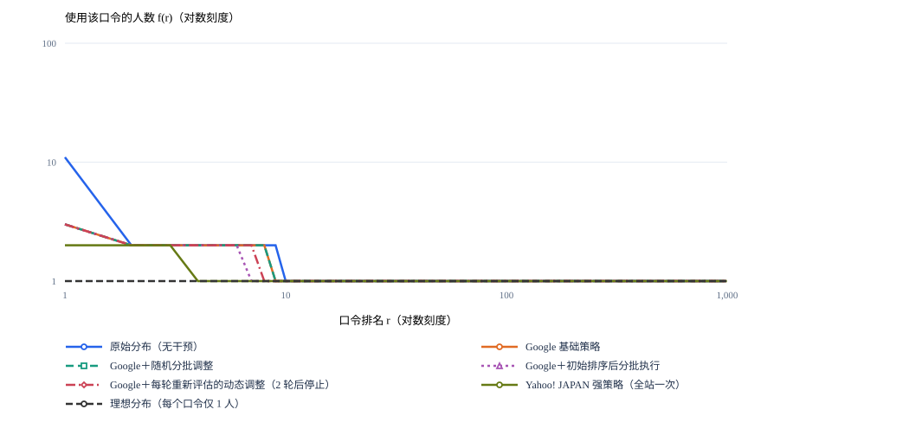
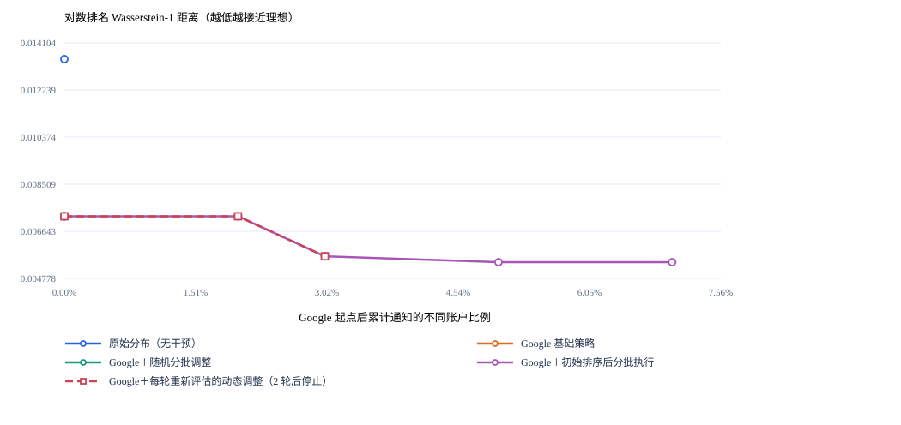
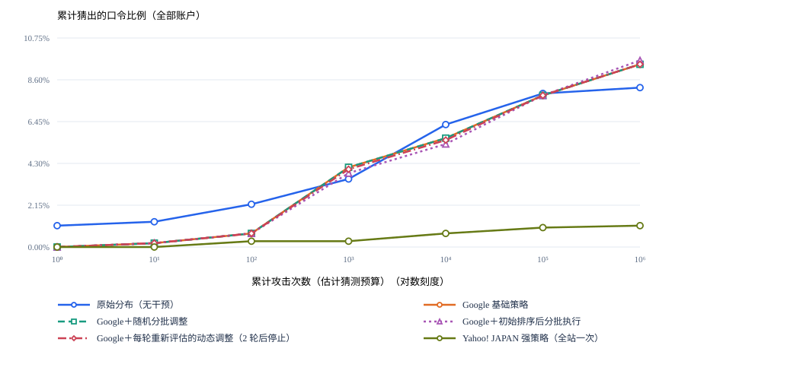
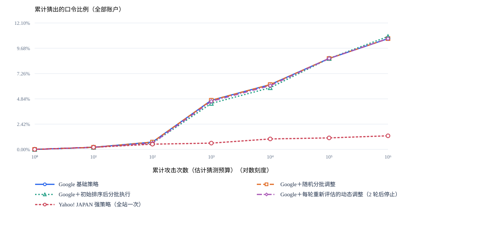
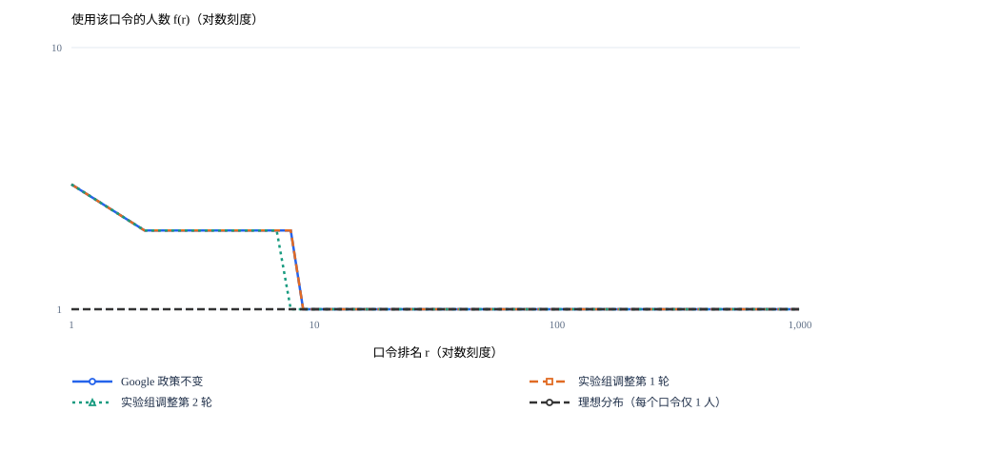
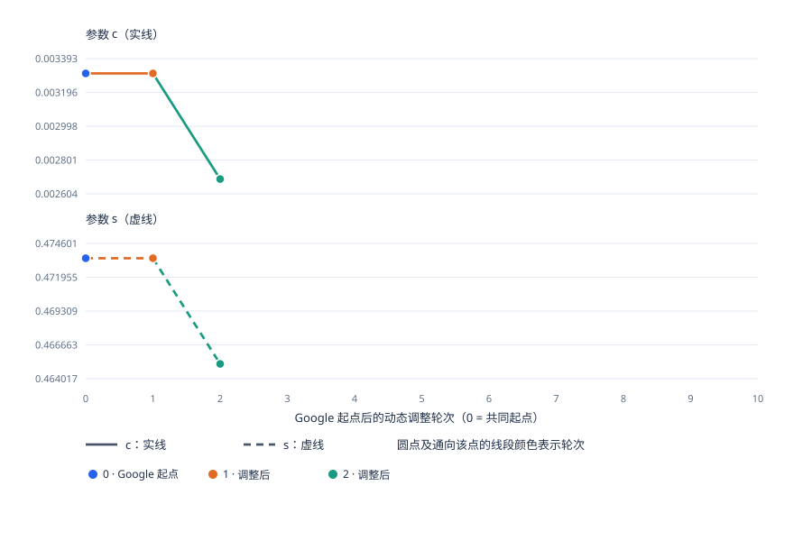

# ZipfGuard：预算约束下的局部动态口令分布优化系统

## 摘要

存量账户口令整改既需要改善群体选择的集中现象，也需要控制通知与修改成本。针对这一问题，本作品构建 ZipfGuard 局部动态口令分布优化系统，以完整口令频次为统计对象，将干预表示为账户集合、修改规则与通知规模的组合，利用用户响应模拟比较候选，并在每轮执行后更新分布与剩余预算。

修改方法从 Top20 网站政策资料中整理，共 20 条。其中最低 6 字符和最低 8 字符已被实验的 Google 基础长度起点满足，后续默认使用其余 18 条。系统结合 CDF 采样拟合描述频次形态，以固定账户规模下每个账户使用不同完整口令为理想参照，采用归一化对数排名轴上的一维 Wasserstein-1 距离评价分散程度。整批提交另要求固定猜测模型 F 的总体曲线积分下降及未覆盖比例不增加，并利用独立参考群体迁移后训练的 A1 检查终态可猜测性。

在当前协议的 1,000 账户流程验证中，动态组使用 3% 后续通知预算，经验距离较 Google 起点缩小 9.35%，拟合距离缩小 21.88%；A1 在百万次估计猜测预算下的命中率保持 10.60%。初始规划组在相同通知点具有相同状态，19 项相关自动检查通过。结果说明系统能够执行预算、验收与反馈流程，但当前证据尚未建立动态方法的稳定优势。作品同时整理历史 10 万账户探索，明确其与当前协议的差异，为进一步配对主实验提供依据。

**关键词：** 口令分布；局部动态干预；Wasserstein-1 距离；通知预算；口令猜测评估

## 目录

- 第一章 作品概述
- 第二章 作品设计与实现
- 第三章 作品测试与分析
- 第四章 创新性说明
- 第五章 总结与后续工作
- 参考文献
- 附录 A 完整修改方法池与来源说明
- 附录 B 参数、记账与复现说明
- 附录 C 实验记录与证据索引

## 第一章 作品概述

### 1.1 背景分析

#### 1.1.1 口令频次集中与群体猜测风险

口令认证依赖用户选择并记忆秘密字符串，其实际安全性既受单个口令的内容影响，也受群体选择规律影响。用户可能偏好熟悉的单词、数字序列或便于记忆的组合，使少数完整口令被多个账户重复使用。将不同口令按出现频次从高到低排序后，可以观察到高频口令与低频口令共同构成的排名分布。已有研究利用 Zipf 分布分析此类频次特征，并据此探索口令政策的动态生成方法[1]。

重复使用会放大某些猜测对账户群体的覆盖效果。当一个完整口令被多个账户使用时，猜测者一旦尝试该口令，就可能命中多个账户。因此，仅检查单个口令是否满足长度或字符种类要求，不能完整描述群体层面的集中风险。即使多个口令都符合既定政策，用户仍可能集中选择其中少数形式。

本作品据此将完整口令频次分布作为政策分析对象。这里的统计单位是完全相同的完整字符串：两个口令即使具有相同的字符结构，只要字符串不同，就分别计数。字符结构用于组织候选账户群体，不能替代完整口令频次统计。

频次分散程度与口令可猜测性分别描述群体状态的不同方面。若所有账户使用的口令都不同，但它们来自容易枚举的序列，猜测者仍可能取得较高命中率。因此，分布优化可以描述重复与集中程度的变化，安全效果则需要由明确的猜测模型和猜测预算进一步检验。

#### 1.1.2 固定口令政策与存量账户修改成本

网站口令政策通常通过最低长度、字符组成和禁止模式等要求限定可接受的口令集合。这类规则便于执行，但规则本身并不直接说明执行后的人群分布。用户可能通过增加相同后缀、替换少量字符或重新选择常见口令满足要求，从而在消除旧有集中模式的同时形成新的集中模式。口令政策优化研究因此需要同时考虑政策限制与用户选择之间的关系[2]。

对于存量账户，调整政策还涉及执行成本。管理员需要决定通知哪些账户，用户需要理解要求并完成修改，部分用户可能不响应，或在有限尝试内无法完成修改。即使规则具有潜在收益，也不宜忽略实施范围与修改负担。

这使政策决策从“选用哪套规则”扩展为三个相互关联的问题：选择哪些账户、要求如何修改，以及本轮通知多少账户。同一条规则对不同账户集合可能产生不同结果；对同一账户集合，扩大通知范围也未必带来相同比例的收益。局部决策需要结合当前分布、用户响应与剩余预算进行比较。

本作品将后续累计不同通知账户数作为主要预算口径，同时记录成功修改、未响应和未完成等情况。Google 起始迁移与后续局部干预分别记账，使基础规则带来的变化与动态决策带来的变化能够分别分析。

#### 1.1.3 相关研究与本作品定位

已有研究为本作品提供了分布建模、政策优化和猜测评估的基础。Xiao 和 Zeng 从 Zipf 分布出发研究动态口令政策生成，说明群体频次特征可以参与政策设计[1]。这一研究方向启发本作品从当前分布出发构造调整建议，而非仅依据预设复杂度对规则排序。

Blocki 等将口令组成政策与用户选择纳入优化分析[2]；Segreti 等研究通过适应性政策促进口令多样性[3]。这些工作提示，政策效果取决于用户如何响应，动态调整也需要检查新形成的选择模式。本作品继承这一问题意识，将有限响应、不响应和修改失败纳入存量账户的迁移模拟。

在攻击评估方面，Weir 等提出的概率上下文无关文法（PCFG）方法利用口令的结构规律开展猜测[4]，为评估政策诱导的模式提供了方法基础。Ur 等关于口令可猜测性模型准确性与偏差的研究表明，安全判断需要关注评估模型的适用范围[5]。本作品因此设置固定猜测模型 F 与在独立参考群体迁移后重训的模型 A1，分别考察固定攻击知识与适应修改后分布时的猜测结果。

在分布比较方面，一维 Wasserstein-1 距离可由两个累计分布函数之差的绝对值积分计算[6]。本作品采用这一已有数学工具，并明确选择固定账户规模、完整口令排名及归一化对数坐标作为评价设定。距离公式的数学依据来自文献，理想参照与坐标的选择属于本作品的实验设计，二者不应混同。

基于上述研究，本作品将重点放在固定规模存量账户的局部干预：在有限通知预算内联合选择对象、规则和规模，通过逐轮分布反馈更新决策，并分别核验频次分散与可猜测性变化。作品的贡献定位于这一决策机制及其可追溯实验实现，不将已有 Zipf 分析、PCFG 或 Wasserstein 距离本身作为原创算法。

#### 1.1.4 本作品研究问题

本作品关注的核心问题是：在已有基础口令要求的固定账户群体中，能否利用当前分布信息，在有限通知预算内选出具有分布改善潜力的局部修改动作，并使其通过独立于分布指标的总体猜测检验？

围绕这一问题，后续实验需要回答以下三个问题。

1. **局部选择是否有效？** 在相同通知成本下，结合账户分布与修改规则选择动作，是否比随机分批调整更接近理想分布？
2. **逐轮反馈是否有价值？** 与只在共同起点制定计划相比，每轮重新分析分布能否改善后续决策，其效果受哪些响应与预算条件影响？
3. **分布改善是否伴随猜测风险下降？** 距离缩小后，固定模型 F 与适应性评估模型 A1 的累计猜测成功率如何变化，是否存在分布改善与攻击结果不一致的情形？

这些问题需要通过共同数据、共同起点及一致评估条件下的对照实验回答。动态调整不预设为最优方案，执行轮数也不作为成功标准；当预算耗尽或现有搜索范围内未发现满足要求的动作时，系统应停止并记录原因。

### 1.2 作品概览

#### 1.2.1 总体思路与处理流程

ZipfGuard 面向具有基础口令要求的存量账户群体，形成“分布分析—局部动作生成—响应模拟—整批验收—反馈更新”的处理流程。系统输入包括口令频次语料、模拟账户样本、规则配置、用户响应参数与通知预算；输出包括候选及执行动作、逐轮频次分布、猜测评估、成本账本和停止记录。

系统首先统计当前完整口令频次，并结合 CDF 采样拟合描述排名分布。在此基础上，系统组织热门完整口令群体、结构群体等候选对象，将其与适用规则及不同通知规模组合。随后，通过有限用户响应模拟估计迁移后的完整频次分布，对满足预算和接受条件的候选动作进行比较。

整批提案通过验收后，成功修改账户进入新状态，未响应或未完成修改的账户保留原状态；未通过验收的提案不提交，已发生的通知成本仍需记录。每轮结束后，系统重新统计分布、更新候选信息并计算剩余预算。新形成的热门口令同样进入下一轮分析，以反映政策执行后的实际模拟状态。

系统对观测频次与拟合结果分别记录：实际完整频次用于核验分布变化，拟合分布用于描述形态和辅助候选比较。拟合误差下降只意味着描述更贴近数据，不直接表示口令更安全。

#### 1.2.2 修改方法的来源与数量

本作品从 Top20 网站的口令政策中提取并整理了 20 条修改方法，形成完整方法池。这里的“20 个网站”表示政策来源范围，“20 条方法”表示整理后的规则数量，两者不构成网站与方法的一一对应关系，也不表示同时执行 20 套完整网站政策。

为比较后续局部调整效果，实验采用统一的 Google 基础起点，具体实现为项目固定的最低 8 字符规则子集，公开政策的更完整范围参见文献[9]。处于该起点的账户已经满足“长度至少 6 字符”和“长度至少 8 字符”两条要求，因此这两条方法不产生额外的起点整改对象。默认局部候选池保留其余 18 条方法；完整 20 条方法池则由这 18 条加上上述两条最低长度要求构成。

**表 1-1 修改方法数量与使用范围**

| 层次 | 数量 | 含义 |
| --- | --- | --- |
| 政策来源网站 | 20 个 | 提供提取与整理修改方法的政策资料 |
| 完整修改方法池 | 20 条 | 包含最低 6 字符、最低 8 字符及其余 18 条方法 |
| Google 起点已满足的方法 | 2 条 | 最低 6 字符、最低 8 字符 |
| 后续默认局部候选池 | 18 条 | 用于 Google 起点后的局部动作生成与比较 |

后续修改仍需满足共同基础要求。默认使用 18 条候选方法，不表示这 18 条规则同时施加于每个账户，也不保证每条规则在每轮都适用。具体动作取决于当前分布、候选对象、响应模拟和预算条件。本文所称 Google 基础策略均限于上述最低长度规则，不代表完整复现 Google 的全部官方安全政策。

#### 1.2.3 理想分布与效果评价

本作品的主实验设定以 10 万个模拟账户为固定群体，理想参照为每个账户使用一个不同的完整口令。此时不同口令数为 10 万，每个口令的出现人数均为 1；在排名—频次图中，该参照表示为覆盖排名 1 至 10 万、纵坐标为 1 的水平虚线。它描述样本内无重复的频次状态，不指定具体口令内容。

设固定账户总数为 $N$，第 $t$ 轮不同完整口令的频次降序排列为 $f_t(r)$，实际不同口令数为 $K_t$。在统一排名范围 $1,\ldots,N$ 上，对 $r>K_t$ 的频次补零。将排名映射到归一化对数坐标：

$$
x_r=\frac{\ln r}{\ln N},\qquad r=1,\ldots,N.
$$

在坐标 $x_r$ 处，当前分布赋予概率质量 $f_t(r)/N$，理想分布赋予概率质量 $1/N$。记这两个排名概率分布分别为 $P_t$ 与 $P_{\mathrm{ideal}}$，相应累计分布函数为 $C_t(x)$ 与 $C_{\mathrm{ideal}}(x)$，则分布距离为：

$$
D_t=W_1(P_t,P_{\mathrm{ideal}})
=\int_0^1\left|C_t(x)-C_{\mathrm{ideal}}(x)\right|\,\mathrm{d}x.
$$

该公式应用了一维 Wasserstein-1 距离的累计分布表达式[6]，衡量两个排名概率分布之间的差异。距离越小，表示当前频次状态越接近理想参照；对实际经验分布而言，距离为零表示样本中每个完整口令只出现一次。此处计算的是两条累计分布曲线之间的绝对差积分，而非单条分布曲线与横轴围成的面积，也不是频次图中两条折线的像素间距。理想频次虚线对应的累计分布在对数坐标上并非直线。

分布距离与安全评价承担不同职责。F 在干预过程中保持固定，用于比较整批提案前后的总体猜测结果；现有接受机制要求其累计猜测成功率曲线的对数预算面积下降，且模型未覆盖比例不增加。A1 基于独立参考群体的迁移结果训练，用于检查攻击者适应后是否仍存在改善。F 的曲线面积属于猜测评估，其横轴是猜测预算，与上述分布距离中的口令排名不同。距离、F 和 A1 应分别报告，不能由距离下降直接推导攻击成功率下降。

### 1.3 作品贡献

#### 1.3.1 面向通知预算的局部动作建模

本作品将存量账户的政策执行细化为账户集合、修改规则和通知规模三个维度，使决策能够同时表达“改谁、如何要求修改、通知多少人”。通过区分基础迁移与后续通知成本，并保留未响应和修改失败账户，系统能够在固定账户总数下分析有限资源的分配效果。其有效性需由相同通知成本下的对照结果验证。

#### 1.3.2 基于分布反馈的多轮决策

本作品将完整口令频次统计、CDF 采样拟合、候选响应模拟与逐轮反馈连接起来，在每轮执行后更新账户群体与候选动作。该机制允许系统根据旧热点消退、新热点出现及剩余预算变化重新决策。它提供对状态变化作出响应的能力，但不预先保证动态方法优于初始固定计划；两者的效果差异由配对实验检验。

#### 1.3.3 分布目标与猜测评估分离的可追溯分析

本作品以统一理想参照下的 Wasserstein-1 距离描述频次分散程度，以 F、A1 描述指定攻击模型下的可猜测性，并单列通知与修改成本。逐轮账本记录选择动作、执行结果、接受或拒绝情况及停止原因，使分布变化能够对应到具体操作。该设计有助于识别“分布更分散但猜测风险未改善”等情况，并约束报告结论的范围。

### 1.4 应用场景与研究范围

本作品适用于网站或组织已有基础口令要求、希望在有限通知资源下分批开展口令整改的研究场景。管理员可以配置预算和规则范围，比较不同决策方案的模拟结果，查看下一批建议处理的对象及其理由，并审阅成本、分布变化和停止记录。

当前系统定位为离线模拟与决策评估原型。语料频次用于构造固定规模模拟账户群体，通知和口令修改过程由行为模型生成。语料中的出现次数不等于已经核实的独立真实账户身份，模拟响应也不等于真实用户试验。后续实验需报告行为假设，并检查结论对响应概率、修改方式及预算设置的敏感性。

系统采用完整口令频次开展研究，不意味着真实网站能够直接读取用户明文口令。实际部署还需解决受保护的分布统计、真实响应数据获取以及整批提案验收等问题。尤其是逐用户即时修改流程，不能直接继承离线模拟中“整批通过后统一提交”的性质。

作品的结论限于给定语料、规则池、用户响应模型、搜索范围和攻击评估条件。群体指标改善可能伴随部分个体口令变弱，拟合与猜测估计也存在误差。因此，本作品不承诺每个账户均获得安全提升，不将有限候选中的最佳动作称为全局最优，也不把距离为零解释为抵抗所有猜测攻击的保证。

## 第二章 作品设计与实现

本章围绕数据准备、分布建模、局部动作决策与总体猜测验收展开，说明各模块的输入输出及方法依据。固定账户规模、通知预算、候选组织、响应参数和整批提交机制属于本作品的实验与工程设定，其效果由后续实验检验。

### 2.1 系统方案

#### 2.1.1 总体架构与模块职责

ZipfGuard 将政策决策与执行评估组织为五个模块：数据与共同起点、分布分析、局部动作决策、整批验收、反馈与报告。系统以账户状态为连接各模块的基础，每个模拟账户保留标识、当前口令、分阶段通知次数及修改记录；完整口令频次由账户状态汇总得到。这样既能分析群体分布，又能核对同一账户是否被重复通知，以及一次修改是否实际进入下一轮状态。

**表 2-1 系统模块及其输入输出**

| 模块 | 主要输入 | 核心处理 | 主要输出 |
| --- | --- | --- | --- |
| 数据与共同起点 | 带频次语料、抽样种子、基础规则 | 抽取目标与开发样本，训练 F，构造 Google 共同起点 | 固定账户群体、独立参考群体、起点核验记录 |
| 分布分析 | 当前账户状态 | 统计完整口令频次，执行 CDF 采样拟合，计算与理想参照的距离 | 经验分布、拟合参数、拟合误差与距离 |
| 局部动作决策 | 分布状态、默认 18 条规则、剩余预算 | 生成对象—规则—规模组合，模拟响应，筛选并复核候选 | 拟执行动作、预计收益与候选排除原因 |
| 整批验收 | 独立执行响应、固定 F、预算刻度 | 检查总体猜测曲线变化及未覆盖比例 | 接受或拒绝决定、实际提交的修改 |
| 反馈与报告 | 提交结果与通知记录 | 更新状态和预算，保存逐轮账本，开展终态 A1 评估 | 新一轮输入、比较图表、成本与停止记录 |

候选模拟在当前状态的副本或临时频次表上进行，不直接改变正式账户状态，也不计入通知成本。只有选定动作进入模拟执行阶段后，才产生本轮通知记录。系统随后对该批响应统一验收，并将提交后的状态作为下一轮输入。这一区分使搜索计算量与用户通知成本能够分别核算。

#### 2.1.2 数据角色与模型训练边界

系统按语料中的出现位置抽样，构造目标账户群体与开发样本。主实验配置中，两者分别包含 100,000 条出现记录；开发样本进一步按 60%、20%、20% 划分训练、调参与验证角色。当前局部干预主流程主要使用其中的训练部分，不将预留角色等同于已经完成调参或独立验证。

目标群体用于形成待优化分布，并作为干预与最终评估对象。攻击侧采用 PCFG 方法，其利用口令结构及组成片段概率开展猜测的基础来自 Weir 等的研究[4]，工程实现采用固定版本开源项目[8]。开发训练部分用于训练固定 PCFG 模型 F，同时构造用户响应所需的重选词池、片段词表及部分规则的参考词表。模型训练后，F 及其猜测估计索引在整个干预过程中保持不变，以便各轮使用同一评估尺度。本文的 F、A1 数据角色与冻结、重训流程是本作品的评估设计，不是对原始 PCFG 论文完整实验协议的复现。

开发训练部分还构成独立参考群体。目标群体选定某项局部动作后，参考群体依据该动作的分组条件、规则和执行比例独立模拟迁移；它不复制目标账户的修改结果。各组结束后，系统在对应参考群体的终态上训练 A1，再评估该组目标群体的终态。在当前主流程中，A1 不参与逐轮候选选择，也不作为每批修改必须通过的接受条件。

参考群体的迁移规模依其自身可行动账户数和预算计算。结构或热门口令分组通常按目标动作的组内选择比例映射，随机动作按目标总体通知比例映射；因此，参考群体与目标群体不必具有相同的实际通知比例。两者分别保存迁移账本，并分别执行总体 F 验收，不强求其接受结果一致。

这里的数据分离是抽样出现位置的分离。同一个口令字符串可以自然出现在目标与开发样本中，不能据此宣称两边不存在相同口令，也不能将同源抽样称为跨数据源验证。A1 的独立性具体指训练数据不采用目标终态，且终态评估不反馈给本次动作选择；F 与 A1 仍属于同一攻击模型族。已有研究讨论了口令可猜测性模型的准确性与偏差[5]，因此，这一设计只能检验给定模型族及训练条件下的结果，尚不能替代跨模型验证。

#### 2.1.3 Google 共同起点与对照关系

原始组保留抽样得到的初始口令。其余四组从同一次 Google 基础迁移后的账户状态复制生成，分别为 Google 基础策略保持组、随机分批调整组、初始排序后分批执行组和逐轮动态调整组。复制范围包括账户与口令的对应关系；系统通过状态摘要核对各组起点一致，避免仅凭相近的统计曲线认定起点相同。

共同起点要求全部账户满足最低 8 字符。构造时，系统先对短口令执行响应模拟，并将该阶段的不响应概率设为零；有限尝试后仍未满足要求的记录，再由显式长度补全步骤形成合规口令。补全数量单独记录。这是为了定义一致的实验起点而采用的构造过程，不能解释为现实中的用户响应率或修改成功率为 100%。

共同起点之后，局部干预恢复有限响应假设，并持续保留最低 8 字符要求。Google 起始迁移成本与后续通知预算分别统计；一个账户可以先参与基础迁移，再接受一次后续局部通知。对照比较中，四个 Google 组共享起点，三个局部干预组进一步共享默认 18 条候选方法、行为设定和预算上限。实际通知量可能因动作规模或提前停止而不同，效果比较应同时报告实际成本。

### 2.2 核心方法与实现

#### 2.2.1 完整口令频次建模与 CDF 采样拟合

Xiao 和 Zeng 的研究为利用 Zipf 分布分析口令频次并生成政策提供了相关工作基础[1]。本节在这一研究背景下介绍本项目采用的 CDF 采样拟合；以下潜在类别采样、重排序和参数搜索改写自项目提供的拟合代码，其来源与文献[1]的研究背景分别说明。

**完整频次表示：** 设第 $t$ 轮账户 $i$ 的口令为 $w_{i,t}$，账户总数为 $N$。先按完整字符串统计人数，再将非零频次降序排列，得到 $f_t(1),\ldots,f_t(K_t)$，满足：

$$
\sum_{r=1}^{K_t}f_t(r)=N.
$$

相应的经验排名累计分布为：

$$
C_t(r)=\frac{1}{N}\sum_{j=1}^{\min(r,K_t)}f_t(j),\qquad r=1,\ldots,N.
$$

其中，超过实际支持范围的累计值保持为 1。每次迁移后均重新排序，避免将旧排名误当作新状态中同一口令的位置。频次相同的条目交换位置不会改变该累计分布。

**参数初始化与采样：** 本作品采用根据项目提供的拟合代码改写的 CDF 采样模型描述频次形状。首先在对数坐标上对经验累计分布进行回归，以截距和斜率给出参数 $c,s$ 的初始值。该步骤用于初始化搜索，不将双对数线性拟合结果直接作为最终分布模型。

给定 $0<c\leq1$、$0<s\leq1$，生成 $N$ 个均匀随机数 $U_i\in(0,1)$，并计算潜在类别编号：

$$
z_i=\left\lfloor\left(\frac{U_i}{c}\right)^{1/s}\right\rfloor,\qquad i=1,\ldots,N.
$$

随后统计各潜在类别的占用次数，将非零次数重新降序排列，得到一次模型频次样本。潜在类别允许从 0 开始，它们不是口令的最终排名，也不对应具体口令字符串。重新排序后的累计分布才与观测频次进行比较。

**拟合误差与搜索：** 记模型生成的排名累计分布为 $\widetilde C_{c,s}(r)$，拟合目标为：

$$
E(c,s)=\max_{1\leq r\leq N}\left|C_t(r)-\widetilde C_{c,s}(r)\right|.
$$

计算时，两条累计分布均在各自支持范围结束后补为 1。程序在初始化参数附近设置搜索范围，结合粗网格与嵌套黄金分割搜索，并保留所有已访问参数中的最小误差结果。比较参数时复用同一组均匀随机数，以减少随机采样差异对误差排序的干扰。由于潜在类别取整和重排序会使目标函数呈现离散变化，该过程是有限范围内的启发式搜索，不具有全局最优保证。

拟合输出包括 $c,s$、最大累计误差、随机种子与搜索记录。计算候选分布得分时，系统利用拟合参数进行多次独立于拟合采样的再采样，并取与理想参照距离的平均值，记为 $\widehat D_t$。实际频次距离 $D_t$ 与拟合距离 $\widehat D_t$ 分别报告：前者反映已形成的经验频次状态，后者反映采样模型描述下的状态。

拟合误差 $E$ 与分布距离 $D$ 具有不同用途。前者比较观测分布与模型分布，用于检查描述准确度；后者比较当前分布与理想参照，用于评价分散程度。参数 $c,s$ 仅描述该采样模型的形状，不能将 $s$ 直接解释为传统频次 Zipf 模型的指数，更不能据此给出具体口令的猜测概率。

#### 2.2.2 候选账户分组与修改方法组织

**候选对象：** 对象选择既考虑重复口令，也保留结构群体和跨结构对象。当前实现主要生成以下四类候选。

**表 2-2 候选账户集合的构造方式**

| 候选类型 | 构造依据 | 作用与边界 |
| --- | --- | --- |
| 热门完整口令组 | 当前频次排名前 20 且至少出现 2 次的完整口令，每个口令形成一组 | 定位重复人数较多的具体口令；不等同于完整危险口令名单 |
| 非热门结构组 | 排除上述热门口令后，按字母、数字、符号及连续段长度形成结构分组 | 将相似结构账户组织为备选对象；组内不同完整口令仍分别计数 |
| 跨结构高频账户 | 对满足某规则整改条件的账户，按其当前口令频次优先排序 | 允许单个动作跨越结构边界；优先依据频次，而非直接采用攻击命中率排序 |
| 随机账户候选 | 在未接受后续通知且符合相应整改条件的账户中按固定随机顺序选择 | 为候选池提供不同覆盖范围，并支持随机选择对照 |

热门组和非热门结构组在基础分组时互斥。对于数量较多的结构组，系统依据重复集中程度优先保留，并预留部分结构候选名额，避免候选完全由头部口令占据。跨结构候选与其他备选动作仍可能重叠，但同一批实际执行动作必须去重。

用于提取政策的 Top20 网站与用于形成热门账户组的前 20 个完整口令，是两个不同概念。前者规定修改方法的资料来源，后者随当前账户分布变化，规定一种候选对象集合。

**规则组织：** 完整方法池共 20 条，其中最低 6 字符和最低 8 字符已被 Google 共同起点满足，后续默认候选池使用其余 18 条。为便于方法说明，表 2-3 沿用默认池的实现编号；两条起点已满足的规则不在该编号范围内。

**表 2-3 默认 18 条候选方法及其判定范围**

| 编号 | 修改要求 | 当前判定范围 |
| --- | --- | --- |
| 1—3 | 长度至少 10、12、15 字符 | 三条可单独选择的最低长度规则 |
| 4—6 | 至少一个英文字母、一个小写英文字母、一个大写英文字母 | 分别按对应英文字母范围判断 |
| 7—8 | 至少一个数字；至少一个数字或符号 | 两条独立规则，字符范围按实现定义 |
| 9 | 大写、小写、数字、符号中至少两类 | 检查字符类别覆盖 |
| 10 | 至少四个不同字符 | 检查完整字符串的不同字符数 |
| 11—12 | 禁止连续三个相同字符；禁止整串为同一字符 | 两条规则存在覆盖交叉，仍作为独立候选 |
| 13 | 禁止简单键盘序列 | 当前匹配 qwerty、asdf、zxcv、qazwsx、1qaz、2wsx 等固定条目，不是完整键盘路径检测 |
| 14 | 禁止四位连续顺序字母或数字 | 检查连续升序或降序片段 |
| 15 | 禁止仅为开发词表中的字典词 | 以独立开发训练样本的纯英文字母词作为有限字典代理 |
| 16 | 禁止包含固定可预测词 | 由配置词表确定，当前示例为 gitlab、devops |
| 17 | 禁止当前热门完整口令 | 与本轮热门名单完整匹配；动态组逐轮更新 |
| 18 | 禁止命中独立开发样本中的泄露口令 | 与开发训练样本中的完整口令匹配，覆盖范围有限 |

这些方法用于定义可比较的动作空间，不预设每条规则均能提高安全性。涉及字典或泄露口令的条目只覆盖其参考词表；缺少所需数据时不能假定该条目具有完整检测能力。每个局部规则均与共同基础规则同时判定，因此选择字符组成或禁止模式规则不会撤销最低 8 字符要求。

**动作表示：** 单一动作记为 $a=(G,R,I)$，其中 $G$ 是账户筛选条件，$R$ 是基础要求与所选片段规则的组合，$I$ 是本轮实际通知的账户标识集合，通知规模为 $|I|$。候选账户须尚未接受后续通知，并且当前口令不满足该动作要求；再从中按预设规模档位选取部分或全部账户。

同一对象集合可以与多条规则组合，同一规则也可以用于不同对象集合。系统比较的是组合后的迁移效果，不建立“某个热门排名必然对应某条修改方法”的固定关系。单轮还可组合多个子动作，但其账户集合必须互不重叠，且应对组合后的整体分布重新评估。

#### 2.2.3 用户响应、频次迁移与预算内动作选择

口令组成政策优化需要考虑用户选择如何随规则变化，Blocki 等的研究为这一建模问题提供了理论背景[2]；Segreti 等的适应性政策研究则讨论了口令多样性与用户使用负担[3]。基于这些研究，本作品显式模拟政策执行后的选择变化。下述三类行为、有限尝试机制及其概率均为本项目的具体设定，并非直接取自上述论文的实测参数。

**有限用户响应：** 对每个被通知账户，系统先依据不响应概率判断是否进入修改过程。响应者从简单修补、片段重组和重新选择三类行为中抽取一种，并在设定的最大尝试次数内产生候选口令。简单修补模拟追加后缀等操作，片段重组使用参考词表组织新字符串，重新选择按开发词池频次抽样。候选只有同时不同于原口令并满足本轮规则，才成为待提交修改。

当前默认设定为不响应概率 15%，响应者三类行为权重分别为 60%、25%、15%，每名响应者最多尝试 5 次。这些数值属于模拟假设，尚不代表对真实用户行为的测量。响应生成过程不查询攻击模型来挑选更难猜的口令，因此允许产生形式合规但更易猜测的提案，交由后续总体验收处理。

**表 2-4 响应结果及其状态处理**

| 结果 | 判定情形 | 口令状态 | 通知记账 |
| --- | --- | --- | --- |
| 未响应 | 未进入修改过程 | 保留原口令 | 计入本轮和累计预算 |
| 有限尝试未完成 | 尝试上限内未产生合规的新口令 | 保留原口令 | 计入本轮和累计预算 |
| 形成修改提案 | 产生不同于原口令且合规的新口令 | 暂存，等待整批验收 | 计入本轮和累计预算 |
| 整批验收拒绝 | 批次不满足总体 F 条件 | 所有待提交修改回退为原口令 | 已发生的通知仍计入预算 |
| 修改提交成功 | 整批通过验收 | 使用新口令进入下一轮 | 另计成功修改及编辑量 |

整批拒绝与用户尝试失败是不同原因。即使实现中将二者都汇入未完成修改记录，报告仍通过验收标记单列拒绝批次，避免误将系统拒绝归因为用户行为。

**频次迁移与人数守恒：** 设 $n_t(w)$ 表示修改前使用完整口令 $w$ 的账户数，$M_t$ 为本轮最终提交成功的修改集合，则：

$$
n_{t+1}(w)=n_t(w)
-\sum_{i\in M_t}\mathbf{1}\{w_{i,t}=w\}
+\sum_{i\in M_t}\mathbf{1}\{w_{i,t+1}=w\}.
$$

该更新同时计入旧口令的迁出与新口令的迁入。不同账户若修改为同一新口令，其频次会累加，不能将每次修改自动视为生成一个独有口令。未响应、尝试失败及整批拒绝的账户保持原状态，因此始终满足 $\sum_w n_{t+1}(w)=N$。

**通知预算：** 记前 $t$ 轮已接受后续通知的账户集合为 $U_t$，单轮上限比例为 $\rho$，累计上限比例为 $\beta$。下一轮动作须满足：

$$
I_{t+1}\cap U_t=\varnothing,\qquad
|I_{t+1}|\leq
\min\left\{\lfloor\rho N\rfloor,\ \lfloor\beta N\rfloor-|U_t|\right\}.
$$

默认 $\rho=2\%$、$\beta=20\%$，对于 10 万账户，分别对应每轮最多通知 2,000 人、累计最多通知 20,000 个不同账户。由于后续阶段每个账户最多接受一次通知，通知失败或提案被拒绝后，该账户也不重新进入后续候选。成功修改人数因此可能明显少于通知人数。

**候选比较：** 系统先用经验频次距离变化进行多次响应模拟粗评，再生成部分不重叠的组合动作。随后对收益靠前的候选重新拟合，并增加响应模拟次数。若常规复核范围内尚未找到可行候选，则继续检查后续候选。参与比较的方案共享按账户生成的预测随机流，以降低无关随机差异；实际执行使用另一随机流，保留预测与执行之间的偏差。

对于经过拟合复核的候选 $a$，其预计分布收益记为：

$$
\widehat{\Delta D}(a)=\frac{1}{L}\sum_{\ell=1}^{L}
\left[\widehat D_t-\widehat D_{t+1}^{(a,\ell)}\right],
$$

其中 $L$ 为响应预测重复次数，每个 $\widehat D$ 内部还包含模型频次再采样。普通单步选择要求预计分布收益超过数值阈值，并满足预计总体 F 条件，再从实际复核的可行候选中选择总收益最大的动作。单位通知收益作为辅助记录，不能将主决策写成“单位成本收益最大化”。候选数量限制、短名单和组合启发式共同限定了搜索范围。

#### 2.2.4 理想分布距离与总体猜测接受条件

**经验距离的精确计算：** 一维 Wasserstein-1 距离等于两个累计分布函数绝对差的积分，其一般公式见 Panaretos 和 Zemel 的综述第 1.2 节[6]。本作品选择固定 $N$ 单例参照与归一化对数排名轴，将该公式用于完整口令频次分布比较；这一参照与坐标设定并非文献[6]专为口令安全提出。为在候选模拟中高效计算，令 $f_t(r)=0$ 对所有 $r>K_t$ 成立，并记 $x_r=\ln r/\ln N$。由于累计分布在相邻排名坐标间保持不变，将一般公式分段积分可得：

$$
D_t=\sum_{r=1}^{N-1}
\left|C_t(r)-\frac{r}{N}\right|
\frac{\ln(r+1)-\ln r}{\ln N}.
$$

当 $r\leq K_t$ 时，每个已出现口令至少对应一名账户，因此前 $r$ 项频次之和不小于 $r$；当 $r>K_t$ 时，当前累计值为 1。由此，在本作品的整数频次和固定单例参照设定下，始终有 $C_t(r)\geq r/N$。针对该设定进一步整理可得：

$$
D_t=
\sum_{r=1}^{K_t}\frac{f_t(r)}{N}\frac{\ln(N/r)}{\ln N}
-\frac{1}{N}\sum_{r=1}^{N}\frac{\ln(N/r)}{\ln N}.
$$

第二项仅由账户总数 $N$ 决定，是固定理想参照的累计积分。实现可据此避免显式构造长度为 $N$ 的补零数组，同时得到与两条累计分布差异积分相同的距离。对于人数固定的两个状态，距离变化等于第一项的变化。因此，采用该距离建立了明确的理想基准和零点，但不会仅因减去固定参照量而改变同一批候选的排序；这一数值等价关系不构成新的安全增益证据。上述公式适用于 $N>1$，主实验满足该条件。

报告将该量统一称为“与理想分布的 Wasserstein-1 距离”。拟合距离则对采样生成的完整频次按同一公式计算并平均。二者使用相同的 $N$ 和坐标尺度，不能在各组实际不同口令数之间随意改变积分范围。本作品报告距离本身、变化量及相同通知成本下的组间差异，不设未经验证的安全合格距离阈值。

**固定 F 的猜测评估：** 蒙特卡洛采样估计概率模型下猜测次数的方法依据见文献[7]。本作品记录自身排序约定与采样支持范围。设 $g_F(w)$ 为固定模型 F 对完整口令 $w$ 给出的估计猜测次数；模型无法给出可用结果的口令单列为未覆盖。预算 $b$ 下的总体估计命中比例为：

$$
S_t^F(b)=\frac{1}{N}\sum_w n_t(w)
\mathbf{1}\{g_F(w)\text{ 可用且 }g_F(w)\leq b\}.
$$

其分母始终为全部账户数，而非仅模型覆盖的账户数。未覆盖比例记为 $q_t^F$，另行报告，不能将未覆盖口令解释为已经证实无法猜中。

在固定递增预算点 $b_0,\ldots,b_m$ 上，系统按对数预算坐标对累计成功率折线进行归一化梯形积分：

$$
A_t^F=\frac{1}{\log_{10}b_m-\log_{10}b_0}
\sum_{j=0}^{m-1}
\frac{S_t^F(b_j)+S_t^F(b_{j+1})}{2}
\left(\log_{10}b_{j+1}-\log_{10}b_j\right).
$$

当前默认预算点为 $1,10,\ldots,10^6$。该量汇总给定预算网格上的估计猜测结果，其数值依赖模型与猜测次数估计，需与实际枚举得到的命中率及分布距离分别解释。对模型适用范围保持区分，与口令可猜测性评估中的模型偏差问题有关[5]；采用这一对数预算积分及其下降条件，则是本作品的协议设定，并非该文献给出的通用安全判据。

**整批接受规则：** 对执行阶段生成的整批提案，记其拟提交状态为 $t+1$，接受条件为：

$$
A_t^F-A_{t+1}^F>\varepsilon,\qquad
q_{t+1}^F-q_t^F\leq\varepsilon,
$$

其中当前数值容差 $\varepsilon=10^{-12}$。预测阶段使用多次模拟的平均变化筛选候选，执行阶段则对本次整批响应重新验收。两项均满足才提交，否则全部待修改口令保留原值，通知记录仍更新。

整批约束允许不同账户的变化相互抵消，因此不保证每名账户均变强，也不保证成功率曲线在每个预算点均下降。报告应保留个体变强、变弱、相同和无法比较的统计，以及可能出现的曲线交叉。执行验收只检查上述总体 F 条件，并不额外保证本次实现的分布距离下降；预测随机性与有限前瞻均可能使实际单轮距离上升。

**终态 A1 评估：** A1 在各组独立参考群体的终态上训练，检验新分布中的模式是否更易被重新学习。其结果与 F 分开列示，不与分布距离加权合成一个总分。F 下降首先验证接受机制按设计执行；只有结合 A1、模型覆盖和行为敏感性结果，才能讨论改善是否超出固定评估器本身。

#### 2.2.5 多轮反馈、组合动作与有限前瞻

根据口令分布生成或调整政策已有相关研究：Xiao 和 Zeng 从 Zipf 分布出发生成政策[1]，Segreti 等研究通过适应性政策促进口令多样性[3]。本作品在此基础上，将反馈用于存量账户的对象、规则和通知规模选择。以下去重组合、冻结计划对照及有限两步预演，是本项目控制器的具体实现，不据此主张首次提出动态口令政策。

**逐轮反馈：** 一轮迁移可能改变热门口令排序、结构群体规模、规则适用人数及拟合参数。动态组依据已提交的新状态重新生成候选，使用剩余未通知账户继续决策。初始排序组则始终基于共同起点制定计划，只在规划过程中预留互不重复的账户，不模拟提交结果来更新规划分布；其规则名单、优先次序和预计收益均由起点状态决定。

两组执行阶段仍采用相同的有限响应模型和总体 F 验收。因而，初始计划也可能在后续执行时遭遇拒绝；发生拒绝不会触发该组重新规划。动态组下一轮可以依据新状态和预算继续搜索。两者的比较用于检验反馈机制的作用，不能由机制名称预先判定优劣。

**组合动作：** 单一规则只覆盖局部账户时，系统可将多个子动作组合成一批。组合时删除重复账户，按剩余容量截取子动作，并重新模拟完整批次。不同子动作可能产生相同新口令，其总体分布收益通常不等于子动作收益的简单相加。F 验收同样针对整批执行，允许子群体之间的风险变化抵消，并记录最终提交结果。

**有限两步前瞻：** 普通单步搜索未找到可行正收益动作时，系统在少量候选上开展两步预演。第一步允许预计经验距离存在配置范围内的小幅增加，但须满足预计总体 F 条件。系统在预演副本上模拟第一步、通过实际批次验收并更新通知记录，再在新状态上搜索第二步。每一步均保持基础规则和预算限制，第二步不再递归启动更深前瞻。

两步预演要求配置次数的模拟均通过各自 F 验收，且相对于初始状态的两步累计拟合距离收益均超过阈值。满足后，系统按预计两步收益选择第一步进入正式执行；第二步只是预览，下一轮仍根据真正实现的状态重新决策。因此，两步预演提供了短期探索能力，不承诺执行中一定出现相同的第二步动作，也不保证最终实现预期累计收益。

**算法 1 局部动态干预的单轮处理流程**

1. 汇总当前完整口令频次，读取已通知账户和剩余预算。
2. 构造热门、结构及跨结构候选对象，组合适用规则与通知规模，排除重复通知和超预算动作。
3. 多次模拟响应，以经验距离变化粗评候选，并产生部分去重组合动作。
4. 对入围候选重新拟合、复核预计收益和总体 F 条件，选择拟合距离预计总降幅最大的可行方案。
5. 若普通选择失败，则开展有限两步前瞻；仍未找到可行方案时停止，并保存候选排除记录。
6. 使用独立于预测的执行随机流产生本轮响应，对整批提案进行 F 验收。
7. 提交通过验收的修改或保留原口令，计入全部本轮通知，更新分布和独立参考群体，保存账本。
8. 检查剩余预算与轮数上限；满足继续条件时进入下一轮，结束后开展终态 A1 评估。

当前 Google 起点主比较最多执行 10 轮，单轮可以少于通知上限，也可能提前停止。该上限是实验流程设定，不是算法必须执行的轮数。对一次停止，只能根据保存的搜索记录说明“当前搜索范围内未找到可接受动作”，不能据此断言不存在任何有效政策。

### 2.3 模型框图及设计参数

系统的数据与决策路径见表 2-1。目标群体的账户状态产生当前分布，分布与剩余预算共同决定候选；预测产生临时提案，F 验收决定提交状态；提交结果回到分布分析，并驱动独立参考群体迁移。A1 位于各组终态评估阶段，其输出不回流到本次搜索。下列参数表区分主研究设定与本次流程验证的实际配置。

#### 2.3.1 数据与通知预算

**表 2-5 数据、基础规则与执行预算**

| 参数 | 主研究设定 | 本次流程验证 | 含义 |
| --- | --- | --- | --- |
| 目标账户数 $N$ | 100,000 | 1,000 | 一次实验内保持固定 |
| 开发出现记录数 | 100,000 | 3,000 | 与目标出现位置不重叠 |
| 开发训练/调参/验证划分 | 60%/20%/20% | 1,800/600/600 | 当前主流程主要使用训练部分 |
| 基础长度要求 | 至少 8 字符 | 至少 8 字符 | 所有后续候选持续满足 |
| 单轮通知上限 | 2%，即 2,000 人 | 2%，即 20 人 | 上限允许未用满 |
| 后续累计通知上限 | 20%，即 20,000 人 | 20%，即 200 人 | 按不同账户统计 |
| 通知规模档位 | 0.1%、0.2%、0.5%、1%、2% | 1、2、5、10、20 人 | 同时截断至可行动人数与剩余容量 |
| 最小动作规模 | 0.1% | 1 人 | 用于减少过小候选 |
| Google 起点比较轮数上限 | 10 | 10 | 覆盖通用配置中的 40 轮字段 |
| 每账户后续通知次数 | 最多 1 次 | 最多 1 次 | 拒绝批次与未响应同样消耗资格 |

预算在运行前确定，初始 Google 迁移不占用后续 20% 上限。通知比例用于衡量管理与用户扰动的代理成本，尚不能直接换算为记忆负担、满意度或流失率。成功修改量与通知量分别统计，使预算使用与实际迁移效果能够同时解释。

#### 2.3.2 响应与拟合参数

**表 2-6 行为模拟及拟合设定**

| 参数 | 当前值 | 用途与来源 |
| --- | --- | --- |
| 后续不响应概率 | 15% | 项目模拟假设 |
| 响应者修补/重组/重选权重 | 60%/25%/15% | 条件于已经响应，非修改成功率 |
| 每账户最大尝试次数 | 5 | 有限响应，失败保留原口令 |
| 修补行为中的简单追加倾向 | 55% | 内部行为假设，可能形成新后缀热点 |
| Google 构造阶段不响应概率 | 0% | 定义合规共同起点，失败再显式补全 |
| 初始化回归排名点 | 最多 1,024 个 | 对数间隔取点，仅给出搜索初值 |
| 参数范围 | $0<cleq1$、$0<sleq1$ | 限制采样模型有效域 |
| 初值邻域 | 初值的约 1/3 至 3 倍，再截断 | 有限搜索范围 |
| 粗网格 | $5	imes5$ | 避免仅依赖局部搜索 |
| 默认搜索迭代 | 12 | 嵌套黄金分割的工程预设 |
| 距离再采样次数 | 3 | 使用独立于拟合的采样流，平均距离 |
| 拟合诊断再采样次数 | 5 | 用于累计误差复核，与距离再采样不同 |

用户响应概率没有从所引用论文中直接取得。文献[2–3]用于支持政策与用户选择共同建模的必要性，实际参数属于可配置假设。参数作用应通过行为敏感性分析检验，而不以一次目标结果优劣反向确定。

#### 2.3.3 搜索及攻击评估参数

**表 2-7 搜索资源与猜测评估设定**

| 参数 | 当前设定 | 说明 |
| --- | --- | --- |
| 热门名单长度 | 20 | 同时要求频次至少 2 |
| 重点分组上限 | 12 | 保留部分结构组机会 |
| 部分结构候选短名单 | 80 | 跨结构与随机候选额外保留，不是全部动作总数 |
| 粗评响应重复 | 3 | 比较经验距离预计变化 |
| 常规拟合复核短名单/响应重复 | 5/5 | 没有可行方案时可继续复核后续候选 |
| 组合搜索宽度 | 6 | 有限、不重叠的子动作组合 |
| 两步前瞻宽度/预演次数 | 2/2 | 仅在普通搜索失败后启用 |
| 第一阶段经验距离损失筛选阈值 | 0.0003 | 前瞻筛选参数，不是实际收益保证 |
| 分布正收益及 F 验收容差 | $10^{-12}$ | 数值比较阈值，不代表统计显著性 |
| 猜测预算点 | $1,10,ldots,10^6$ | 所有组共用七个点 |
| PCFG 蒙特卡洛样本 | 主设 100,000；本次 10,000 | 估计概率排序下的猜测次数[7] |
| PCFG 训练超时 | 主设 3,600 秒；本次 180 秒 | 工程资源上限 |
| 本次种子 | 42 | 单次实例，不构成多种子统计证据 |
| A1 | 各组终态独立参考训练 | 当前主流程不逐轮用 A1 选动作 |

PCFG 使用项目固定版本的开源实现[8]。本作品汇总同一字符串的多条语法推导概率，并以完整字符串的边际概率及固定同概率排序约定估计猜测次数。其排序对象与实现细节需随模型版本记录，不能简单等同于原始文法解析队列的枚举顺序。

部分配置字段来自历史研究流程。当前五组主比较中的目标改善比例、连续停滞次数、HHI 增长上限和 A1 回归上限等，不应仅因出现在配置文件中就写成生效约束。正文列出的实际接受条件以 2.2.4 节和执行账本为准。

### 2.4 软件流程与停止机制

#### 2.4.1 总体软件流程

系统先检查配置、语料格式与样本容量，再通过扫描统计有效频次并抽取不重叠出现位置。缓存命中时仍核对语料内容摘要，避免在输入发生变化后继续使用旧统计。随后训练 F、构造 Google 共同起点并核验四组账户状态一致，再分别运行三种局部方法。各组结束后训练对应 A1，完成终态拟合、逐轮参数诊断和报告导出。

该流程保留配置、数据摘要、源码摘要和运行标识，使不同协议的结果能够被识别。用户加载历史结果时，应根据结果自身的协议解释动作与曲线，不能把新界面的指标名称当作历史控制器已经采用该指标的证据。

#### 2.4.2 单轮执行与异常处理

单轮执行包括预算检查、候选生成、预测复核、独立响应执行、整批 F 验收、账户状态更新和账本保存。提交前检查账户标识去重、口令与当前状态一致及基础规则合规；拒绝批次保留通知成本并记录拒绝原因。候选预测失败与正式提案拒绝分别记录：前者没有产生通知，后者已经消耗本轮预算。

配置项超出范围、数据数量不足或 PCFG 训练失败时，任务输出错误状态及原因，不将未完成状态写为成功结果。训练超时是工程失败原因，与没有可行政策属于不同类型的停止。

#### 2.4.3 停止条件

**表 2-8 主要停止情形及其含义**

| 情形 | 触发条件 | 报告处理 |
| --- | --- | --- |
| 预算用尽 | 后续累计容量不足 | 保留末次实际执行及未使用容量说明 |
| 达到轮数上限 | 已执行 10 轮 | 按实际终态比较，不追加虚构轮次 |
| 没有可行候选 | 普通、组合和允许的前瞻均未找到可接受方案 | 保存候选排除审计 |
| 初始计划结束 | 冻结计划已执行完 | 保留现有状态，不重新规划 |
| 没有可行动对象 | 未通知账户中无相应整改对象 | 报告对象耗尽 |
| 配置、数据或训练异常 | 输入或模型构建无法完成 | 记录失败阶段，不混入效果统计 |

当前 Google 动态组并不因一次实际距离未下降就直接停止。下一轮仍可重新搜索；若没有可行候选，才形成停止审计。停止审计不构成额外执行轮次。有限搜索范围内未找到动作，只描述本次控制器和资源限制下的结果。

### 2.5 软件与系统功能

系统提供本地网页展示台与命令行入口。参数配置覆盖账户规模、开发样本、通知比例、不响应概率、随机种子和蒙特卡洛样本数；后台任务显示语料扫描、候选比较、模型训练及导出进度。展示层将五组分布、F/A1 曲线、逐轮动作和成本记录关联起来，并提供向量图和结构化结果导出。

逐轮审计展示分组、规则、通知人数、实际修改、预测与实现收益、F 验收结果及停止原因。历史结果保留协议标识；网页截图和图表用于说明功能及数据表达，效果结论以结构化实验记录为依据。当前验证覆盖离线计算、结果生成和图形导出，本报告不将其扩展为真实网站的线上部署测试。

### 2.6 评价指标及解释

**表 2-9 评价指标及其角色**

| 指标 | 方向与用途 | 解释范围 |
| --- | --- | --- |
| 经验距离 $D$ | 越小越接近理想单例参照 | 实际完整口令频次的分散程度 |
| 拟合距离 $widehat D$ | 候选主排序，越小越好 | 采样模型描述下的分布状态 |
| 参数 $c,s$ | 描述逐轮形态 | 不直接表示口令强度 |
| 最大累计拟合误差 $E$ | 越小表示模型更贴近观测 | 拟合质量，不是安全分数 |
| F 曲线积分 $A^F$ | 越小越好，整批验收条件 | 固定模型、既定预算网格下的总体估计 |
| $S^F(b)$、$S^{A1}(b)$ | 指定预算下越低越好 | 所用模型的估计命中率 |
| 未覆盖及低采样支持比例 | 与曲线同时报告 | 区分模型支持范围与估计信息不足 |
| 后续不同通知比例 $Q=\lvert U\rvert/N$ | 主要扰动成本 | 失败与拒绝通知均计入 |
| 后续成功修改数 | 描述实际迁移量 | 与 Google 初始修改分开 |
| 归一化编辑距离 | 描述字符串修改量 | 尚不代表真实记忆成本 |
| 个体强度分类 | 变强、变弱、相同、无法比较 | 以固定 F 的估计次数比较 |
| 不同口令数、HHI、头部占比 | 辅助检查热点变化 | 不替代主距离或攻击评估 |
| 运行时间与候选数 | 计算代价 | 与机器和缓存状态关联 |

后续距离相对改善采用共同 Google 起点作为参照：

$$
R_D=rac{D_{mathrm{Google}}-D_{mathrm{final}}}{D_{mathrm{Google}}},
qquad D_{mathrm{Google}}>0.
$$

拟合相对改善同理计算并单独报告。攻击命中率的百分点变化与相对百分比变化分别表达；不同预算下的曲线可能交叉，因此一个终点与整个对数预算积分回答不同问题。

## 第三章 作品测试与分析

### 3.1 测试方案与证据范围

本章检验三个层面：模型能否描述完整频次，控制器能否执行预算与验收约束，以及不同决策方式在已完成实验中产生何种分布与猜测结果。本次补充运行采用当前 v7 协议、1,000 个目标账户和单一种子，作为端到端流程验证；同时对同一原始频次补做三种拟合方法的比较。已有 10 万账户 v5 结果仅用于历史探索分析，其理想距离为事后重算。

**表 3-1 测试项目、已有材料与结论范围**

| 项目 | 本报告采用的材料 | 可支持的判断 |
| --- | --- | --- |
| 拟合比较 | 同一 1,000 账户频次、独立再采样及 70/30 形状留出 | 当前样本的拟合误差与计算代价 |
| 当前协议流程 | v7 单种子五组执行、逐轮账本、F/A1 终态 | 预算、提案验收和反馈流程是否按定义运行 |
| 约束核验 | 距离、拟合、整批验收共 19 项自动检查 | 被检查的计算与状态处理行为 |
| 历史大样本 | 10 万账户 v5 记录及事后距离计算 | 历史设定下的探索现象 |
| 新协议主效果与稳健性 | 尚无同协议 10 万账户配对重复 | 当前不足以支持稳定优势或统计显著性 |

两种规模实验均在自身固定 $N$ 的支持范围上使用 $N$ 个单例作为参照。1,000 账户的距离不与 10 万单例直接比较，跨规模数值也不作为控制器优劣的直接证据。

### 3.2 测试环境与威胁模型

当前验证在 Windows 11 环境运行，Python 版本为 3.13.9，解释器报告 16 个逻辑处理器。PCFG 上游固定提交为 `b04bbdadfe8928fd1287fa73ad1aa46a297ff83a`，拟合实现标识为 `cdf-zipf-sampling-gss-v1`。本次验证未完整记录 CPU 型号与物理内存，因此耗时作为当前机器的运行记录，不用于硬件标准化比较。

威胁模型为具有有限猜测预算的离线攻击者。F 使用独立开发训练记录建立并冻结；A1 知道公开的局部动作，并依据独立参考群体的模拟终态训练。A1 不采用目标终态作为训练集。PCFG 与蒙特卡洛估计提供概率排序下的可猜测性度量[4,7]，不覆盖所有攻击算法、定向个人信息攻击或现实攻击者的全部知识。模型族与训练来源的限制需结合覆盖率解释[5]。

### 3.3 测试数据与公平性设置

#### 3.3.1 数据来源与角色

本项目采用本地 `rockyou-withcount.txt` 带频次语料。当前扫描清单记录原始行数 14,344,391、无效行数 10、有效出现次数 32,603,039，编码为 Latin-1。频次用于模拟账户出现概率；语料出现次数没有被核实为独立真实账户。文件内容摘要见附录 C，用于识别本报告采用的具体数据版本。

本次验证抽取 1,000 个目标出现位置及 3,000 个开发位置。开发记录分为 1,800 个训练、600 个调参和 600 个验证位置。主干预流程使用训练部分建立 F、响应词池与独立参考群体。拟合比较中的 70/30 留出是对目标原始频次单独开展的形状诊断，与上述开发角色划分属于不同操作。

#### 3.3.2 五组及附加策略对照

**表 3-2 实验组别与控制条件**

| 组别 | 决策与执行 | 主要比较目的 |
| --- | --- | --- |
| G0 原始组 | 保留原始状态 | 给出原始分布和固定 F 参照 |
| G1 Google 保持 | 构造最低 8 字符共同起点，此后保持 | 分析基础迁移 |
| G2 随机分批 | 随机抽取可行动账户，再筛选规则分配 | 检查局部定向选择的价值 |
| G3 初始规划 | 在共同起点冻结计划，后续验收执行 | 比较分布反馈的作用 |
| G4 动态反馈 | 每轮根据新状态重新选动作 | 分析完整决策闭环 |

G1—G4 的账户级起点摘要一致，三个局部组共享规则池、响应设定、F 验收和通知上限。随机组仍进行收益筛选，因此其停止不等于随机账户没有任何可修改规则。不同组的实际通知规模和停止时点可能不同，终态比较须同时列出成本。

系统另运行 Yahoo! JAPAN 命名的全站策略对照，按项目规则记录实现 15—32 字符、有限允许字符及禁止组合。该对照从原始状态一次迁移，采用强制合规和显式补全，不受局部 20% 预算或 F 验收门槛约束。它用于说明大范围规则变更与局部通知的成本差异，不纳入五组同预算优劣判断。对应帮助页见文献[10]，页面依赖 JavaScript，政策快照的来源限制在附录 A 中说明。

#### 3.3.3 共同成本比较原则

横轴采用 Google 起点后的累计不同通知比例。曲线只画到各组实际到达的成本，提前停止后不外推到 20%。实际共同成本点优先用于对比；没有共同点时，终态差异仅作带成本的描述，不据此归因于动态选人或反馈。

本次 G3 与 G4 在后续通知 3% 时具有相同状态，G3 之后继续执行至 7%，G4 则停止于 3%。G2 没有执行局部批次，因而本次数据不足以形成三个局部组在 20% 预算处的完整比较。未用满预算与停止原因均作为结果呈现。

### 3.4 测试结果与分析

#### 3.4.1 拟合精度与计算代价

拟合比较使用原始组的 1,000 账户频次，共 982 个不同完整口令。比较离散 Zipf、有限支持 CDF-Zipf 与 CDF 采样拟合；误差统一为完整支持上的最大累计差。采样方法另用五个独立采样种子复核。留出检查将出现次数按随机二项划分得到 715 个训练账户和 285 个验证账户，验证频次独立重排序，各模型生成验证规模样本后再比较形状。

**表 3-3 原始频次的拟合比较**

| 方法 | 全样本拟合误差 | 独立采样平均误差 | 留出形状平均误差 | 参数拟合耗时/s |
| --- | --- | --- | --- | --- |
| 离散 Zipf | 0.022840 | 解析模型，无该项再采样 | 0.116491 | 0.000793 |
| CDF-Zipf（有限支持） | 0.025783 | 解析模型，无该项再采样 | 0.116491 | 0.001118 |
| CDF 采样拟合 | 0.004000 | 0.006200 | 0.009825 | 0.066029 |

在该样本中，采样模型的全样本拟合误差为 0.004000，独立采样平均误差为 0.006200；其留出形状误差低于两种有限支持解析模型。与此同时，参数拟合耗时明显高于解析模型。由于模型支持假设、参数空间和采样后重排序过程均不同，误差差异不能全部归因于参数搜索算法，也不能由此推出猜测风险降低。一次留出划分与五个模拟种子仍不足以构成跨数据源验证。

#### 3.4.2 当前协议的分布与成本

共同 Google 起点通知并修改 519 个短口令账户，其中 4 个通过显式长度补全完成合规；其余 481 个账户原本已满足基础长度要求。该阶段后的经验距离由 0.016124466 降至 0.007459600，不同口令数由 982 增至 991。基础迁移采用全体合规构造，因此这些人数反映本次模拟操作。

**表 3-4 当前 v7 五组的终态分布**

| 组别 | 不同口令数 | 经验距离 $D$ | 拟合距离 $\widehat D$ |
| --- | --- | --- | --- |
| G0 原始组 | 982 | 0.016124466 | 0.013461232 |
| G1 Google 保持 | 991 | 0.007459600 | 0.007237371 |
| G2 随机分批 | 991 | 0.007459600 | 0.007237371 |
| G3 初始规划 | 993 | 0.006044509 | 0.005421450 |
| G4 动态反馈 | 992 | 0.006761793 | 0.005654052 |

**表 3-5 后续执行成本与停止情况**

| 组别 | 执行轮数 | 后续通知人数 | 后续通知比例 | 后续提交修改数 | 停止原因 |
| --- | --- | --- | --- | --- | --- |
| G0 原始组 | 0 | 0 | 0.00% | 0 | 保留原始状态 |
| G1 Google 保持 | 0 | 0 | 0.00% | 0 | Google 政策保持不变 |
| G2 随机分批 | 0 | 0 | 0.00% | 0 | 当前候选没有可靠的正收益动作 |
| G3 初始规划 | 4 | 70 | 7.00% | 21 | 初始计划已执行完 |
| G4 动态反馈 | 2 | 30 | 3.00% | 7 | 当前候选没有可靠的正收益动作 |

G4 在后续通知 30 人后形成 7 次提交修改，经验距离降至 0.006761793，相对共同起点缩小 9.35%；拟合距离由 0.007237371 降至 0.005654052，相对缩小 21.88%。二者改善幅度不同，表明拟合状态与实际频次之间仍存在描述差异，应同时解释。

G3 使用更多通知预算后达到更低的终态经验距离，但其与 G4 在 3% 通知处的状态相同。本次数据因此没有证明动态反馈优于初始规划。G2 因未找到满足条件的动作而停止于起点，不能将其零修改结果扩展为随机干预在其他样本中无效。

**图 3-1 当前协议完整排名频次。** 目标账户数为 1,000，理想虚线为 1,000 个不同口令各 1 人。图中附加 Yahoo 对照采用独立全站迁移条件。

**图 3-2 拟合距离与后续通知成本。** 每条曲线仅到实际执行终点；G0、G1 及未执行的 G2 位于零后续成本。该图不包含把未用预算补齐的虚构状态。

#### 3.4.3 固定与适应性猜测结果

**表 3-6 当前协议的猜测评估及模型覆盖**

| 组别 | $A^F$ | $S^F(10^6)$ | $S^{A1}(10^6)$ | F 未覆盖 | A1 未覆盖 |
| --- | --- | --- | --- | --- | --- |
| G0 原始组 | 0.043083333 | 8.20% | 未训练 | 91.60% | 不适用 |
| G1 Google 保持 | 0.038500000 | 9.40% | 10.60% | 89.20% | 81.70% |
| G2 随机分批 | 0.038500000 | 9.40% | 10.60% | 89.20% | 81.70% |
| G3 初始规划 | 0.037666667 | 9.60% | 10.80% | 89.10% | 82.00% |
| G4 动态反馈 | 0.038166667 | 9.40% | 10.60% | 89.20% | 81.50% |

G4 的 F 总体积分由 0.038500000 降至 0.038166667，但在百万预算处的估计命中率仍为 9.40%；A1 终点仍为 10.60%。因此，本次结果支持指定预算网格上的固定 F 汇总改善，不支持 A1 终点风险下降。

G3 的 F 总体积分更低，但其 F 百万预算终点由 9.40% 升至 9.60%，A1 终点为 10.80%。这说明曲线积分下降与每个预算点下降并不等价。原始组的 F 终点为 8.20%，Google 起点为 9.40%，基础迁移也未在该终点产生下降。

本次小开发训练集导致 F 与 A1 未覆盖比例较高。G4 的 F 未覆盖比例为 89.20%，A1 为 81.50%。曲线以全部账户为分母，模型未覆盖质量不计入已命中；这些口令的实际攻击难度仍未确定。高未覆盖比例显著限制了安全结论，需要扩大训练支持并增加独立模型验证[5]。

**图 3-3 固定 F 的估计累计成功率。** 七个猜测预算点，全部账户分母；含附加全站对照。

**图 3-4 各组终态 A1 的估计累计成功率。** 每个模型训练于对应独立参考终态。原始组未单独训练 A1，因此不将其 F 曲线冒充 A1 放入本图。

#### 3.4.4 动态轨迹与总体约束核验

G4 第一轮选择“至少一个英文字母”的跨结构账户，通知 20 人；本次响应提案使 F 总体积分增加，因此整批拒绝。第二轮选择“至少一个数字或符号”，通知 10 人并提交 7 次修改；F 总体积分下降且未覆盖比例不增加。下一轮搜索未找到可行候选，停止于两轮实际执行。

**表 3-7 两个局部组的批次验收记录**

| 组别 | 轮次 | 通知 | 提交修改 | 验收前 $A^F$ | 提交后 $A^F$ | 决定 | 原因 |
| --- | --- | --- | --- | --- | --- | --- | --- |
| G4 动态反馈 | 1 | 20 | 0 | 0.038500000 | 0.038500000 | 拒绝 | 固定 F 猜测成功曲线的对数面积未下降 |
| G4 动态反馈 | 2 | 10 | 7 | 0.038500000 | 0.038166667 | 接受 | 两项条件均通过 |
| G3 初始规划 | 1 | 20 | 0 | 0.038500000 | 0.038500000 | 拒绝 | 固定 F 猜测成功曲线的对数面积未下降 |
| G3 初始规划 | 2 | 10 | 7 | 0.038500000 | 0.038166667 | 接受 | 两项条件均通过 |
| G3 初始规划 | 3 | 20 | 14 | 0.038166667 | 0.037666667 | 接受 | 两项条件均通过 |
| G3 初始规划 | 4 | 20 | 0 | 0.037666667 | 0.037666667 | 拒绝 | 固定 F 模型未覆盖账户比例增加，无法确认总体改善 |

G3 第一轮与 G4 相同，第二轮也产生相同提交状态；第三轮提交 14 次修改，第四轮虽然提案 F 积分下降，却因未覆盖比例增加而拒绝。预算与验收的两项条件均在实际执行中产生了可辨认的作用。

**表 3-8 动态组的频次与拟合轨迹**

| 轮次 | $c$ | $s$ | 不同口令数 | 经验距离 | 拟合距离 | 后续通知比例 |
| --- | --- | --- | --- | --- | --- | --- |
| 0 | 0.003306497 | 0.473443481 | 991 | 0.007459600 | 0.007237371 | 0.00% |
| 1 | 0.003306497 | 0.473443481 | 991 | 0.007459600 | 0.007237371 | 2.00% |
| 2 | 0.002690437 | 0.465174611 | 992 | 0.006761793 | 0.005654052 | 3.00% |

**图 3-5 共同起点及 G4 实际执行后的频次。** 第一轮拒绝后的曲线与起点重合，停止审计不作为第三次修改。

**图 3-6 CDF 采样参数的逐轮变化。** 参数用于形态诊断，实际效果由距离和攻击评估共同解释。

个体分类根据修改前后固定 F 的可用估计猜测次数计算，见表 3-9。

**表 3-9 实际修改账户的固定 F 诊断**

| 组别 | 轮次 | 实际修改 | 变强 | 变弱 | 相同 | 无法比较 |
| --- | --- | --- | --- | --- | --- | --- |
| G4 动态反馈 | 1 | 0 | 0 | 0 | 0 | 0 |
| G4 动态反馈 | 2 | 7 | 0 | 0 | 0 | 7 |
| G3 初始规划 | 1 | 0 | 0 | 0 | 0 | 0 |
| G3 初始规划 | 2 | 7 | 0 | 0 | 0 | 7 |
| G3 初始规划 | 3 | 14 | 1 | 1 | 0 | 12 |
| G3 初始规划 | 4 | 0 | 0 | 0 | 0 | 0 |

G4 第二轮 7 名修改账户均无法进行完整的前后估计比较。G3 第三轮则同时出现变强与变弱账户。总体未覆盖比例不增加允许未知与可用状态之间的迁移相互抵消，因此它既不保证每名账户都可比较，也不提供逐账户安全保证。

#### 3.4.5 历史 10 万账户探索

历史记录 `975472d3703d4c61` 的决策协议为 v5，其父记录为 `ef77ab5e267c09c5`。该阶段采用拟合累计面积目标与旧的个体响应保障；后续扩展保持原动作和攻击结果，仅补算固定理想参照距离及附加全站对照。表 3-10 因而属于历史状态的重分析，不能替代 v7 主实验。

**表 3-10 历史协议终态的事后距离分析**

| 历史组别 | 轮数 | 后续通知比例 | 补算经验距离 | 补算拟合距离 | F 百万预算命中 | A1 百万预算命中 |
| --- | --- | --- | --- | --- | --- | --- |
| G1 Google 保持 | 0 | 0.00% | 0.041133196 | 0.041318762 | 16.20% | 18.72% |
| G2 随机分批 | 10 | 19.98% | 0.036973485 | 0.036913882 | 15.18% | 17.94% |
| G3 初始规划 | 10 | 14.80% | 0.025711713 | 0.025655649 | 13.34% | 17.34% |
| G4 动态反馈 | 8 | 12.30% | 0.025562474 | 0.025176134 | 13.85% | 17.57% |

在该历史实例中，动态组用 12.30% 的后续通知比例获得约 0.025562474 的经验距离，初始规划组用 14.80% 获得约 0.025711713。两组终态接近，实际成本不同。该现象说明较细粒度的局部动作具有进一步研究价值，但单一种子、不同终态成本和旧接受机制限制了结论。本报告不将这些数值与当前小规模验证合并计算均值或显著性。

#### 3.4.6 软件检查与计算开销

本次针对 CDF 采样与频次还原的 6 项、理想距离与附加对照的 6 项、整批 F 验收的 7 项自动检查均通过，共 19 项。检查覆盖可复现采样、完整支持误差、平台频次还原、独立积分等价、理想零点、历史动作保持、全站对照与局部预算的区别、整批拒绝记账及允许个体变弱时的总体接受等行为。

端到端验证生成结构化结果、校验摘要、HTML 报告及向量图，内部记录总耗时为 44.30 秒。该时间包含缓存复用下的语料核验、抽样、模型训练、候选搜索、拟合与附加对照，不代表冷启动或 10 万账户性能。单独拟合比较的耗时见表 3-3。当前记录没有可靠的逐阶段资源峰值，报告据此只给出总运行记录。

### 3.5 结果讨论与有效性边界

现有证据支持系统能够在固定群体中执行预算核算、规则约束、整批验收、状态反馈与终态评估。G4 的经验距离下降与提交记录一致，拒绝批次保留成本，提前停止也得到保留。算法正确运行与算法效果领先是不同层面的判断：本次共同成本下 G3、G4 状态相同，A1 终点未改善，尚不足以支持动态方法稳定优于其他方案。

分布理想只要求当前样本不重复，未指定口令内容。归一化对数坐标改变了对头部集中和尾部质量的权重；跨规模比较、其他坐标和其他距离可能产生不同解释。因此，应先冻结距离与支持定义，再开展主实验，不把多个指标中事后最有利的一项当作唯一证据。

当前行为模型、同源语料和 PCFG 支持范围共同影响结果。不响应概率、常见修补倾向与重选池可能诱导新热点，单一模型族也可能偏好某些结构。有限候选及两步前瞻的停止只说明本次搜索未发现可行动作。真实部署还需要受保护的分布统计、真实响应数据和可执行的批次提交流程。

后续确认性实验应在 v7 及冻结参数下完成 10 万账户五组比较，并预先指定配对种子、行为情景和共同成本节点。建议使用种子 42—46，以 0%、15%、30% 不响应和少量预先定义的修改偏好开展敏感性分析。每个场景报告全部配对差值、未达到的成本点、拒绝与停止记录，再据此界定有效条件；本报告未将该计划写成已完成的稳健性结论。

## 第四章 创新性说明

### 4.1 通知预算下的局部动作建模

已有研究将口令分布和用户选择纳入政策生成与优化[1–2]。本作品将决策对象进一步限定为存量账户，在明确通知预算下联合组织对象、规则和规模，而非仅在整套网站政策之间切换。完整方法池来源于已有网站政策，贡献在于它与局部执行、未响应状态及预算账本的结合。该建模机制已实现，成本效益优势仍需通过相同成本的主实验确认。

### 4.2 完整频次反馈驱动的多轮决策

动态与适应性政策已有研究基础[1,3]。本作品的具体设计是每轮依据完整字符串频次更新对象与规则适用性，再用有限响应模拟比较局部动作，并在普通选择失败时使用有界前瞻。此处的特色是将反馈落实到预算内账户迁移的闭环过程。当前验证显示控制器能够更新并停止，但与初始规划的共同成本状态相同，反馈的额外效果尚未得到稳定实验证明。

### 4.3 理想距离与猜测接受条件的分离

Wasserstein-1 是已有概率分布距离[6]，PCFG 与蒙特卡洛可猜测性评估也来自已有方法[4,7]。本作品明确选择固定单例参照和对数排名几何，使频次效果具有一致基准；同时采用固定 F 的整批接受条件及终态 A1，避免由距离变化直接给出安全结论。

这一组合提供可分别审查的分布、风险与成本证据。它不改变 Wasserstein 公式本身，也不赋予模型外口令绝对安全性。固定 $N$ 下与旧累计目标的常数差关系已在 2.2.4 节说明，不能据此宣称仅切换为距离就提高了优化能力。

### 4.4 可追溯的政策实验实现

本作品将共同起点核验、候选预测、提交结果、成本、拒绝原因与停止记录保存为同一实验的结构化材料。历史协议与新协议可分别识别，经验指标与拟合指标也分别报告。这一实现有助于复核政策效果和失败原因。软件功能与实验设计属于系统贡献，效果数值及部署能力仍以已完成测试为界。

**表 4-1 贡献、实现与现有证据**

| 贡献 | 实现位置 | 当前证据 | 尚需确认 |
| --- | --- | --- | --- |
| 局部对象—规则—规模决策 | 候选与控制器 | 20/18 方法池、预算及实际动作账本 | 同成本稳定收益 |
| 逐轮分布反馈 | 状态统计、候选重建与有限前瞻 | 当前轨迹与停止审计 | 反馈相对初始规划的增量价值 |
| 分布与猜测分别核验 | W1、F 验收、终态 A1 | 距离变化、拒绝批次与风险曲线 | 更大模型支持及独立攻击族 |
| 复现与审计 | 配置、摘要、导出 | 实验标识、自动检查及匿名结果 | 新协议大样本配对重复 |

## 第五章 总结与后续工作

### 5.1 工作总结

本作品针对存量账户口令整改中的有限通知资源，构建了局部动态分布优化与评估系统。系统以完整口令频次为对象，将 20 条来源方法整理为 Google 起点后的默认 18 条候选，结合有限用户响应模拟选择对象、规则和通知规模。频次效果以与固定单例参照的 Wasserstein-1 距离度量，实际提交受固定 F 总体条件约束，并在终态利用独立参考群体训练 A1。

本次 v7 小规模验证完成五组运行、预算核算与结果导出，19 项相关自动检查通过。动态组使用 3% 后续通知，经验距离较 Google 起点缩小 9.35%，但 A1 百万预算终点未下降；初始规划在相同通知点具有相同状态。现有结果说明系统能够执行设计流程，尚不能据此主张动态方案全面领先。历史 10 万账户分析为进一步实验提供线索，其协议差异单独保留。

### 5.2 当前局限

第一，用户行为由预设模型生成，通知比例和编辑量只是扰动代理，真实记忆与接受成本仍未知。第二，目标与开发样本来自同一语料母体，原始出现记录缺乏独立账户身份核验。第三，F 与 A1 同属 PCFG 模型族，本次小训练集覆盖不足，模型估计不能代表所有攻击者。

第四，拟合采样、短名单和有限前瞻带来估计及搜索限制，未发现动作不等于政策空间已被穷尽。第五，批次整体接受允许局部个体变弱，真实逐用户即时修改流程未必满足暂存与统一提交假设。第六，当前 v7 缺少 10 万账户配对主实验和系统敏感性结果，因此统计优势与跨条件有效性仍待确认。

### 5.3 后续工作

首先，在冻结协议和参数后完成 v7 大样本配对实验，围绕共同成本和实际支持范围评价三种局部方案，避免以调参替代验证。其次，收集真实响应、尝试与修改成本资料，对行为设定开展预先定义的敏感性分析。再次，扩大攻击训练支持，在独立模型族和独立语料上复核，检查是否出现只对固定 F 有利的规则。

面向部署，需要进一步研究受保护的频次统计、用户交互与批次审批，确认建议怎样在真实口令保护边界内实施。规则附录还应保存 Top20 网站的原始条款快照与映射，拟合代码的作者、版本及获取信息也应补全，以保证方法归属和政策来源可核验。

## 参考文献

[1] XIAO Y, ZENG J. Dynamically Generate Password Policy via Zipf Distribution[J]. IEEE Transactions on Information Forensics and Security, 2022, 17: 835–848. DOI: [10.1109/TIFS.2022.3152357](https://doi.org/10.1109/TIFS.2022.3152357).

[2] BLOCKI J, KOMANDURI S, PROCACCIA A D, et al. Optimizing Password Composition Policies[C]//Proceedings of the 14th ACM Conference on Electronic Commerce. 2013: 105–122. DOI: [10.1145/2492002.2482552](https://doi.org/10.1145/2492002.2482552). [作者公开版本](https://arxiv.org/abs/1302.5101).

[3] SEGRETI S M, et al. Diversify to Survive: Making Passwords Stronger with Adaptive Policies[C]//Thirteenth Symposium on Usable Privacy and Security. 2017: 1–12. [会议出版页](https://www.usenix.org/conference/soups2017/technical-sessions/presentation/segreti).

[4] WEIR M, AGGARWAL S, DE MEDEIROS B, et al. Password Cracking Using Probabilistic Context-Free Grammars[C]//IEEE Symposium on Security and Privacy. 2009: 391–405. DOI: [10.1109/SP.2009.8](https://doi.org/10.1109/SP.2009.8).

[5] UR B, et al. Measuring Real-World Accuracies and Biases in Modeling Password Guessability[C]//24th USENIX Security Symposium. 2015: 463–481. [会议出版页](https://www.usenix.org/conference/usenixsecurity15/technical-sessions/presentation/ur).

[6] PANARETOS V M, ZEMEL Y. Statistical Aspects of Wasserstein Distances[J]. Annual Review of Statistics and Its Application, 2019, 6: 405–431. DOI: [10.1146/annurev-statistics-030718-104938](https://doi.org/10.1146/annurev-statistics-030718-104938). [作者公开版本，第 1.2 节](https://arxiv.org/html/1806.05500v3#S1.SS2)。

[7] DELL’AMICO M, FILIPPONE M. Monte Carlo Strength Evaluation: Fast and Reliable Password Checking[C]//Proceedings of the 22nd ACM SIGSAC Conference on Computer and Communications Security. 2015: 158–169. DOI: [10.1145/2810103.2813631](https://doi.org/10.1145/2810103.2813631). [作者公开全文](https://www.dcs.gla.ac.uk/~maurizio/Publications/ccs15.pdf).

[8] LAKIW. PCFG Password Cracker[CP/OL]. [2026-10-08]. [项目仓库](https://github.com/lakiw/pcfg_cracker). 本作品固定提交：`b04bbdadfe8928fd1287fa73ad1aa46a297ff83a`。

[9] GOOGLE. Create a strong password & a more secure account[EB/OL]. [2026-10-08]. [Google Account Help](https://support.google.com/accounts/answer/32040). 引用用途：说明公开规则及安全建议的范围；不据此声称完整复现 Google 政策。

[10] YAHOO! JAPAN. Yahoo! JAPAN IDに関するヘルプ：H000004639[EB/OL]. [2026-10-08]. [帮助页面](https://support.yahoo-net.jp/SccLogin/s/article/H000004639). 引用用途：标识项目规则摘要的来源链接；本次访问未取得完整 JavaScript 页面内容。

## 附录 A 完整修改方法池与来源说明

### A.1 完整 20 条方法

下表以默认池 1—18 的编号为基础，另将最低 6 字符、最低 8 字符列为 19、20，用于完整展示本报告的方法池。该编号是报告与实现的对照约定，不是网站排名，也不表示 20 条必须同时启用。

**表 A-1 完整 20 条修改方法及使用角色**

| 完整池编号 | 修改方法 | Google 起点后的角色 |
| --- | --- | --- |
| 1 | 长度至少 10 字符 | 默认局部候选 |
| 2 | 长度至少 12 字符 | 默认局部候选 |
| 3 | 长度至少 15 字符 | 默认局部候选 |
| 4 | 至少一个英文字母 | 默认局部候选 |
| 5 | 至少一个小写英文字母 | 默认局部候选 |
| 6 | 至少一个大写英文字母 | 默认局部候选 |
| 7 | 至少一个数字 | 默认局部候选 |
| 8 | 至少一个数字或符号 | 默认局部候选 |
| 9 | 大写、小写、数字、符号至少两类 | 默认局部候选 |
| 10 | 至少四个不同字符 | 默认局部候选 |
| 11 | 禁止连续三个相同字符 | 默认局部候选 |
| 12 | 禁止整串为同一字符 | 默认局部候选 |
| 13 | 禁止简单键盘序列 | 默认局部候选 |
| 14 | 禁止四位连续字母或数字顺序序列 | 默认局部候选 |
| 15 | 禁止仅为开发词表中的字典词 | 默认局部候选 |
| 16 | 禁止包含固定可预测词 | 默认局部候选 |
| 17 | 禁止当前热门完整口令 | 默认局部候选 |
| 18 | 禁止命中独立开发样本中的泄露口令 | 默认局部候选 |
| 19 | 长度至少 6 字符 | 已由最低 8 字符起点满足 |
| 20 | 长度至少 8 字符 | 已由最低 8 字符起点满足 |

字符范围、键盘名单、顺序序列及有限词表的实际判定见表 2-3。默认 18 条中部分要求具有交叉覆盖，保留独立条目是为了形成可比较的执行动作，不能由规则数量推导等量独立安全增益。

### A.2 网站条款与实现来源

网站资料是提取方法的直接来源，研究论文支持方法背景，二者承担不同引用职责。当前可核验的项目资料包含内部规则去重说明、规则判定实现和两项命名网站对照。Top20 网站到每条方法的完整原始页面、条款及采集日期尚未形成可核验的一一映射，本报告不补造这份来源清单。正式提交前需归档原资料并完成规则映射。

Google 命名基线采用项目固定的最低 8 字符子集；本次查阅的 Google 帮助页[9]还涉及弱口令、历史复用、首尾空格等限制，并建议更长口令。该页面并不为本实验“仅长度 8”的整体政策提供完整复现依据。Yahoo 命名对照按项目保存的条款摘要实现，来源链接为文献[10]，本次重新访问只能取得依赖 JavaScript 的页面外壳，未独立重读全部条款。表述和结论因此限于具体实现的规则子集。

PCFG 实现来源见文献[8]及固定提交；CDF 采样拟合改写自项目提供代码。现有材料不足以确定原代码作者和外部发表信息，因此正文保留代码来源说明，并将搜索与复核改动作为本项目适配，不虚构论文归属或原创身份。

## 附录 B 参数、记账与复现说明

### B.1 有效参数与历史字段

正式运行应保存合并默认值后的配置，包括表 2-5—2-7 中的预算、响应、搜索和攻击参数。对于不同流程中未生效的字段，应以调用路径和审计结果为准。当前 Google 五组比较上限为 10 轮，通用配置的 40 轮、目标比例和停滞字段不替代该流程的实际停止规则。

### B.2 成本账本

账本分别保存 Google 通知、后续通知、累计不同通知人数、累计不同修改人数、修改事件数与归一化编辑量。基础阶段与后续阶段可能通知同一账户，因此两阶段人数相加不等于总不同账户数。当前验证中 G4 总不同通知人数为 539，而 519 次基础通知加 30 次后续通知为 549 次事件，差异来自两阶段账户重叠。

后续阶段每账户最多通知一次，所以后续不同人数与后续通知事件数相同。G4 后续提交 7 次修改，总修改事件数为 526，但不同修改账户数为 525；一个账户可能在基础迁移和后续迁移中分别修改。效果分析应使用对应字段而不混用事件与人数。

### B.3 复现顺序

1. 核对语料文件摘要和编码，读取固定协议的完整配置。
2. 按记录种子抽取不重叠出现位置，保存样本与开发角色摘要。
3. 用开发训练角色建立固定 F 和响应词池，构造并核对 Google 共同起点。
4. 分别执行随机、初始规划和动态组，保存每轮提案、提交、成本与停止审计。
5. 在对应独立参考终态训练 A1，计算终态距离、覆盖与猜测曲线。
6. 对原始匿名频次开展独立的拟合比较，导出记录、校验摘要及图表。

本报告附带当前匿名实验 JSON 与拟合比较 JSON，不附真实口令清单。可复现性依赖原语料、固定上游模型、源码版本和运行配置共同一致，单独随机种子不足以识别一次实验。

## 附录 C 实验记录与证据索引

**表 C-1 本报告主要证据来源**

| 证据 | 协议与标识 | 用途 |
| --- | --- | --- |
| 当前 1,000 账户记录 | v7，`1c08a5567e27a0c8` | 第三章当前分布、风险、轨迹与成本 |
| 当前拟合比较 | 相同原始频次，种子 42 | 表 3-3，715/285 留出形状诊断 |
| 历史 10 万账户父记录 | v5，`ef77ab5e267c09c5` | 识别历史执行协议 |
| 历史理想距离扩展 | `975472d3703d4c61` | 表 3-10，事后重分析 |
| 自动检查 | CDF 6 项、距离/附加对照 6 项、F 验收 7 项 | 被检查行为的正确性 |

本次语料 SHA-256：

`e9d22d5316e7668aba2e9fa1c22dfc6e5afd217a60defc8f3c7f68a4f48f84b9`

当前结构化记录与拟合比较分别保存在随附的 `current_v7_report.json` 和 `shape_benchmark.json`，其中保留数据角色、源码摘要、参数与图表来源。历史记录仍位于项目实验归档，未改写为当前协议结果。
