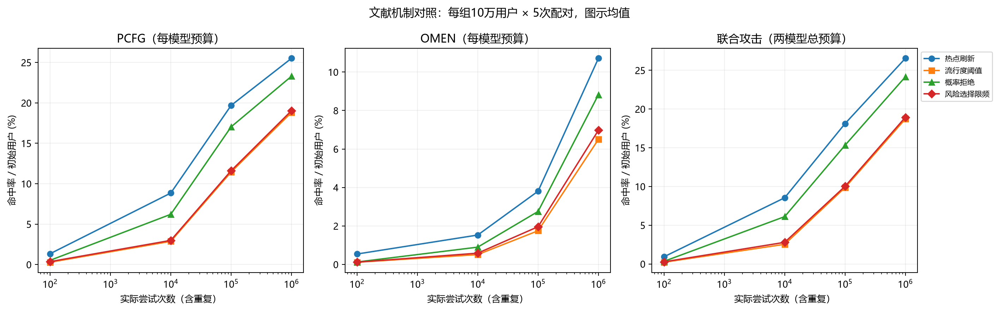
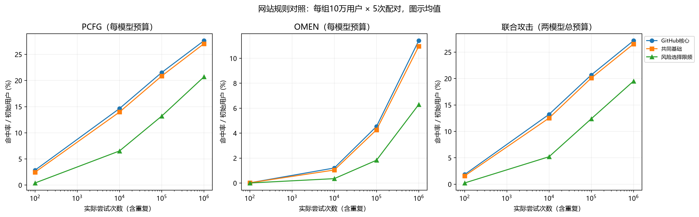
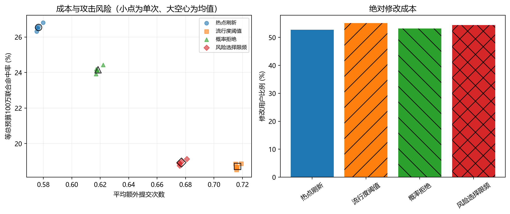
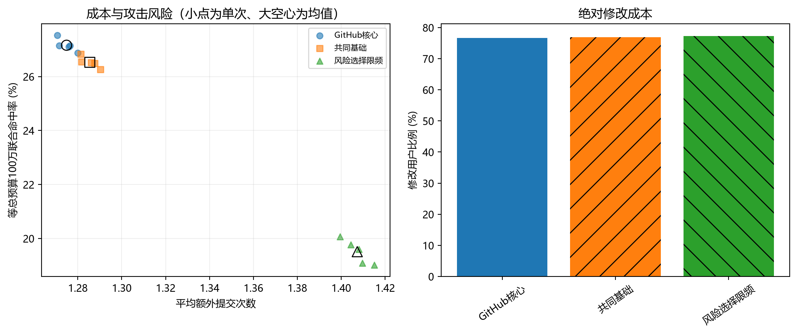
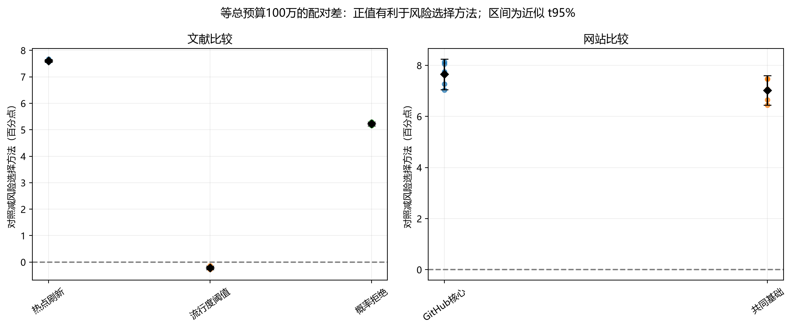
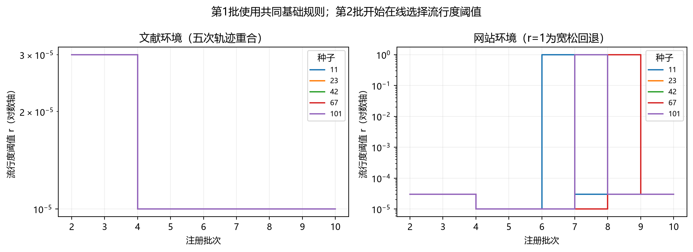

# 注册阶段动态口令策略：文献复现、网站对照与改进方案报告

**状态:** 本地科研审阅稿。实验数据已生成并通过机器审计；引用及科学表述待作者人工核验，未声明可直接投稿。

## 1. 当前方案的判断

此前联合控制器没有选择结构阻断，完整字符串策略与联合策略在先前验证中表现相同；旧实验不能支持结构联合的独立贡献，也不能把动态调整本身写成首次提出。 [claim:C001] [evidence:E012,E011]

开发校准中纯反事实收益列表较弱，因此在终测未开封时改为风险选择限频：只对训练预测可猜中字符串增加流行度限制，按重选模拟的攻击收益和提交成本动态选择阈值，再用另一预览集确认。它是有可检验差异的改进候选，文献新颖性不能仅凭胜出认定。 [claim:C002] [evidence:E011]

可讨论的贡献是：将限频对象缩小到训练攻击器在指定预算下能猜中的字符串；利用完整重选结果而非仅流行度或均匀度选择阈值；把注册成本纳入可行条件；用另一预览集确认单一赢家，并用重新训练的攻击器评价。各组成思想均有相关研究，本研究应表述为这一具体组合与条件下的实现和实验证据，不宣称首次动态生成或首次考虑可用性。 [claim:C003] [evidence:E001,E003,E004,E005,E011]

较强文献对照：流行度阈值的联合命中率为18.717%，风险选择方法为18.933%；新方法相对对照的平均额外提交差为-0.0394次。攻击风险与成本必须同时解释，不能把较低成本写成已证明安全更强或安全等效。 [claim:C004] [evidence:E010]

主要结果：网站共同基础的联合命中率为26.533%，风险选择方法为19.510%，差为7.023个百分点；平均额外提交差为+0.1219次。动态贡献应以该共同基础比较，而非把公共黑名单收益也算作动态收益。 [claim:C005] [evidence:E010]

## 2. 现有研究与改进空间

| 研究 | 已做工作 | 与本研究问题相关的局限及复现范围 |
| --- | --- | --- |
| Schechter 等（2010） | 用流行度阈值限制过于常见的完整口令，并设计 sketch 与防泄露机制 | 阈值关注频次，未直接计算本次具体重选过程的攻击收益。本次是理想精确计数接受机制复现，未复现隐私系统。 | [claim:C006] [evidence:E001,E011]
| Malone、Maher（2012） | 在线估计提议频率并概率接受，目标是更均匀的口令选择 | 理论独立提议假设不覆盖本次修补相关响应；均匀化也不等于对指定猜测器最优。本次按第6节时序复现。 | [claim:C007] [evidence:E002,E011]
| Segreti 等（2017） | 真人研究结构及字符串自适应限制、反馈和可用性 | 已有真实可用性证据，不能说未研究成本；其预计算黑名单实验不等于本项目简单按热点建结构表，本次未宣称完整复现。 | [claim:C008] [evidence:E003,E011]
| DPPG | 动态生成特征要求，探索与利用平衡分布，含可用性控制和攻击评价 | 已覆盖动态生成及攻击者视角；本次聚焦攻击可猜字符串的选择性限频、完整重选收益与具体预算，不能宣称首次考虑攻击或动态策略。 | [claim:C009] [evidence:E004,E011]
| Skeptic | 按不同重选假设模拟策略诱导分布，以均匀度帮助选策略 | 已覆盖自动选择与行为模型；本次用实际攻击前缀作选择预测并做在线终测，仍受响应模型与预测器限制。 | [claim:C010] [evidence:E005,E011]

### 两个复现机制的具体设置

Schechter对所有符合共同基础的完整字符串使用流行度门槛：未出现过的字符串允许，否则仅当已完成注册次数小于r乘已完成账户数时允许；每次注册成功立即递增该字符串计数。使用精确计数以避免sketch近似误差削弱该对照。 [claim:C011] [evidence:E001,E011]

Malone–Maher从过去已见的不同字符串中均匀选取参考字符串v，每名用户在重试期间保持v。对本次提议w，先从[0,F(w)]均匀抽取u，再递增F(w)，最后读取更新后的F(v)；只有共同基础满足且u不超过F(v)时接受。F统计所有提议，包括失败提议和不满足共同基础的提议，不仅是成功注册结果。 [claim:C012] [evidence:E002,E011]

热点刷新对照按最近两批已完成注册计数更新完整字符串拒绝表，仅纳入至少出现两次且满足共同基础的字符串，按频次排序截取校准容量。它用于检验风险选择方法相对单纯刷新热门列表的增益，未将其冒充另一篇论文的完整复现。 [claim:C013] [evidence:E011]

## 3. 方法设置与理论依据

令共同基础为P0、全部完成注册口令计数为C、已完成账户数为N、训练预测器在等总预算B内的猜测字符串并集为G。所有完成注册字符串均计数，但只有G中的字符串受附加流行度限制；新字符串在启动时允许。 [claim:C014] [evidence:E011]

$$
\operatorname{Accept}_t(w;r)=P_0(w)\land[w\notin G_B\lor C_t(w)=0\lor C_t(w)<rN_t].
$$

设在阈值r下完整重选所得预览计数为H_t^(r)，预览用户数为n，下一批用户数为m。选择目标是固定预测猜测集合内的累计账户命中比例；不是仅删除热门口令后重新归一化原始数据。 [claim:C015] [evidence:E011]

$$
\widehat R_t(r)=\frac{\sum_{w\in G_B}C_t(w)+(m/n)\sum_{w\in G_B}H_t^{(r)}(w)}{N_t+m},\qquad r_t^*=\arg\min_{r\in\mathcal F_t}\widehat R_t(r).
$$

可行集合F_t由注册修改率、提交次数、长尾提交、较小猜测预算和联合支持域条件共同限定；同风险时先选提交成本较低者，再选较宽松阈值。选择集合决定一个赢家，确认集合只评估该赢家与当前阈值，确认不通过则保持；无可行阈值则使用r=1的宽松阈值回退。 [claim:C016] [evidence:E011]

固定阈值的一段注册期间，对G中的任意字符串w，期末频数不超过max{期初频数, 1, ceil(r×期末账户数)}：已有过多历史账户不会被删除；每次新增只在计数为零或低于rN时发生，整数计数增加一后满足上述界。该计数性质解释了限频的作用，但不保证整体攻击风险下降，因为用户重选可能迁移到其他易猜字符串，故仍需完整重选预测和最终实际攻击验证。 [claim:C017] [evidence:E011]

每批克隆过去的计数状态，对六个阈值及保持当前阈值使用相同预览序列完整模拟在线接受和重选，再比较累计预测攻击风险；阈值网格为1e-6、1e-5、3e-5、1e-4、3e-4、1e-3。候选预览不得更新真实注册状态。 [claim:C018] [evidence:E011]

主预测器是经共同基础规则转换的独立开发训练用户所训练的固定PCFG与OMEN前缀；以历史账户和预测新批账户的加权命中率选取成本合格赢家。历史项对固定预测器下的候选是常数，主要影响累计更新门槛，不能说选择阶段已经解决攻击者重新训练问题。 [claim:C019] [evidence:E011]

选择及确认各使用6000名模拟预览用户，半数来自各自独立角色，半数来自过去两批初始口令；确认角色不同，但历史共享。当前阈值在选择预览中成本合格时，累计预测改善在选择和确认两阶段均须至少0.05个百分点；当前阈值成本不合格时允许修复约束的更新，不强制收益门槛。两种情况均要求新阈值成本合格、较小预算风险增加不超过0.2个百分点、两个模型均不支持的比例增加不超过2个百分点。PCFG单模型外另外披露。 [claim:C020] [evidence:E011]

该依据是可计算的收益与成本决策目标，并非全局最优或真实安全证明。最终使用策略条件化的开发训练数据重新训练两个攻击器，验证固定预测器上的改善是否仍成立。 [claim:C021] [evidence:E011]

## 4. 两项实验的共同条件

数据来自本地rockyou-withcount.txt，按文件声明的频次展开出现位置，仅使用ASCII有效条目，再对出现位置不放回抽样。模拟用户代表源数据中的出现次数，不是已核验的独立真人；没有把去重后的口令字符串等概率当作用户。数据源哈希与各角色位置哈希保存在data_manifest.json。 [claim:C022] [evidence:E010,E011]

每组100000用户、10批、5个配对种子（11、23、42、67、101）。校准与终测新增100万出现位置，排除旧实验全部50万出现位置；终测种子之间位置不重叠，两类实验共享同一组用户以便配对。相同字符串可跨角色出现，出现位置不可重叠。 [claim:C023] [evidence:E010,E011]

响应沿用60%修补、25%短语拼接、15%重新选择，以及原有确定性长度补齐；所有策略共享策略无关的候选序列。该模拟不能替代真人注册、记忆、放弃及长期使用实验。 [claim:C024] [evidence:E011]

文献实验共同基础为长度至少8及训练频次前1000公共黑名单，修改率上限60%、平均额外提交上限1、超过3次额外提交比例上限5%。网站实验采用GitHub官方核心：至少15字符，或至少8字符且有小写字母和数字，未复现其不可得的完整服务端检查。 [claim:C025] [evidence:E006,E011]

网站实验附加控制相对网站核心加公共黑名单计算增量，限制为最终字符串变化20%、平均正向提交差0.5、正向提交差超过3次比例5%。同时报告绝对成本；共同约束并不表示实际成本严格相等。 [claim:C026] [evidence:E011]

刷新容量及Schechter阈值分别校准，使用五组独立十万用户校准集，冻结后才开封终测。概率拒绝不加弱化系数。两篇在线文献机制共享首批启动；前者统计完成注册口令，后者统计所有提议，含基础规则拒绝的提议。报告范围缩减为35条完整轨迹，仅去掉额外旧项目控制器比较，未更改最终方法、封存参数或数据。 [claim:C027] [evidence:E011]

最终攻击只使用60000名开发训练用户的策略响应；公开列表规则用于转换开发用户，在线频数机制在开发用户上独立运行，因此其样本人数与目标100000不同。各攻击器实际生成100万尝试，重复计费；等总预算联合指标按各模型50万尝试计数，不把两个各100万写成总100万。 [claim:C028] [evidence:E010,E011]

OMEN作者代码的训练路径内存分配少了字符串结束符空间，正式运行中触发崩溃；仅增加该分配的一字节，模型和排序逻辑不变。修复后用同一开发输入重放100万猜测，其首次排名字典与原缓存完全相同；实现及二进制哈希另存，缓存保留。 [claim:C029] [evidence:E011]

五次配对区间采用近似t区间，另报双侧精确符号翻转值；五次全同向时最小双侧值为0.0625，不据此硬写5%显著。多方法比较未作确认性多重检验结论。 [claim:C030] [evidence:E011]

## 5. 封存参数

文献环境：刷新容量 1000，文献流行度阈值 1e-05；最终风险选择方案使用封存的在线阈值网格与确认规则。文献对照参数通过校准角色选取；新方法在终测中按封存规则使用过去注册状态和预览角色在线选择阈值。 [claim:C031] [evidence:E011]

网站环境：刷新容量 1000，文献流行度阈值 不适用；最终风险选择方案使用封存的在线阈值网格与确认规则。文献对照参数通过校准角色选取；新方法在终测中按封存规则使用过去注册状态和预览角色在线选择阈值。 [claim:C032] [evidence:E011]

### 文献对照参数的选取依据

| 校准候选 | 固定预测联合命中率 (%) | 平均额外提交 | 五次均成本合格 |
| --- | --- | --- | --- |
| refresh_100 | 28.053 | 0.5530 | 是 | [claim:C033] [evidence:E011]
| refresh_1000 | 26.336 | 0.5765 | 是 | [claim:C034] [evidence:E011]
| refresh_3000 | 26.336 | 0.5765 | 是 | [claim:C035] [evidence:E011]
| refresh_10000 | 26.336 | 0.5765 | 是 | [claim:C036] [evidence:E011]
| schechter_1e-06 | 18.607 | 0.7157 | 是 | [claim:C037] [evidence:E011]
| schechter_1e-05 | 18.607 | 0.7157 | 是 | [claim:C038] [evidence:E011]
| schechter_3e-05 | 22.832 | 0.6343 | 是 | [claim:C039] [evidence:E011]
| schechter_0.0001 | 26.843 | 0.5712 | 是 | [claim:C040] [evidence:E011]
| schechter_0.0003 | 28.676 | 0.5450 | 是 | [claim:C041] [evidence:E011]
| schechter_0.001 | 29.111 | 0.5390 | 是 | [claim:C042] [evidence:E011]
| malone | 23.726 | 0.6186 | 是 | [claim:C043] [evidence:E011]
| risk_budgeted | 18.302 | 0.6764 | 是 | [claim:C044] [evidence:E011]

本表仅用于说明终测前的选择依据，使用固定开发预测器，不能充当策略条件化攻击器重新训练后的终测结果。刷新和流行度对照均选各自成本合格候选中的最低预测风险，风险持平时优先较低提交成本，再以候选名称作确定性排序；未人为选择风险更高的文献对照参数。 [claim:C045] [evidence:E011]

## 6. 终测数据与配对结论

### 实验一：文献机制

| 方法 | PCFG@100万 (%) | OMEN@100万 (%) | 等总预算联合@100万 (%) | 修改 (%) | 额外提交 | 超过三次 (%) | PCFG模型外 (%) | 成本合格次数 |
| --- | --- | --- | --- | --- | --- | --- | --- | --- |
| 热点刷新 | 25.506 | 10.711 | 26.540 | 52.77 | 0.5767 | 0.04 | 61.48 | 5/5 | [claim:C046] [evidence:E010]
| 流行度阈值 | 18.808 | 6.499 | 18.717 | 55.16 | 0.7165 | 0.55 | 63.66 | 5/5 | [claim:C047] [evidence:E010]
| 概率拒绝 | 23.289 | 8.822 | 24.156 | 53.18 | 0.6185 | 0.22 | 62.43 | 5/5 | [claim:C048] [evidence:E010]
| 风险选择限频 | 19.027 | 6.973 | 18.933 | 54.40 | 0.6771 | 0.14 | 63.62 | 5/5 | [claim:C049] [evidence:E010]

| 对照减风险选择方法 | 平均降低 (百分点) | 近似t95%区间 | 同向次数 | 双侧符号翻转值 | 额外提交差（新减对照） |
| --- | --- | --- | --- | --- | --- |
| 热点刷新 | 7.607 | [7.554, 7.660] | 5/5 | 0.0625 | +0.1005 | [claim:C050] [evidence:E010]
| 流行度阈值 | -0.215 | [-0.285, -0.146] | 0/5 | 0.0625 | -0.0394 | [claim:C051] [evidence:E010]
| 概率拒绝 | 5.224 | [5.148, 5.299] | 5/5 | 0.0625 | +0.0587 | [claim:C052] [evidence:E010]

相对流行度阈值，主指标均值差为-0.215个百分点，平均额外提交减少5.49%，修改率降低0.757个百分点。可以报告本模拟下的提交成本优势与攻击均值差，但不能据此宣称攻击等效或安全优越。 [claim:C053] [evidence:E010]

相对概率拒绝，风险选择方案主指标降低5.224个百分点，5/5次同向，达到预设实际改善门槛；但存在实际成本变化，应解释为共同预算内的效果与成本权衡。 [claim:C054] [evidence:E010]

相对热点刷新，风险选择方案主指标降低7.607个百分点，5/5次同向，达到预设实际改善门槛；但存在实际成本变化，应解释为共同预算内的效果与成本权衡。 [claim:C055] [evidence:E010]

在全部五次成本合格的方法中，本次样本主指标最低的是流行度阈值。这是该实验条件下的描述性推荐，不是使用终测重新调参后得到的独立确认结论。 [claim:C056] [evidence:E010]

### 实验二：网站规则

| 方法 | PCFG@100万 (%) | OMEN@100万 (%) | 等总预算联合@100万 (%) | 修改 (%) | 额外提交 | 超过三次 (%) | PCFG模型外 (%) | 成本合格次数 |
| --- | --- | --- | --- | --- | --- | --- | --- | --- |
| GitHub核心 | 27.615 | 11.411 | 27.161 | 76.61 | 1.2749 | 6.84 | 53.42 | 5/5 | [claim:C057] [evidence:E010]
| 共同基础 | 27.042 | 10.958 | 26.533 | 76.84 | 1.2854 | 6.90 | 53.55 | 5/5 | [claim:C058] [evidence:E010]
| 风险选择限频 | 20.702 | 6.293 | 19.510 | 77.30 | 1.4073 | 7.66 | 55.20 | 5/5 | [claim:C059] [evidence:E010]

| 对照减风险选择方法 | 平均降低 (百分点) | 近似t95%区间 | 同向次数 | 双侧符号翻转值 | 额外提交差（新减对照） |
| --- | --- | --- | --- | --- | --- |
| GitHub核心 | 7.651 | [7.051, 8.251] | 5/5 | 0.0625 | +0.1325 | [claim:C060] [evidence:E010]
| 共同基础 | 7.023 | [6.444, 7.602] | 5/5 | 0.0625 | +0.1219 | [claim:C061] [evidence:E010]

相对GitHub核心，风险选择方案主指标降低7.651个百分点，5/5次同向，达到预设实际改善门槛；但存在实际成本变化，应解释为共同预算内的效果与成本权衡。 [claim:C062] [evidence:E010]

相对共同基础，风险选择方案主指标降低7.023个百分点，5/5次同向，达到预设实际改善门槛；但存在实际成本变化，应解释为共同预算内的效果与成本权衡。 [claim:C063] [evidence:E010]

在全部五次成本合格的方法中，本次样本主指标最低的是风险选择限频。这是该实验条件下的描述性推荐，不是使用终测重新调参后得到的独立确认结论。 [claim:C064] [evidence:E010]

网站核心对动态的总差包含公共黑名单收益，动态独立贡献以网站核心加黑名单的共同基础作为参照；网站核心组成本合格标记仅表示本模拟增量协议，不等于真实网站体验验证。 [claim:C065] [evidence:E010,E011]

## 7. 图表

文献环境按种子11、23、42、67、101依次统计：确认更新次数为[2, 2, 2, 2, 2]，无可行候选的宽松回退次数为[0, 0, 0, 0, 0]，确认失败保持次数为[0, 0, 0, 0, 0]。r=1表示宽松回退，不是强限频；文献环境的五次阈值轨迹重合。 [claim:C066] [evidence:E010]

网站环境按种子11、23、42、67、101依次统计：确认更新次数为[3, 3, 3, 3, 3]，无可行候选的宽松回退次数为[1, 1, 1, 1, 1]，确认失败保持次数为[0, 0, 0, 1, 1]。r=1表示宽松回退，不是强限频；文献环境的五次阈值轨迹重合。 [claim:C067] [evidence:E010]

## 8. 结论边界与后续优化

结果仅支持同一来源口令语料、声明的响应混合及两个有限预算猜测器下的模拟结论。未命中、PCFG模型外状态和更均匀的分布均不等于已证实安全；需要进一步扩展攻击器、行为模型与真实用户验证。 [claim:C068] [evidence:E010,E011]

本次较强刷新对照用于检验控制是否超出更新列表的收益；两篇文献对照检验是否超出已有在线机制。若攻击风险与修改成本有不同方向，应给出具体权衡，不能挑选攻击预算制造全面优势。 [claim:C069] [evidence:E010,E011]

下一步可在独立开发角色刷新策略条件化预测器、学习更真实的修补转移模型，并加入更强攻击器。当前没有这些实验数据，不能将其写成已经验证的贡献。隐私部署也需要独立设计，本地精确计数与明文模拟不构成线上隐私保护方案。 [claim:C070] [evidence:E011]

## 9. 文献与软件流程

- [E001: Popularity Is Everything: A New Approach to Protecting Passwords from Statistical-Guessing Attacks](https://www.usenix.org/legacy/event/hotsec10/tech/full_papers/Schechter.pdf)。定位：Section 2, pp. 2-3; Section 3 privacy design。 [claim:C071] [evidence:E001]

- [E002: Investigating the Distribution of Password Choices](https://www.maths.tcd.ie/~dwmalone/p/www2012.pdf)。定位：Section 6, printed p.308, PDF p.9。 [claim:C072] [evidence:E002]

- [E003: Diversify to Survive: Making Passwords Stronger with Adaptive Policies](https://www.usenix.org/system/files/conference/soups2017/soups2017-segreti.pdf)。定位：Sections 3.3, 3.5 and results。 [claim:C073] [evidence:E003]

- [E004: DPPG: A Dynamic Password Policy Generation System](https://nesa.zju.edu.cn/download/DPPG%20A%20Dynamic%20Password%20Policy%20Generation%20System.pdf)。定位：Sections III-IV; source is accepted manuscript。 [claim:C074] [evidence:E004]

- [E005: Skeptic: Automatic, Justified and Privacy-Preserving Password Composition Policy Selection](https://arxiv.org/html/2007.03809v2)。定位：Sections 3.3, 3.4; 2024 revision。 [claim:C075] [evidence:E005]

- [E006: Creating a strong password](https://docs.github.com/en/authentication/keeping-your-account-and-data-secure/creating-a-strong-password)。定位：Official published length/category requirements, accessed 2026-10-11。 [claim:C076] [evidence:E006]

- [E007: Scientific Agent Skills: A Library of Procedural Knowledge for Research Agents](https://arxiv.org/abs/2609.00065)。定位：arXiv v2 metadata, 2026-09-02; writing workflow only。 [claim:C077] [evidence:E007]

Scientific Agent Skills 引用仅记录科研写作工作流，不作为口令算法优势证据。论文引用、署名和投稿信息待作者人工确认。
