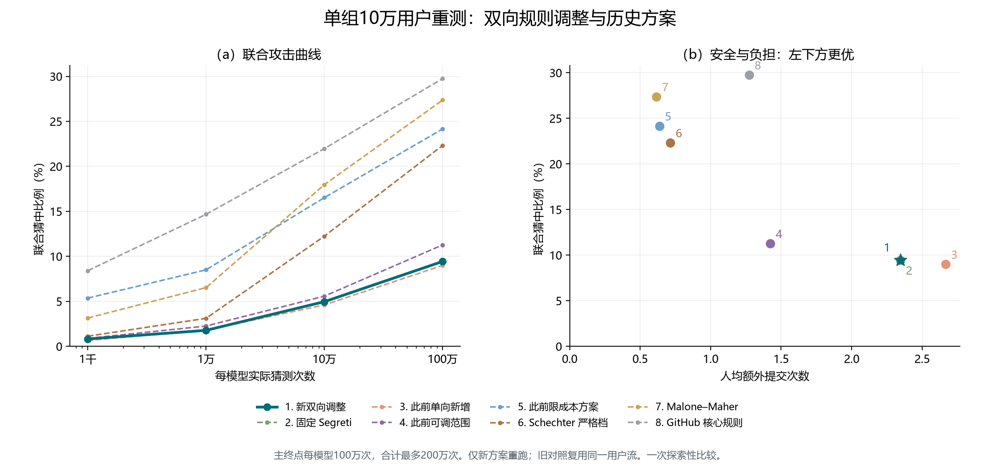

# 双向规则调整：单组十万用户重测结果

只新增运行双向调整方案；七组历史结果只读复用。共同用户划分、seed 11、十批注册、假设响应序列相同。

PCFG 与 OMEN 各实际猜测一百万次，合计最多二百万次；重复猜测计费，联合命中同一账户只计一次。

| 方法 | 联合猜中率 | 人均额外提交 | 口令改变比例 | 超过3次 | 平均编辑量 |
| --- | ---: | ---: | ---: | ---: | ---: |
| 新双向调整 | 9.431% | 2.34561 | 93.124% | 17.510% | 5.45994 |
| 固定 Segreti | 9.431% | 2.34561 | 93.124% | 17.510% | 未测 |
| 此前单向新增 | 8.992% | 2.66616 | 93.205% | 21.705% | 5.43531 |
| 此前可调范围 | 11.268% | 1.42262 | 81.087% | 3.163% | 4.59774 |
| 此前限成本方案 | 24.154% | 0.63641 | 54.431% | 0.202% | 1.47947 |
| Schechter 严格档 | 22.322% | 0.71259 | 54.947% | 0.584% | 未测 |
| Malone–Maher | 27.362% | 0.61555 | 52.996% | 0.243% | 未测 |
| GitHub 核心规则 | 29.749% | 1.27243 | 76.511% | 6.879% | 未测 |

相对固定 Segreti，联合猜中率变化 +0.000 个百分点，人均额外提交变化 +0.00000 次。

本轮是否同时改善：否，未同时降低这两项。

新方案平均编辑量为 5.45994 字符／全部用户；修改用户条件均值为 5.86309 字符／修改用户。
固定 Segreti 等部分历史组未测编辑距离，旧汇总中的 0 是缺失值汇总造成的占位，不能解释为无字符修改。

## 逐批实际规则

| 批次 | 硬阻断结构 | 选择性结构 | 更新状态 |
| --- | ---: | ---: | --- |
| 1 | 213 | 0 | 共同原名单起点 |
| 2 | 213 | 0 | hold_no_selection_double_improvement |
| 3 | 213 | 0 | hold_no_selection_double_improvement |
| 4 | 213 | 0 | hold_no_selection_double_improvement |
| 5 | 213 | 0 | hold_no_selection_double_improvement |
| 6 | 213 | 0 | hold_no_selection_double_improvement |
| 7 | 213 | 0 | hold_no_selection_double_improvement |
| 8 | 213 | 0 | hold_no_selection_double_improvement |
| 9 | 213 | 0 | hold_no_selection_double_improvement |
| 10 | 213 | 0 | hold_no_selection_double_improvement |

## 解释边界

成本约束针对开发选择与确认，不保证目标执行成本逐批满足。公开基础规则保持；候选和最终攻击均由开发训练响应条件化训练。
本方案按旧实验结果提出，并复用旧目标用户流，只能报告一次配对探索的实际效果。没有新独立目标、跨种子稳定性或真人体验结论。
即使最终优于某个历史档位，也不能称已优于该方法全部可调参数下的风险—成本前沿。

输入结果、用户状态和攻击前缀哈希见 `comparison_evidence.json`；作图数据见 `comparison_summary.csv`。

## 候选未通过的原因

本轮实际更新 0 批；共有 33 个开发候选同时降低预测风险与提交数，但平均编辑量增加，未满足完整目标。
候选排除条件可同时出现，计数不可相加解释为不同用户人数。明细见 `selection_diagnosis.json`。
