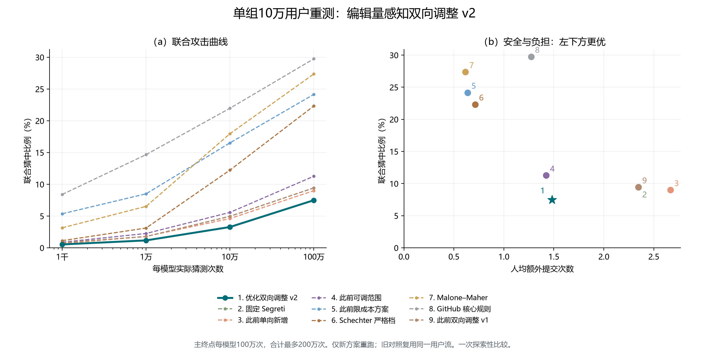

# 编辑量感知双向调整 v2：单组十万用户重测结果

只新增运行双向调整方案；八组历史结果只读复用。共同用户划分、seed 11、十批注册、假设响应序列相同。

PCFG 与 OMEN 各实际猜测一百万次，合计最多二百万次；重复猜测计费，联合命中同一账户只计一次。

| 方法 | 联合猜中率 | 人均额外提交 | 口令改变比例 | 超过3次 | 平均编辑量 |
| --- | ---: | ---: | ---: | ---: | ---: |
| 优化双向调整 v2 | 7.490% | 1.48240 | 76.722% | 7.540% | 3.87207 |
| 固定 Segreti | 9.431% | 2.34561 | 93.124% | 17.510% | 未测 |
| 此前单向新增 | 8.992% | 2.66616 | 93.205% | 21.705% | 5.43531 |
| 此前可调范围 | 11.268% | 1.42262 | 81.087% | 3.163% | 4.59774 |
| 此前限成本方案 | 24.154% | 0.63641 | 54.431% | 0.202% | 1.47947 |
| Schechter 严格档 | 22.322% | 0.71259 | 54.947% | 0.584% | 未测 |
| Malone–Maher | 27.362% | 0.61555 | 52.996% | 0.243% | 未测 |
| GitHub 核心规则 | 29.749% | 1.27243 | 76.511% | 6.879% | 未测 |
| 此前双向调整 v1 | 9.431% | 2.34561 | 93.124% | 17.510% | 5.45994 |

相对固定 Segreti，联合猜中率变化 -1.941 个百分点，人均额外提交变化 -0.86321 次。

本轮是否同时改善：是，两项均严格降低。

新方案平均编辑量为 3.87207 字符／全部用户；修改用户条件均值为 5.04688 字符／修改用户。
固定 Segreti 等部分历史组未测编辑距离，旧汇总中的 0 是缺失值汇总造成的占位，不能解释为无字符修改。

## 逐批实际规则

| 批次 | 硬阻断结构 | 选择性结构 | 更新状态 |
| --- | ---: | ---: | --- |
| 1 | 213 | 0 | 共同原名单起点 |
| 2 | 208 | 8 | confirmed_bidirectional_update |
| 3 | 211 | 8 | confirmed_bidirectional_update |
| 4 | 213 | 11 | confirmed_bidirectional_update |
| 5 | 215 | 14 | confirmed_bidirectional_update |
| 6 | 215 | 14 | hold_no_selection_double_improvement |
| 7 | 215 | 14 | hold_no_selection_double_improvement |
| 8 | 215 | 14 | hold_no_confirmed_double_improvement |
| 9 | 211 | 14 | confirmed_bidirectional_update |
| 10 | 211 | 14 | hold_no_selection_double_improvement |

## 解释边界

成本约束针对开发选择与确认，不保证目标执行成本逐批满足。公开基础规则保持；候选和最终攻击均由开发训练响应条件化训练。
本方案按旧实验结果提出，并复用旧目标用户流，只能报告一次配对探索的实际效果。没有新独立目标、跨种子稳定性或真人体验结论。
即使最终优于某个历史档位，也不能称已优于该方法全部可调参数下的风险—成本前沿。

输入结果、用户状态和攻击前缀哈希见 `comparison_evidence.json`；作图数据见 `comparison_summary.csv`。

## 候选未通过的原因

本轮实际更新 5 批；共有 0 个开发候选同时降低预测风险与提交数，但平均编辑量增加，未满足完整目标。
候选排除条件可同时出现，计数不可相加解释为不同用户人数。明细见 `selection_diagnosis.json`。

## 相对 v1 的优化效果

相对 v1：联合猜中率变化 -1.941 个百分点，平均额外提交变化 -0.86321 次，平均编辑距离变化 -1.58787 字符。
v1 与 v2 均完整测量编辑量，分母一致；成本门槛、用户响应与六个重训名额保持，搜索机制变化单独记录。

| 批次 | 粗筛候选 | 全成本合格 | Pareto 候选 | 重训短名单 |
| --- | ---: | ---: | ---: | ---: |
| 2 | 378 | 146 | 14 | 6 |
| 3 | 404 | 402 | 58 | 6 |
| 4 | 414 | 412 | 56 | 6 |
| 5 | 431 | 429 | 54 | 6 |
| 6 | 439 | 437 | 77 | 6 |
| 7 | 429 | 427 | 68 | 6 |
| 8 | 427 | 425 | 91 | 6 |
| 9 | 432 | 430 | 65 | 6 |
| 10 | 409 | 407 | 44 | 6 |

运行中修复了重复计算大型集合摘要的性能问题，从两批检查点继续。摘要与原实现逐项一致的检查通过，候选算法、用户响应、配置及选择条件未改变；原实现哈希和修复记录保留于运行目录。
