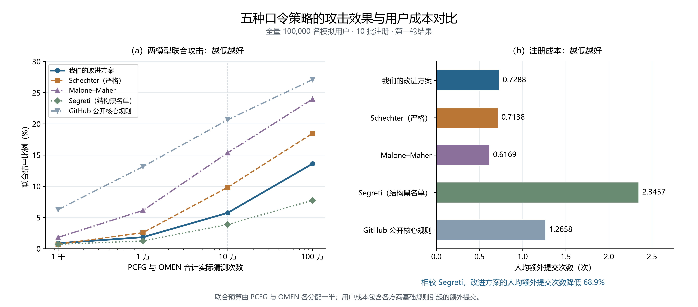

# 10万用户分批注册：五方案攻击效果与用户成本对照

本目录汇总2026-10-11完成的第一轮实验：每个配置使用同一批100,000个模拟用户出现记录，分10批注册。比较我们的改进方案、Schechter严格档、Malone–Maher、Segreti结构黑名单机制适配，以及GitHub公开核心规则。



[下载PDF](五方案攻击与用户成本.pdf) · [可编辑SVG](五方案攻击与用户成本.svg) · [作图数据CSV](五方案作图数据.csv) · [完整图注与论述](五方案对照论述.md)

## 攻击与成本口径

- 攻击采用PCFG与OMEN的联合结果，两模型各分配一半总预算。同一账户被两模型猜中只计一次，重复猜测仍计入次数。
- 用户成本为第一次提交之后的人均额外提交次数，包含各方案基础要求引起的重选。
- 图中只使用最初指定的第一轮（seed 11），不按表现挑选种子。只展示一次模拟，不给出跨轮次误差条或显著性结论。
- 文献配置采用共同的至少8位要求及训练前1000常见口令黑名单；GitHub公开核心规则采用至少15位，或至少8位且包含小写字母和数字，未复现其完整弱口令检查服务。因此，图中比较的是这五个完整配置。

## 最终结果

| 方案 | 联合10万次猜中比例 | 联合100万次猜中比例 | 人均额外提交 |
|---|---:|---:|---:|
| 我们的改进方案 | 5.737% | 13.608% | 0.7288次 |
| Schechter严格档 | 9.827% | 18.469% | 0.7138次 |
| Malone–Maher | 15.361% | 23.954% | 0.6169次 |
| Segreti结构黑名单（适配） | 3.881% | 7.733% | 2.3457次 |
| GitHub公开核心规则 | 20.652% | 27.073% | 1.2658次 |

## 结果论述

在10万模拟用户的分批注册实验中，我们的改进方案取得了较好的攻击防御效果。在PCFG与OMEN合计10万次猜测下，改进方案的猜中比例为5.737%，低于Schechter严格档的9.827%、Malone–Maher的15.361%和GitHub公开核心规则的20.652%。在合计100万次猜测下，改进方案仍优于这三个对照。同时，改进方案的人均额外提交次数为0.7288次，与Schechter的0.7138次接近，说明相较Schechter，安全效果的改善只增加了较少的注册负担。

Segreti的攻击防御效果更好，但用户成本也更高。在合计10万次猜测下，我们方案的猜中比例比Segreti高1.856个百分点，而人均额外提交次数从Segreti的2.3457次降至0.7288次，降低了68.9%。在合计100万次猜测下，两者猜中比例相差5.875个百分点。因此，本轮结果体现了我们方案的优势：相较Schechter、Malone–Maher和网站公开规则，降低了主要攻击预算下的猜中比例；相较Segreti，则在保留较好防御效果的同时，大幅减轻了用户的注册负担。

Segreti在本次文献组的预设注册成本要求下未达标，但其较低的猜中比例完整保留。文献复现为统一模拟条件下的机制适配，不代表原论文完整真人实验；本轮也不能将改进方案的收益分别归因于风险排序或结构内限制。

## 重制作图

本目录只需要公开的汇总数据，不需要口令明文或本地检查点。安装 `requirements-figure.txt` 中的依赖后运行：

```bash
python rebuild_figure.py
```

脚本读取 `data/final_results.json`，重新生成PNG、PDF和SVG，不重新运行注册或攻击实验。中文显示需安装Microsoft YaHei、SimHei或Noto Sans CJK SC字体之一。

数据核对记录见 [aggregate_audit.json](aggregate_audit.json)，证据及文件哈希见 [figure_manifest.json](figure_manifest.json)。图表说明、替代文本和写作工具来源见 [五方案图表说明.md](五方案图表说明.md)。
