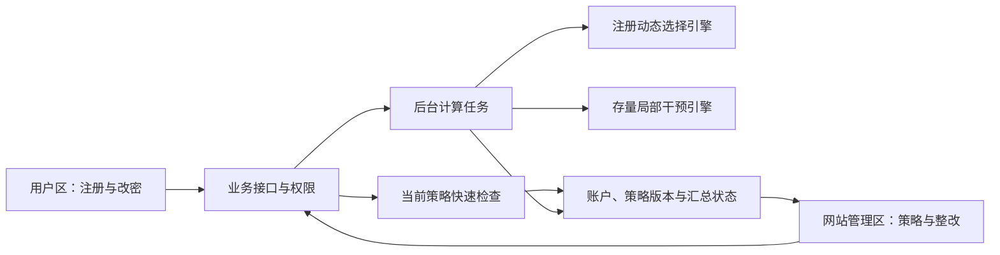

# TriGuard 全新前端：用户端与网站端实施计划

**日期:** 2026-10-11。

**当前定位:** 本文保留早期设计记录。2026-10-11用户已明确要求功能完整一次性交付，以及用户/管理员界面完全隔离、仅允许必要后端业务流转。现行实施依据为[双端完整构建计划](现实可用工具_双端完整构建计划.md)，其中两个独立应用、可信用户扩展及完整服务接入取代下文早期单项目和首版范围设想。新应用尚未编码。

## 0. 新增隐私要求与实施依赖

用户新增要求：网站服务器与管理员均不能接收或查看用户明文口令。仅在后台界面隐藏口令、接收明文后再加盐存储，均不能满足该要求。本文的业务功能继续有效，涉及真实口令输入的接口必须遵循本节；密码学小样本原型已验证，前端与完整业务服务尚未接入。

注册、登录、改密和口令助手应在可信客户端处理输入，业务接口接收协议消息或证明，不接收真实口令明文。当前 Python 规则检查可作为离线研究基准；不能原样包装为接收真实候选的服务器接口。

管理员可查看聚合结构与受保护的分布指标。已选定严格模式：不披露完整热门口令字符串，只输出经过保护的结构人数、匿名频次及有限业务状态，完整热点集合在受保护计算内部参与规则检查。

已选定研究接入路线：可信客户端、独立三方且最多一方被动腐化；采用 MPyC 安全计算，以同一秘密输入完成认证相等性、规则检查与统计，避免政策输入和认证输入被替换。已运行本地三进程与双向认证 TLS 的小规模密码学原型，覆盖逐位分享、秘密结构派生、隐藏联合检查、受保护离散噪声、三方签名回执，以及账户更新与预算状态；这些不是已完成的新前端或独立运营部署。研究认证路线不等同于 OPAQUE/标准 PAKE；若最终改用 OPAQUE，需另行实现同口令绑定。

最终原型48项检查全部通过，含注册、登录、改密、份额检查点读取、有限整改分配与完成，以及预算与回执负例。账户权限体系、可信扩展分发、线上成本评估、跨组织部署和崩溃恢复仍为前端与服务接入的待完成事项，不把原型状态机等同于完整应用验收。

服务入口必须在任何秘密封包绑定计算之前完成鉴权与总额度检查，冲突 nonce、格式拒绝、重放等也计入调用额度。原型在固定批次中先生成并交换私有 HMAC 绑定，再运行业务 guard；每操作四次的登录限制并不覆盖整个绑定入口。HMAC 防止无密钥的离线枚举，但重复令牌可成为在线核对信号，不能据此声称已抵抗恶意客户端与腐化计算方的无限联合探测。

两套研究引擎可复用，但依赖明文的输入、逐人选择及在线成本控制仍需服务适配。实际接入还须落实独立方运营与密钥权限、可信客户端分发、贡献范围和多轮发布预算，以及崩溃恢复；单机多个进程不能证明现实独立不串通。完整契约与论证见[工具全流程隐私可行性论证](第三板块_工具全流程隐私可行性论证.md)，文献依据见[隐私保护口令统计：文献与项目接入分析](隐私保护口令统计_文献与项目接入分析.md)。

## 1. 产品目标与当前基础

建设一个本地可运行的口令策略应用，包含用户区和网站管理区。用户实际完成注册、查看反馈和修改测试账户口令；管理员设置约束、预览注册策略和存量整改方案、应用方案并追踪反馈。

两项研究分别承担职责：

| 研究能力 | 网站端用途 | 用户端用途 |
| --- | --- | --- |
| 注册阶段完整口令与字符结构联合动态阻断 | 根据已完成批次选择下一批规则，查看候选成本、风险预测与确认记录 | 在当前规则下提交注册候选，收到接受或拒绝反馈 |
| 存量账户局部动态干预 | 在人数预算内选择整改群体、修改要求与干预强度 | 查看分配给自己的要求，主动提交新口令并完成改密 |

当前可复用的代码包括 `policy/registration_joint.py` 的规则检查和候选构建、`experiments/registration_joint_pipeline.py` 的批次选择和独立确认、`policy/intervention_controller.py` 的干预选择、`experiments/intervention_pipeline.py` 的局部干预流程，以及已有攻击索引与报告产物。

这些是可复用的研究引擎，不等于已经完成在线业务服务。尤其要区分：模拟响应生成器用于预览和实验；实际用户流程必须检查用户主动提交的候选，不能调用模拟器替用户完成注册或改密。

第一版按“本地受控测试站”交付。研究数据与实际测试账户分开管理，界面明确标示数据来源和结果性质。商业网站接入、浏览器插件、多网站运营与邮件短信通知列为后续扩展。

## 2. 前端结构与技术选择

采用一个前端项目、两套界面布局和分开的权限。建议使用 React、TypeScript、Vite，复用同一套表单、状态和图表组件；已有 Python 代码通过新服务层提供数据。第一版建议 FastAPI、SQLite 与独立后台工作进程，重计算任务与交互请求分开。

技术选择以实现本地可用闭环为目的，不代表已经完成依赖安装或兼容核验。

用户输入与本地预检查在可信客户端执行；服务器通过私密协议验证最终接受条件。前后端共享规则定义和策略版本，以避免判断不一致。上图仅表示业务模块关系，隐私通道和独立聚合方见第 0 节所链接的分析。

## 3. 用户区页面与交互

用户区采用简洁的表单与解释卡片，突出当前问题和下一步操作。管理区采用侧边导航、关键指标和可展开的决策记录。两区共享字体、间距和状态色；错误和通过同时使用文字与图标，不能仅靠颜色表达。

### 3.0 独立口令助手 `/assistant`

提供无需进入注册流程的单条候选检查，复用已有模型索引查询。用户选择研究参照或已合作站点，输入测试候选并主动检查，查看规则合规性、模型评价及其限制。未合作网站只能使用明确标注的参考评价，不声称掌握该站分布。

输入不保存到浏览器或查询日志。检查采用浏览器本地评价或受保护的查询协议，不向网站服务提交候选明文；未经适配的 Python 查询只能用于隔离研究数据。用户可以从这里进入测试站注册或改密。第一版不接入用户的全部口令库，也不将模型未覆盖显示为强口令。

### 3.1 注册页面 `/register`

- 展示站点名称、当前基础要求和简洁的选密提示。
- 用户填写测试账户标识、口令和确认口令。
- 用户主动点击检查或提交时执行本地检查和私密协议，仅发送协议消息，不上传候选明文。
- 拒绝时返回有用的原因与下一步建议，不显示该口令的精确站内人数、排名或其他账户信息。
- 表单首次获取策略版本，并在本次操作中固定版本；策略刷新不能造成要求反复变化。
- 正式提交时验证政策合规结果与认证凭据的绑定；本地检查通过不等于注册成功。
- 成功后建立测试账户，进入个人账户页；后台只在成功提交后更新已注册统计。

状态包含未输入、检查中、需修改、可提交、提交中、已完成、请求失败与策略会话过期。重复点击不会产生重复账户或重复计数。

### 3.2 登录页面 `/login`

提供进入测试账户的必要入口。使用不向服务器发送口令明文的认证流程；不因新注册策略变化而否定已有口令。需要整改的账户在验证身份后看到任务提示。认证库选择与政策绑定仍属于待实施依赖。

### 3.3 个人账户页 `/account`

展示自己的账户状态、待办改密要求与已完成记录。提供主动改密入口。只显示本人信息；不展示群体名单或猜测模型的内部明细。

### 3.4 改密页面 `/account/password`

- 从主动改密或分配任务进入，展示本次要求与原因。
- 根据任务和账户权限核实身份，再通过私密协议验证用户实际选择的新口令，不向服务器发送明文。
- 规则检查与有限攻击门槛检查分别记录；模型未知、失败或未覆盖不得显示为“安全”。
- 通过后更新账户验证记录、完成相应任务并更新汇总状态。
- 失败或退出保持任务未完成，不能沿用研究中的“通知后全部成功修改”假设。
- 对恢复账户而无法提交旧口令的场景，另走身份恢复流程；第一版不实现完整恢复系统。

第一版不实现个人口令库、跨网站自动改密或浏览器插件。

## 4. 网站管理区页面与交互

### 4.1 总览 `/admin`

展示当前注册策略、注册完成率、重选次数、待整改与已整改账户数、剩余预算，以及后台任务状态。统计按数据来源分区：实际测试操作、模拟预览、历史研究结果。风险估计与真实业务完成率不能混在一个未标注的数值中。

主操作是查看注册策略、预览整改方案和检查正在运行的任务。

### 4.2 注册策略 `/admin/registration`

管理员配置基础要求、额外操作成本上限、批次更新条件和候选范围。低层参数放在高级设置，普通界面不要求理解模型名称或结构编码。

工作流：修改约束 → 后台计算候选 → 独立确认 → 展示推荐或保持原因 → 管理员应用 → 生成新版本 → 对后续注册会话生效。

显示当前版本、版本时间线、调整原因、候选预计成本、风险估计与模型覆盖情况。不存在足够收益时，“保持当前策略”是正常结果。约束冲突、确认失败、计算失败分别显示，不合并为成功推荐。

第一版由管理员应用新版本，验证稳定后才考虑自动应用。应用是站内策略操作，不涉及邮件或第三方发布。

### 4.3 存量整改 `/admin/intervention`

管理员设置每轮和累计人数预算，查看候选群体与修改要求，预览后创建整改任务。

工作流：设定预算 → 计算方案 → 核对预期成本与适用范围 → 创建站内任务 → 用户进入账户页处理 → 收集实际完成反馈 → 再次计算。

计划人数、已分配人数、已完成人数、未响应人数分别统计。预算按事先定义的分配口径记账，不能只对成功修改者计费。第一版通知采用站内待办，不接邮件短信。

若只有匿名语料、没有可授权的账户映射，只能生成群体方案与模拟预览，不能假装已给真实账户分配任务。

### 4.4 账户与任务 `/admin/accounts`

查看测试账户标识、任务状态和必要风险标签；筛选待处理、处理中、已完成。管理员不查看口令明文。群体详情只显示允许披露的汇总与受权限保护的任务对象。

### 4.5 运行记录 `/admin/runs`

显示任务排队、计算、确认、完成和失败状态，查看阶段进度与最近更新时间。查看历史结果和策略版本，下载经过筛选的汇总报告，不导出私有口令集或模型缓存。

## 5. 需要新增的服务适配

不把原服务中保留但被路由限制拦住的接口当作已可用接口。新前端连接独立服务层，复用算法和数据结构，不依赖原 HTML 页面。

| 服务 | 职责 | 主要新增内容 |
| --- | --- | --- |
| 账户服务 | 注册、验证身份、改密、会话 | 盲注册认证协议适配、凭据存储、事务与权限 |
| 策略检查服务 | 私密验证真实候选 | 本地预检查、受保护的政策检查及与认证的绑定；现有明文函数保留作离线基准 |
| 注册策略服务 | 获取版本、预览、应用策略 | 持久化策略版本、批次状态与生效范围 |
| 整改服务 | 预览计划、分配、完成任务 | 账户映射、实际响应反馈和预算台账 |
| 任务服务 | 调度昂贵计算 | 持久化任务、进度、失败记录和受控续跑 |
| 汇总服务 | 支持管理页面与下载 | 过滤私有信息、标识模拟与实测来源 |

拟议接口包括当前策略与会话、注册检查、注册提交、身份登录、改密检查与提交、管理员策略预览与应用、整改计划预览与分配、任务状态和汇总结果。准确请求字段在开发第一阶段冻结，并由类型定义生成前端调用代码。

业务结果需要包含状态、策略版本、原因代码、用户可见解释、下一步动作，以及可选的任务编号。前端不能依赖解析研究日志来判断成功。

快速预检查复用当前生效的公开规则与适合客户端的模型；隐藏热点和私有模型查询需要对应协议，不得通过发送明文调用已有索引。独立参考数据的 PCFG 训练、候选搜索和独立确认可在后台执行，不在用户每次提交时重新训练。旧任务的计算结果若基于过期状态，应用前必须重新核对版本。

## 6. 数据边界与状态一致性

### 6.1 研究数据与测试账户

研究引擎已有流程依赖完整口令频次和独立开发资料。真实网站的加盐哈希不能直接提供这种频次。因此第一阶段必须核对所需输入和可观察统计，不将“有研究算法”描述为“已经能分析任意网站口令库”。

原型通过本地隔离的研究数据运行完整字符串与结构联合策略；实际测试账户使用不传明文的注册认证流程。真实结构统计也应在客户端生成并受保护地聚合，不逐账户明文上报。完整字符串通道需要单独设计受保护的统计表示、查询边界与误差核验，完成前不接收或持久化真实用户口令来凑齐研究输入。

界面明确标注当前策略依赖的是研究参照还是已接入站点统计，不把参照语料的热门程度显示成本站事实。

### 6.2 业务一致性

- 注册、改密和任务完成使用事务及幂等请求，防止重复计数。
- 新策略只影响明确的后续会话，已有账户登录不套用新注册规则。
- 完成注册后才计入已注册分布；首次提议、拒绝和重试统计与接受结果分开。
- 同一账户同时改密或重复领取任务必须处理冲突。
- 策略回退作用于后续检查；已经修改的账户不会被自动改回旧口令。
- 用户口令不进入浏览器持久缓存、分析日志或第三方监测服务。

## 7. 实施顺序与阶段交付

### 第一阶段：引擎适配与接口约定

核验两套引擎的输入、输出和已有成功产物；制作能力表；先按第 0 节确定隐私目标、协议与信任模型，再明确在线统计可提供的范围；定义策略、账户、任务和结果的数据结构；建立独立服务入口与权限；冻结首版接口。隐私方案不能留到表单和明文接口完成后再补。

**交付:** 可调用的规则检查与策略任务接口、数据来源声明、错误状态清单。此时不承诺全部动态输入已接入真实账户。

### 第二阶段：用户区最小闭环

实现独立口令助手、注册、登录、个人页和改密页，连接后端，验证拒绝、重选、成功、任务未完成与异常流程。

**交付:** 能实际操作的本地测试账户流程，不能仅用前端假数据模拟成功。

### 第三阶段：网站管理区

实现总览、注册策略、整改计划、账户任务和运行记录。连接真实后端任务，允许管理员预览并应用方案。

**交付:** 管理员可以通过界面操作两套引擎，并看到具体生效范围与用户反馈。

### 第四阶段：反馈与联调

验证新注册统计、真实完成反馈与研究预览的边界，检查策略版本、预算、并发、重复提交和任务状态。对尚不能由实际统计驱动的完整字符串决策保留明确标识。

**交付:** 可复核的双端操作记录、真实反馈汇总和经过确认的引擎结果。

### 第五阶段：展示打磨与打包

统一界面、空状态、失败状态、移动端布局和可访问性。提供启动说明、测试账户、可重置的隔离演示数据和展示步骤。准备已经完成的真实研究产物供快速查看，现场重计算只执行有明确资源上限的任务。

**交付:** 独立前端、服务适配层、本地启动入口、简短使用说明与验收记录。

阶段顺序是实施依赖，不是未经核验的工期承诺。

## 8. 验收标准与展示路径

必须验证以下实际行为：

1. 用户在当前规则下完成注册，拒绝原因能帮助重新选择。
2. 管理员启动注册策略预览，能得到更新、保持或明确失败结果。
3. 新版本对后续会话生效，正在操作的会话行为符合版本约定。
4. 管理员在预算内创建整改任务，只有对应用户可以处理。
5. 用户实际完成改密；管理员汇总同步变化，未完成者保留未完成状态。
6. 重复提交、计算失败、模型未知、状态过期和权限错误不会显示为成功。
7. 汇总图表能追溯数据来源，明确区分预测、模拟结果、实际前缀命中与真实测试操作。
8. 前端、下载文件和日志不泄露私有口令、精确热点列表或其他用户敏感信息。
9. 注册、登录、改密和助手的网络请求及服务器处理均不接收真实候选明文；核验协议输出、聚合方权限及统计与认证绑定。只跑通诚实用户流程时，明确说明尚未验证恶意客户端绕过与服务器串通。

测试重点是关键流程与边界，采用后端行为测试和浏览器端到端验证；不会为每个纯展示组件重复编写与实现相同的测试。

展示顺序：管理员查看当前策略 → 用户注册并经历一次有解释的拒绝与重选 → 管理员运行预览并应用有依据的更新或展示保持原因 → 后续用户在新版本下注册 → 管理员分配一轮存量任务 → 对应用户完成改密 → 后台查看实际响应与研究评价。

展示不能强制制造策略切换，也不能为了动画编造风险下降。当前算法选择保持时，就展示它为何保持；未完成的大规模研究不作为已验证结果。

## 9. 首版范围与后续边界

首版包含一个测试站点、用户区、管理员区、两个引擎适配、站内整改任务、持久化业务状态和汇总报告。

浏览器插件、外部网站账号接入、邮件短信通知、个人口令库、大规模多租户与公网生产部署不进入首版。两项研究各自的有效性仍由独立实验验证，前端完成不等于已证明现实用户或所有攻击条件下的防御收益。
