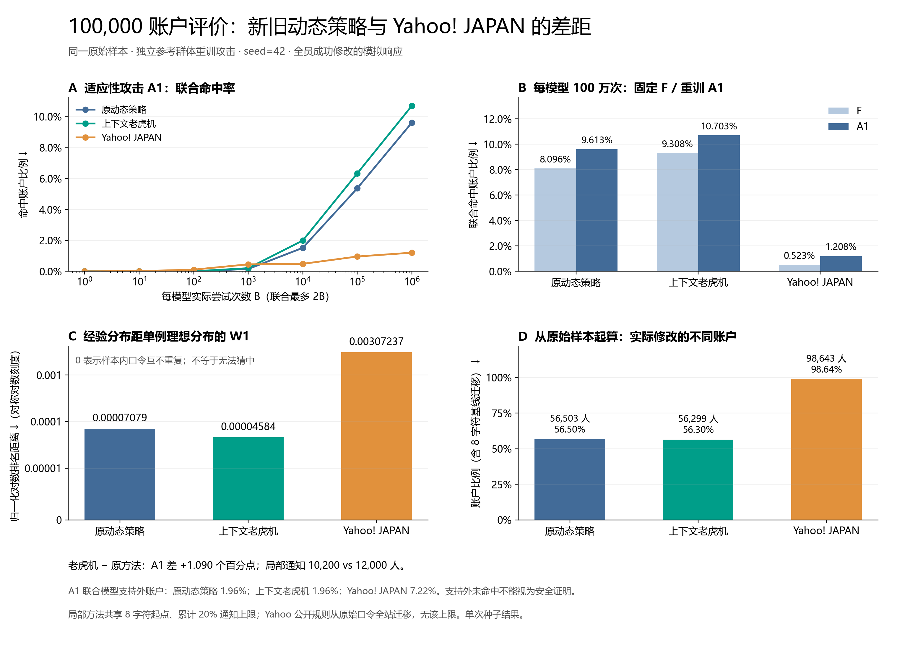

# 十万账户：新旧动态策略与 Yahoo! JAPAN 对照

**评价性质:** 真实语料频次抽样、程序模拟用户修改；不是十万名真人用户的实验。

**结论:** 按预先确定的分布距离主目标，本次上下文老虎机更好。 攻击命中率、通知人数和计算时间分别报告；这一组结果不证明跨场景稳定优势。 本次新方法的 A1 命中率高于原方法；Yahoo 观察命中率最低，但其全站修改成本高，且有更多口令处于攻击模型支持范围之外。

本次目标账户 100,000，开发样本 100,000（训练 60%、预热 20%、验证留出 20%），种子 42。按出现位置分离，允许相同口令字符串存在于不同样本中。三种方法使用相同原始目标样本；两个局部方法另外共享同一次 8 字符基线迁移。

## 结果

| 方法 | 经验 W1 ↓ | F 联合命中率 ↓ | A1 联合命中率 ↓ | 局部通知 / 全站迁移 | 修改的不同账户 | 平均累计编辑成本 ↓ |
| --- | ---: | ---: | ---: | ---: | ---: | ---: |
| 原动态策略 | 0.0000707887 | 8.0960% | 9.6130% | 12,000 | 56,503 (56.50%) | 0.406837 |
| 上下文老虎机 | 0.0000458416 | 9.3080% | 10.7030% | 10,200 | 56,299 (56.30%) | 0.397132 |
| Yahoo! JAPAN | 0.0030723737 | 0.5230% | 1.2080% | 98,643 | 98,643 (98.64%) | 0.698108 |

F 与 A1 均为 PCFG 和作者版 OMEN 的实际前缀；每模型预算 1,000,000 次，联合至多 2,000,000 次。F 在未干预开发训练集上冻结；A1 在每种方法的独立参考迁移分布上重训，不使用目标终态训练。编辑成本为每次归一化编辑距离累计后对全部账户平均；两种局部方法包含基线成本。

原动态策略是保留原选择算法的受控重跑：外层最多 40 轮，关闭非 Google 分支的相对攻击收益提前停止；不是历史发布结果的直接复现。两个局部方法的初始状态配对，内部响应随机流不同。新方法使用经验准入模式，本次没有使用严格置信准入的概率保证。

## 新旧差距

两个局部方法的共同初始经验距离为 0.0409460252。新方法降低 99.8880%，原方法降低 99.8271%；此比例衡量分布形状改善，不是破解风险的相对下降。

新方法相对原方法的经验 W1 差为 -0.0000249472；A1 差为 +1.0900 个百分点；局部通知人数差为 -1,800。这里正数表示新方法指标更高，负数表示更低。

控制阶段耗时：新方法 264.82 秒，原方法 1839.75 秒。此时间不包含终态攻击训练；原方法保留拟合、组合、前瞻和无模拟量上限的搜索，新方法使用经验 W1 与有限搜索，因此不能把耗时差全部归因于学习。

预热有效学习更新 3 次；新方法结束累计 10 次。当前更新量与单种子评价不足以证明稳定的跨场景学习收益。

新方法停止原因为 `no_validated_positive_gain`，实际使用 10.20% 的局部通知额度，原方法停止原因为 `no_feasible_positive_gain_action`。对于候选复核无正收益的停止，只能断言本轮已复核动作未显示收益，不能断言整个动作空间没有更优动作。

## 与 Yahoo! JAPAN 的差距及可比范围

新方法相对 Yahoo 的 A1 差为 +9.4950 个百分点；W1 差为 -0.0030265321；修改的不同账户少 42,344 人。原方法相对 Yahoo 的 A1 差为 +8.4050 个百分点。

Yahoo 对照复刻已公开的 15–32 字符、半角字符与组合限制，执行一次全站合规迁移；不受局部 20% 通知上限或固定攻击个体门槛约束。这里比较的是完整策略流程的效果与实际成本，不能据此推断等修改成本下哪个算法更优，也不是 Yahoo 真实站点安全测评。

公开规则来源：https://support.yahoo-net.jp/SccLogin/s/article/H000004639（本项目既有规则模块核验日期 2026-10-07）。未复刻未公开检测。

| 方法 | F 联合模型支持外账户 | F 比例 | A1 联合模型支持外账户 | A1 比例 |
| --- | ---: | ---: | ---: | ---: |
| 原动态策略 | 11,669 | 11.669% | 1,960 | 1.960% |
| 上下文老虎机 | 11,665 | 11.665% | 1,962 | 1.962% |
| Yahoo! JAPAN | 27,901 | 27.901% | 7,217 | 7.217% |

## 新方法停止诊断

末轮为第 8 轮，生成 146 个合法候选，从中选择 12 个进行初筛，最终复核 3 个。模拟调用 126 次，构造或门槛失败记录 0 条。

末轮独立模拟平均收益（$D_{\mathrm{before}}-D_{\mathrm{after}}$）如下。正值表示改善，负值表示变差：

| 动作人数 | 复核平均收益 |
| ---: | ---: |
| 100 | -0.0000075686 |
| 100 | -0.0000039314 |
| 200 | -0.0000078373 |

支持外是模型可表示范围之外，不代表破解成本已被充分评估。图中的观察命中率须与此诊断一起解释。经验 W1 为零也只说明这批样本没有重复口令，不代表抵抗猜测攻击。

## 指标定义

设降序口令频次为 $f_r$，总人数为 $N$，对数排名坐标为 $x_r=\ln r/\ln N$，则经验指标为：

$$
D=W_1(F,F_{\mathrm{singleton}})=\sum_r\frac{f_r}{N}\frac{\ln(N/r)}{\ln N}-\frac{N\ln N-\ln(N!)}{N\ln N}.
$$

联合攻击命中率与差距分别定义为：

$$
R(B)=\frac{1}{N}\sum_{i=1}^{N}\mathbf{1}\{p_i\in G_{\mathrm{PCFG}}(B)\cup G_{\mathrm{OMEN}}(B)\},\qquad \Delta R_{a,b}=100(R_a-R_b)\ \text{个百分点}.
$$

较低的 $D$、$R$ 与修改成本各自更优；未预先确定三者的权重，不强行合成单一排名。只有一个十万账户种子，图中不绘制虚构误差条，不报告显著性。

## 审计边界

局部方法的通知预算、每轮人数、双攻击计费、完成状态与文件校验和通过核查。源码哈希全量核查有两项差异：`experiments/htpg_iteration.py` 和 `experiments/reproduce_htpg_baseline.py` 在本次运行期间改动；它们属于独立的历史 HTPG 实验，不在本次三方法运行的导入链中。本次评价使用的模块哈希仍与报告记录一致。源文件全量审计不能标记为完全通过。

## 图与证据

- [可编辑 SVG](figures/comparison_100k.svg)
- [完成的原始对照报告](../reports/contextual/seed42_100000_yahoo/comparison.json)
- [局部方法完整结果](../reports/contextual/seed42_100000_yahoo/local/report.json)

comparison.json 带有独立 SHA-256 校验文件，包含样本元数据、各方法证据及审计结果。原论文、原控制器、已有结果与默认配置保留。
