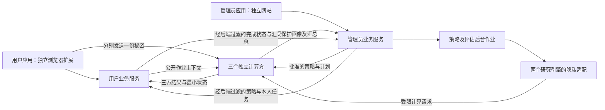

# ZipfGuard现实可用工具：用户端与管理员端完整构建计划

**日期:** 2026-10-11。
**状态:** 两套新应用、常驻隐私服务、接入样例和本机部署工具已实现，并完成合成数据的小样本验收。跨主机部署和生产安全审计尚未完成。
**交付要求:** 用户端和管理员端全部约定功能一起交付。下面的开发阶段仅表示依赖顺序，各阶段均为必做工作，不作为缩减功能的独立版本。新建应用，沿用已有研究与隐私协议成果。

实际交付见 [安装与使用](现实工具_安装与使用.md)、[验收与边界](现实工具_验收与边界.md) 和 [隐私输出论证](现实工具_隐私输出与新服务论证.md)。计划中的自动联合优化仍受证据门槛约束：缺少本站响应和成本模型时保持当前策略；手动快照联合阻断作为单独操作实际执行，不声称通过自动优化门槛。

## 1. 已确认的产品要求

建设两个独立应用：**用户隐私口令助手**和**网站口令策略管理台**。两者独立构建、独立部署、独立登录，禁止相互访问页面、接口、会话和私有数据。后端允许传递当前策略、用户本人任务、受保护汇总和必要业务状态。这一信息边界已经由用户确认。

工具覆盖四项贡献：存量分布调整、注册动态策略、隐私上传与处理、实际用户及网站操作。完整交付包括两套界面、常驻隐私服务、两个引擎的在线适配、网站接入组件、持久化与恢复、部署包、使用说明及联调验收记录。

现实可用的含义是：用户能够实际注册、登录、检查和修改口令，管理员能够实际配置、计算、应用、追踪两类策略；账户、策略、任务和预算能够跨服务重启保留。接入的网站不接收候选口令明文，网页不靠假数据或模拟器替用户完成操作。

## 2. 两个独立界面的形态

### 2.1 用户应用：独立可信的口令助手

采用 Chromium 浏览器扩展，提供完整的独立应用页，弹出窗口只承担快速入口。完整应用页包含口令助手、站点连接、注册、登录、个人账户、修改口令、任务和恢复账户。

口令输入框属于扩展自己的页面，网站脚本不能读取。扩展独立分发，不从管理员网站加载可修改的执行代码。网站只提供连接入口和必要公开业务资料，用户在扩展内确认站点身份及操作。原计划将插件后置，现在因可信输入要求将它纳入完整交付。

扩展权限限定为已配置站点和三个计算服务地址。站点身份、计算方身份及回执验证公钥由可信安装配置或独立签名的站点描述文件确定，不能仅相信管理员页面返回的一组地址和公钥。

### 2.2 管理员应用：全新的网站控制台

采用独立网站，具有总览、私密画像、注册策略、存量调整、账户任务、决策记录、接入配置和运行设置。管理员认证采用通行密钥，权限区分站点负责人、策略操作员和只读审计员。

管理员界面没有口令输入、口令明细、逐账户字符结构或热门字符串查看接口。账户列表只显示业务所需的标识、任务状态和完成记录。任务分配状态属于允许披露的业务信息，不能将它描述为完全没有推断信息。

### 2.3 界面隔离的具体实现

| 隔离项 | 实施要求 | 验收方式 |
| --- | --- | --- |
| 应用与页面 | 两个独立入口、构建产物及运行来源；用户为扩展来源，管理员为网站来源 | 从任一应用均不能打开或读取对方私有页面数据 |
| 身份与会话 | 独立登录流程、会话签发与受众；用户令牌不能登录管理员服务 | 使用用户令牌请求管理员接口及反向请求均被拒绝 |
| 接口 | 用户API只返回本人资料；管理员API只返回授权管理资料 | 直接调用、修改账户编号、跨站点请求仍受后端权限限制 |
| 浏览器状态 | 不共享Cookie、LocalStorage、全局状态或跨界面消息通道 | 检查存储、跨来源请求与消息处理，不存在数据旁路 |
| 导出与日志 | 两端各自过滤输出；管理导出仅含批准汇总与最小业务记录 | 下载文件、错误日志和诊断接口均检查输出字段 |

安全隔离由服务端和计算方共同执行，不能仅通过隐藏菜单或前端路由实现。

### 2.4 界面设计与交互完成度

用户端采用清晰表单、当前要求、操作反馈和本人任务卡片，提示说明用户应该怎样重新选择，而不要求用户理解秘密分享、模型名或内部结构代码。隐藏规则失败使用有限统一提示，公开规则可以具体解释。管理员端采用侧边导航、预算与完成情况卡片、受保护分布图、候选对比及决策时间线，高级参数可展开。

两端分别完成加载、排队、空数据、断线、权限不足、预算耗尽、结果未知、失败和完成状态；颜色同时配合文字。布局支持常见桌面窗口、缩放与键盘操作。图表注明来源、时间、估计性质及分母，下载图保留这些信息，预测与实测不能靠相似样式混为一谈。

## 3. 用户端全部功能

| 页面或模块 | 完整功能 | 成功标准 |
| --- | --- | --- |
| 口令助手 | 本地公开规则检查、可解释的参照评价、已接入站点的限次私密检查、下一步建议 | 不上传候选明文；模型未覆盖时显示无法评价；站内隐藏命中只给合并提示 |
| 站点连接 | 查看站点身份、服务状态、当前规则及隐私处理范围；添加、移除和切换已接入站点 | 操作明确绑定站点；未接入站点只提供本地参照评价 |
| 注册 | 输入及确认口令、公开要求提示、提交私密候选、拒绝后重选、成功建立账户 | 检查、凭据和统计采用同一秘密；失败不创建账户或贡献 |
| 登录 | 私密认证、有限会话、退出、过期处理及查询冷却提示 | 已有口令不受新注册规则锁定；网站凭三方认证结果建立业务会话 |
| 个人账户 | 查看本人站点账户、适用规则、任务、操作历史和服务状态；退出及确认注销 | 不能请求他人资料；注销撤销凭据并移除当前贡献，历史预算不返还 |
| 主动改密 | 验证当前口令、检查新口令、提交替换及展示确认结果 | 旧凭据撤销，新凭据生效，当前统计中每账户仍贡献一次 |
| 整改任务 | 查看本人任务与修改要求，主动处理、查看未完成或已完成状态、站内提醒 | 用户真实操作后才完成；退出、失败和未响应仍保持未完成 |
| 账户恢复 | 注册时生成高熵恢复凭证供本人保存；通过恢复挑战重建凭据并轮换恢复凭证 | 管理员不持有恢复秘密；恢复仍走三方提交并更新统计，旧恢复凭证不能重用 |
| 反馈与隐私说明 | 显示所用策略版本、参照模型来源、有限拒绝原因、提交状态及数据处理说明 | 不把预测当实测、不把私密检查失败显示成通过 |

用户助手不维护明文口令历史。候选仅保留在当前操作需要的内存中，提交、退出或关闭后清理引用；JavaScript环境不能承诺物理内存已立即擦除。公开参照资产只下载经过来源和完整性核对的模型或规则，不向模型服务发送口令查询。

完整工具将口令上限从实验的16字节扩展为至少64个可打印ASCII字符，采用一致的固定填充和结构定义。长度及字符集要求在用户输入前明确显示，禁止静默截断。协议、公开规则、本地评价和各计算方对同一输入必须采用相同编码。

## 4. 管理员端全部功能

| 页面或模块 | 完整功能 | 成功标准 |
| --- | --- | --- |
| 总览 | 当前策略、注册与重选反馈、任务分配及完成数、隐私和人数预算、服务运行状态 | 指标具有来源、时间和分母；缓存画像显示对应快照时间 |
| 私密画像 | 热门结构、结构内匿名频次、集中程度、覆盖及预测不确定性、发布记录 | 不显示热门口令字符串、逐账户结构或可枚举的秘密集合摘要 |
| 注册动态策略 | 配置基础要求、完整热点与结构名额、成本上限、批次及更新条件；候选计算、确认、应用、保持和回退 | 新版本只作用于约定后续会话；未达门槛时保持；回退不回滚已修改账户 |
| 存量分布调整 | 配置每轮及累计人数预算、目标及规则；比较群体方案、生成计划、开启整改、停止未分配计划 | 选人及资格判断在受保护处理中完成；分配不超预算；不需要导出明文账户映射 |
| 账户与任务 | 最小账户资料、停用与启用、待分配/待处理/已完成状态、筛选、站内任务与完成统计 | 任务只对本人可处理；管理员看不到该账户口令、结构或热点排名；停用不伪造用户改密 |
| 决策与效果记录 | 查看更新/保持原因、候选依据、模型版本、业务反馈与隐私预算消耗 | 研究预览、预测和真实操作分别标注，无法估计时不显示虚构收益 |
| 运行任务 | 排队、进度、取消、失败、受控重试、日志和节点状态 | 操作具有持久作业编号；重复重试不重复应用策略或消耗人数预算 |
| 接入配置 | 站点注册、域名及客户端身份绑定、计算方连接状态、SDK配置、协议版本与接入自检 | 业务服务不接收明文；管理员不能随意更换可信节点身份或取得其私钥 |
| 权限与运行设置 | 管理角色、会话、审计、隐私发布安排、数据保留、备份状态与恢复入口 | 权限在后端验证，账本恢复不返还已消耗隐私预算 |
| 报告导出 | 导出受保护图表、策略与任务汇总、配置及可追溯决策记录 | CSV/JSON/图表不含秘密词表、账户结构、份额或确定性口令指纹 |

当前实验中的联合候选没有通过零未完成约束，真实控制台必须允许并解释保持基础政策。能够应用经过验证的其他候选，同时正确保持不合格候选，才是策略模块的完整功能。

## 5. 后端与隐私处理架构



图中两个界面之间没有数据通道。后端服务只在预先定义的信息契约中流转数据，站点及管理员服务不收集三方份额，也不作为三个上传请求的共同代理。

后端跨端信息白名单固定如下：

| 流转方向 | 允许字段 | 用途 |
| --- | --- | --- |
| 管理业务至用户业务 | 站点身份、公开要求、策略版本、本人任务编号与修改要求、有限服务状态 | 告知当前要求和用户本人需要处理的事项 |
| 用户业务至管理业务 | 业务所需账户标识、注册/改密完成状态、最小任务状态及已批准汇总 | 记录实际业务完成，不传递候选、逐人结构或热点位置 |
| 计算方至业务服务 | 经验证的回执、已加噪画像、批准的有限结果 | 支撑认证、统计与计划，拒绝中间秘密值读取 |

新增字段必须在信息契约中注明接收角色及用途，并完成相应隐私和越权检查。业务事件不允许携带任意自由文本或将原始协议封包塞入日志。

技术栈采用 React、TypeScript、Vite，建立独立的用户扩展与管理员网站项目。两者只共享无业务数据的基础组件、字段类型和公共协议定义。新增Python服务使用FastAPI，业务元数据、队列和账本采用明确事务边界；独立部署使用PostgreSQL，各计算方拥有自己的份额存储和密钥目录。MPyC继续承接现有秘密计算路线，后台重计算与交互操作分开调度。

计划目录如下，已有算法和实验目录保持其研究用途：

```text
ZipfGuard/
  apps/user-assistant/       用户扩展与独立应用页
  apps/admin-console/       管理员网站
  services/user_api/        用户会话及本人业务
  services/admin_api/       管理权限、计划及批准输出
  services/jobs/            后台决策与受控作业调度
  privacy/service/          三个常驻计算方使用的服务实现
  adapters/                 两个研究引擎的在线适配
  contracts/                字段类型、规则和协议定义
  sdk/                      网站接入组件及参考站点
  deploy/                   各方部署配置与身份配置模板
  ops/                      启停、自检、备份与恢复
  tests/tool_e2e/           两端、接入及故障流程验收
```

### 5.1 把批量实验变为常驻交互服务

目前 `privacy/mpc_protocol_party.py` 一次加载预设事务序列，不能直接作为在线注册服务。实施中将其运算拆成明确功能，三个计算进程常驻，每次请求形成一致的作业上下文和同步执行顺序，操作后立即返回结果。

用户助手使用普通浏览器可处理的HTTPS向各节点上传本方份额，并携带签名、短时、限操作的会话凭据。实验的双向TLS不直接要求普通用户安装客户端证书；节点间继续采用认证加密通道。传输变化必须单独验证身份、来源、受众及回执绑定，不能假定与实验配置自动等价。

鉴权和总额度检查必须发生在任何份额摘要、比较或计算之前。各节点独立记账，冲突nonce、格式拒绝、重放和协议失败也计入入口额度。站点服务签发的票据不能跳过三方权限与预算检查，管理员无法通过新票据绕过节点的累计限制。

MPyC作业按明确顺序调度，不在单个运行时中随意并发启动不同秘密运算。队列提供排队状态、超时、取消及背压；秘密统计采用后台快照，交互注册和登录不触发整站重新统计。

### 5.2 同口令、同事务与恢复

同一秘密输入用于公开/隐藏规则验证、认证凭据及统计贡献。成功注册加一项；成功改密替换该账户秘密状态，不增加第二份贡献；失败保持现有状态。

账户注销撤销认证、移除当前统计贡献并结束未完成任务，但不返还已使用预算。停用限制账户操作，不等于管理员能够修改其秘密凭据。计数的参与范围及公开账户数随业务状态变化，画像保证仍按各冻结快照的账户替换邻接定义，不承诺隐藏参与或退出本身。

三方维护请求编号、账户版本、策略版本、事务日志、预算与提交证书。凭据、贡献和对应任务完成具有共同提交决定。单方无响应、提交结果未知或业务数据库暂时失败时返回处理中或明确失败，通过相同请求编号查询和恢复，不能让用户盲目重复修改。

三方签名回执扩展为绑定站点、操作、账户、会话、版本、请求及提交结果。用户助手与网站接入组件独立校验不同已知签名者和预期上下文；网站Cookie本身不能取代敏感操作的三方授权。

备份由各计算方分别保存；网站备份仅含业务资料，不能把三个份额和密钥统一打包给管理员。恢复时核对共同提交位置及预算高水位，对未完成事务恢复或中止；旧备份不得让隐私或人数预算复活。

### 5.3 画像、风险与发布账本

固定结构全集、频次前缀和快照，秘密构建后加噪发布，管理员刷新读取同一缓存。新快照、额外分组及新的私密评价均先检查累计预算。预算不足时保留旧图并显示其时间，不生成新的噪声样本。

现有敏感度4只覆盖人数与匿名频谱。为完整控制台增加攻击命中等统计时，应采用冻结参照模型的受保护命中计算和有明确敏感度的汇总，必要时使用互斥命中区间计数，并把新增坐标纳入新的校准与累计预算。不能沿用4去声称任意附加指标都被保护。

精确相等矩阵、隐藏集合、秘密命中及逐人结构不对业务服务开放。原型的合成真值、参考一致性诊断、测试控制器和调试接口不进入实际服务。策略本身、有限拒绝结果及任务状态为明确批准的业务输出，不将整个操作记录称为差分隐私。

## 6. 两个研究引擎怎样真正接入

| 已有成果 | 可复用内容 | 必须新增的在线适配 |
| --- | --- | --- |
| `policy/registration_joint.py` | 联合规则语义、候选参数、公开结构定义 | 隐藏集合留在MPC；匿名位置绑定快照；所有最终检查使用秘密输入 |
| `experiments/registration_joint_pipeline.py` | 批次、成本约束、独立确认及更新/保持逻辑 | 使用受保护统计和已授权参照预测；从真实提交记录学习反馈；计算与应用分开 |
| `policy/intervention_controller.py`、`policy/local_actions.py` | 群体候选、人数预算、规则选择与决策约束 | 将明文Population及热点映射改为秘密群体状态和受保护计算接口；过滤逐人组别 |
| `policy/intervention_fragments.py` | 已有18类政策片段及基础条件 | 完整映射到本地公开预检查与三方最终验证；私密热点仍保留在秘密状态 |
| `policy/privacy_joint_profile.py` | 条件匿名表示、剩余覆盖选择与数值后处理 | 输入来自真实秘密快照；选择结果由节点绑定隐藏值，不向管理台恢复字符串 |
| `privacy/mpc_protocol_party.py`、`privacy/transaction_contract.py` | 秘密运算、绑定、回执与状态守卫 | 常驻接口、前置入口限制、角色及站点隔离、持久事务与真实恢复 |

不能把两个明文研究pipeline直接包装成管理API。在线接口分为受保护输入、决策计算和受限结果，研究语料与实际站点账户具有不同存储及作业权限。现有普通规则摘要中的秘密完整口令集合哈希、明文账户对象及个人结构必须从在线输出契约中移除；公开参照资产的完整性指纹另行保留。

两套引擎的结构编码也须明确区分：注册使用ASCII连续段L/U/D/S，存量研究中还使用L/S/D结构。协议保存带版本的结构命名空间，分别从同一秘密输入派生；不能将两种字符串编码当成相同类别，或为了页面统一而悄悄改变原模型语义。

完整接入包括已有长度、类别、不同字符、重复、序列、词表及热点等规则；对不存在的公开参照资产，明确显示缺少输入并阻止相关决策，不能用空词表假装完成。客户端预检查服务于解释，最终判定由计算方从同一秘密输入完成。

在线预览的用户响应只能由明确的参照响应模型及真实反馈估计，不能知道用户未来会选择什么口令。预览结果显示适用样本、模型版本和误差；应用后实际拒绝、重选、完成与改密结果另行记录。本站秘密口令不交给普通PCFG明文训练器。

两类工作流必须完整实现：

1. 注册策略：取得授权快照 → 生成候选 → 评价覆盖、风险和成本 → 独立确认 → 更新或保持 → 管理员应用/定时执行已批准流程 → 后续会话采用新版本 → 收集实际反馈。
2. 存量调整：配置轮次及人数预算 → 比较候选群体和要求 → 批准计划 → 秘密群体选择与资格确认 → 在预算内分配本人任务 → 用户私密改密 → 更新贡献、任务和汇总 → 再评估。

三方可按已批准群体条件在秘密状态中进行有限任务分配，不需要把热门值和所有匹配账户交给管理台。用户登录后领取本人任务；分配的账户标识和完成状态属于最小业务状态，不返回个人结构或热点位置。

## 7. 网站接入与存量账户

完整交付附带网站接入SDK、接口说明、可运行参考站点和接入自检。参考站点是新建的业务示例，演示真实连接、注册会话与认证结果消费。它不属于旧展示网站，也不承接口令输入。

接入组件负责请求会话、校验三方回执、建立网站会话、查询本人任务和接收过滤后的业务事件。站点和计算方分别配置可信身份及权限；后台事件包含可核对的请求编号并支持去重与重试。前端应用隔离与后端站点隔离都要测试。

存量账户通过既有授权会话、站点身份核验或恢复渠道建立迁移资格，再由用户在助手中登记新的秘密凭据。历史加盐哈希无法直接还原精确分布，也不能靠导入哈希绕过用户参与。已加入私密状态的账户改密或恢复仍由三方验证，不因管理员提交迁移申请而覆盖现有凭据。

管理台显示实际参与及覆盖范围、迁移状态和未参与人数。没有加入秘密状态的历史账户不计入站内画像，也不以零风险表示。

## 8. 开发顺序及完整交付

| 顺序 | 必做工作 | 阶段产物与完成依据 |
| --- | --- | --- |
| 1 | 冻结双端页面、数据契约、规则语义、角色、站点身份、预算与恢复行为；建立两个应用及服务目录 | 页面及权限清单、跨端信息白名单、接口类型、验收用例和目录骨架 |
| 2 | 将批量协议改为常驻服务，实现浏览器上传、入口限额、会话、账户、长口令及共同事务 | 可逐次调用的真实协议API，成功与错误路径、重启及不确定提交恢复通过 |
| 3 | 接入完整注册选择与存量调整引擎、18类政策片段、隐私画像及受保护风险评价 | 两类在线工作流可执行，预算、规则绑定、确认及保持结果有真实依据 |
| 4 | 完成用户端全部界面及交互 | 助手、站点连接、注册、登录、账户、改密、任务、恢复和隐私说明均连接真实服务 |
| 5 | 完成管理员端全部界面及交互 | 画像、策略、存量调整、账户任务、运行记录、权限、接入和导出全部可操作 |
| 6 | 完成SDK、参考站点、各节点独立部署配置、备份恢复、启动停止与运行自检 | 两端安装及服务部署包，接入样例，操作、故障与恢复说明 |
| 7 | 联调、性能核验、角色及站点越权测试、日志输出检查、完整展示打磨 | 全功能验收记录、真实截图、操作录像或步骤、可重现配置与性能范围 |

上述七步全部属于本次构建范围。界面静态设计可在第二步期间推进，但任何操作成功状态最终都必须由真实后端结果触发。编码前不承诺未经测量的工期或吞吐量。

## 9. 验收标准

| 类别 | 必须通过的验证 |
| --- | --- |
| 两端隔离 | 用户/管理员令牌混用、直接请求对端API、替换账户和站点编号、跨来源读取、管理导出及第三方日志均核验 |
| 输入隐私 | 普通站点、两个业务服务及单计算方的请求与持久化不含明文；网站不能读扩展输入；份额不汇聚到共同代理 |
| 输入与规则绑定 | 伪造结构、另报凭据、畸形份额、超长及截断、重复提交、篡改回执和过期版本不能被接受 |
| 认证与恢复 | 正确及错误登录、会话过期、旧密撤销、恢复凭证验证与一次性轮换；新注册规则不锁已有登录 |
| 两个引擎 | 注册候选与存量候选真实计算；不合格候选保持；18类片段及其公开参照前提逐一核对；研究预览不冒充真实用户结果 |
| 全流程预算 | 绑定前入口总限额、隐私发布缓存及累计预算、整改分配人数预算、失败/冲突/重放/重启均不能绕过 |
| 事务恢复 | 并发改密、单方停机、提交前中断、提交后业务写入失败、进程重启与备份恢复；凭据、贡献和任务不会出现互相矛盾状态 |
| 真实反馈 | 用户不响应、退出或失败保持任务未完成；管理员只能看到准许状态和受保护汇总 |
| 网站接入 | 外部参考站点实际消费认证结果；非本站回执、伪造身份、迁移覆盖已有秘密账户均被拒绝 |
| 性能与容量 | 分别测登录/注册/改密交互、完整规则检查、画像构建与队列；包含长口令、多账户及并发，公布实测支持范围 |
| 部署与操作 | 两端分别安装启动，计算方可在不同主机使用独立身份部署；停止、恢复、自检和报告导出可按说明完成 |

现有画像构建采用大量成对比较，需要在服务化时评估缓存、批量处理或秘密排序/聚合优化，避免将交互请求变为整站统计。性能未达标的功能须在交付前优化或明确实际支持容量，不能靠删除功能或切回明文实现解决。

保留已有算法实验和48项协议检查作为回归基础；新增验证集中于真实交互、前置权限、规则库、界面隔离、恢复及性能，无须为纯展示组件重复写同义测试。

## 10. 展示与最终成果清单

完整演示使用两个独立会话或设备：管理员查看受保护画像并运行策略决策；用户通过助手注册、经历真实接受或拒绝；管理员应用合格方案或查看保持依据；用户在规定新版本下操作；管理员运行存量计划；用户处理本人任务并完成私密改密；管理台获得准许的完成状态与汇总。随后演示越权拒绝、查询限额、预算耗尽、状态恢复和报告导出。

最终交付：

1. 用户助手的完整安装包、独立应用界面与使用说明。
2. 管理员控制台的完整构建产物、角色及操作说明。
3. 用户业务服务、管理员业务服务、两个引擎适配及常驻三方计算服务。
4. 网站接入SDK、参考站点、API与消息字段说明。
5. 独立部署配置、启动停止及运行自检、各方备份与恢复工具。
6. 全功能与隐私边界验收记录、可追溯样例、性能结果及展示步骤。

安全条件沿用[全流程论证](第三板块_工具全流程隐私可行性论证.md)：可信客户端、三个独立计算方、最多一方被动腐化。软件交付支持分别部署，现实隐私仍要求各方由独立主体控制；本地一机多进程的展示应如实标明。新服务化、规则扩展及统计发布口径需要随实现补充核验，不能把已有小样本实验当成未实现功能的通过证明。

已有依据：[第三板块报告](第三板块_隐私保护口令统计与联合策略报告.md)、[协议原型说明](../privacy/README.md)、[协议实验记录](../reports/privacy_protocol_20261011/summary.json)。
