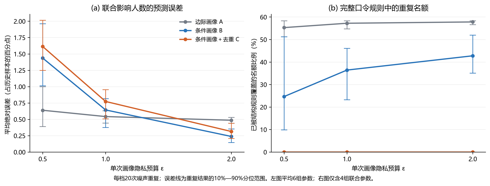
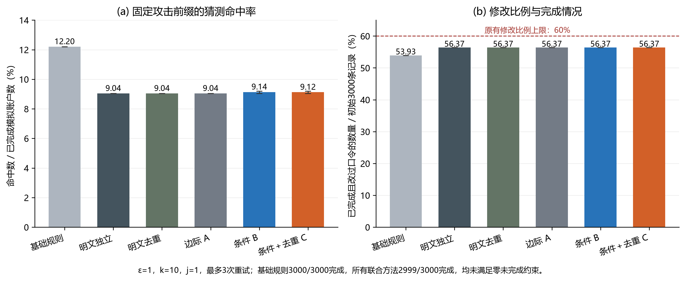

# 第三板块：面向联合口令策略的结构条件匿名画像与隐式阻断

**日期:** 2026-10-11。
**研究范围:** 已完成匿名画像与联合策略的离线效用实验，并补充真实三方安全计算、隐私上传、同口令认证、改密撤销及整改任务的合成小样本原型。本文同时报告算法效果与协议可行性；尚未完成浏览器工具、跨组织部署或恶意服务器安全实现。

## 1. 要解决的实际问题

网站想限制越来越集中的口令，却不应为了统计热门口令而收集所有人的明文。我们的前两个板块已经研究了存量口令分布调整和注册阶段动态策略，现在需要补上两者与真实网站之间的一环：**在不展示口令字符串的前提下，仍然获得制定策略所需的分布信息。**

这里选择严格的输出目标。管理员可以知道哪些字符结构很集中、某个结构下最热门的几个完整口令各被多少人使用，但不能看到这些口令具体是什么。结构采用项目已有的连续字符段编码，例如 `summer2026!` 的结构是 `L6D4S1`。这个例子只是编码说明，不代表实验中的热门值。

## 2. 现有研究能提供什么，还差什么

隐私口令统计已有扎实基础。Blocki 等的 NDSS 2016 工作发布不带字符串的受保护口令频次列表，为“只看分布、不看值”提供了依据 [1]。Naor 等的 CCS 2019 工作研究私密热门口令发现和动态黑名单，说明安全计算可以参与口令热点治理；其作者摘要描述了发布热门口令列表的流程 [2]。Mastic 已经研究私密带权热门项及按属性统计，因此“口令加结构分组”本身不能算我们发明的新协议 [3]。

这些工作与本项目的差距是具体任务上的，而不是没有隐私保护：只有全局匿名频次和结构总人数，无法知道热门完整口令与热门结构重叠多少；输出热门字符串又不符合本项目严格隐藏口令值的目标。我们的策略恰好需要同时处理完整口令和字符结构，因此要保留二者的关系，并让隐藏的完整口令名单真正参与检查。

注册不发送明文也有现成基础，例如 OPAQUE 可以隐藏注册和认证中的口令 [4]。但认证协议不自动完成分布统计和动态规则检查，需要另行接入。我们采用已有密码学技术作为基础，研究自己的统计表示与规则构造方法。

## 3. 我们提出的方案

### 3.1 用结构条件匿名画像保留必要关系

对事先固定的每个结构，记录人数，以及该结构内不同完整口令按人数排列的频次。管理员能看到类似“某结构有500人，最热门的几个口令分别有80、40、20人使用”的受保护统计，但看不到对应字符串。口令值与匿名排名之间的映射只在安全计算内部保存。第6.4节已用真实协议验证这一处理路线。

这层关系确实有用。下面两个构造例的全局口令频次都是 `(4,3,2,1)`，结构 A、B 都各有5人：

| 构造例 | A 内频次 | B 内频次 | 同时禁止 A 与全局第一热门口令的影响人数 |
| --- | --- | --- | --- |
| X | `(4,1)` | `(3,2)` | 5 |
| Y | `(3,2)` | `(4,1)` | 9 |

普通两张边际表完全相同，实际联合影响却不同。条件画像保留结构归属，能够区分它们。这是数学反例，不是用户实验结果。

### 3.2 让完整口令名额补上结构规则没有覆盖的热点

现有注册流程分别选择最热门的 $k$ 个完整口令和 $j$ 个结构。如果完整口令已经属于被禁止结构，两个名额就在处理同一批人。

新方法先确定禁止结构，再从其他结构中选择热门完整口令。固定禁止结构和完整口令名额时，选择剩余频次最大的项能够最大化额外覆盖人数。这样不需要扩大规则表，也能减少重复覆盖。

**覆盖更多人不是安全效果更好的充分条件。** 重选后的口令可能仍然容易猜中，用户也可能放弃注册。因此实验同时检查攻击命中、修改负担和完成情况，不能仅凭影响人数给出正面结论。

### 3.3 完整口令名单隐藏，规则仍然可以执行

选定的流程是：可信客户端生成秘密分享，三个独立计算方在受保护计算中维护频次、凭据与规则；管理员只获得受保护画像；注册或改密时进行私密成员检查，网站获得通过或拒绝结果。认证、策略检查与统计采用同一秘密输入，避免拿口令A通过检查却用口令B登录。

画像效用实验内部使用研究数据作为真值；新增协议实验则确实运行了MPyC 0.11的三方安全计算。其模型是最多一方被动腐化，三方必须由独立主体控制，同机进程只用于实验。不把普通口令哈希、网站独占密钥或界面遮挡当作输入隐私。可信客户端、串通范围及批准输出仍是保证成立的条件，完整命题见[全流程论证](第三板块_工具全流程隐私可行性论证.md)。

## 4. 最小理论支撑

第一，匿名表示可以支持联合覆盖计算。设禁止结构为 $T$，完整口令集合为 $B$，结构人数为 $n_s$，其中被 $B$ 覆盖的人数为 $E_s(B)$，则：

$$
R(B,T)=\sum_{s\in T}n_s+\sum_{s\notin T}E_s(B).
$$

保留结构归属就可以扣除交集。每个结构保存前 $L$ 个频次、且 $k\leq L$ 时，足以找到全局或结构外前 $k$ 项；执行阻断仍需要内部秘密映射。

第二，给定 $T$ 与 $k$，剩余频次前 $k$ 项最大化额外覆盖。每项增益就是它的频次，以更小频次替代更大频次不会增加覆盖量。这是规则构造的性质，不是对重选行为的假设。

第三，单次画像发布可以获得差分隐私。固定结构全集与频次前缀长度，以零补齐，拼接结构人数和排序频次。在固定人数、替换一个账户口令的邻接关系下，向量的 $L_1$ 敏感度至多4。各坐标加入尺度 $4/\varepsilon$ 的拉普拉斯噪声，随后进行确定性后处理，得到该次发布的 $\varepsilon$-差分隐私。

这项保证只覆盖公开画像。实际口令与隐藏集合之间的映射、查询返回的允许或拒绝，都要分别分析。本轮固定种子用于复现模拟；部署时必须使用可靠、保密且不重复使用的随机数，对同一批真实用户多次发布还要累计预算，不能把20次实验重复当成一次发布。

## 5. 实验怎样回答问题

实验复用既有 RockYou 数据划分，把口令出现记录作为模拟账户，不把它们解释成核验过的真实用户身份。使用60000条训练记录冻结32个结构，加 OTHER 共33类；频次前缀长度为30。历史窗口为 tuning 划分前10000条，经基础政策“至少8字符、阻断训练集前1000个常见口令”重选后全部完成；独立注册评价为 test 划分前3000条。训练结构覆盖历史窗口的74.68%，其余进入 OTHER，不直接用于结构阻断。

比较四种方法：

| 方法 | 统计输入 | 完整口令选择 | 作用 |
| --- | --- | --- | --- |
| O：明文参考 | 离线完整真值 | 独立选择或去重选择，分别对应 | 比较统计误差损失 |
| A：边际私密基线 | 全局匿名频次＋结构人数 | 原有独立选择 | 对照丢失结构归属的影响 |
| B：条件私密画像 | 按结构保存的匿名频次 | 原有独立选择 | 分离表示改进 |
| C：完整新方法 | 与 B 相同 | 结构外剩余覆盖选择 | 分离规则改进 |

A 是为本项目构造的对照方法，使用冻结的独立近似估计交集，不代表某篇已有论文的完整复现。B 与 C 共用同一受保护画像。各私密方法使用相同总预算、规则参数与学习窗口，避免靠多查询取胜。

图1使用 $\varepsilon\in\{0.5,1,2\}$、每档20次噪声重复，考察六组 $(k,j)$：$(10,0)$、$(10,1)$、$(10,2)$、$(30,0)$、$(30,1)$、$(30,2)$。图2只使用中间档 $\varepsilon=1$ 和 $(10,1)$，固定配对用户响应种子11；初次提交后最多重试三次，即最多四次提交，比较冻结猜测集合命中率、修改比例和完成率。攻击资产是已有 PCFG 前100000次实际猜测（含重复、共99996个不同值），不重新训练，也不代表策略改变后重新优化的攻击者。

规则由带噪统计形成，再由隔离评价器用完整研究真值计算实际影响。不同噪声重复复用用户偏好，但逐条重新执行具体规则，避免把旧规则下的重选结果当成新规则结果。20次重复描述的是噪声变化，不是20份独立真实用户样本。

## 6. 实验结果

画像实验形成1080条方法—参数—噪声结果；注册评价包含三种私密方法各20次重复，以及基础政策与两种明文参考。以下百分比是比例，比例之差用“百分点”表示。图中误差线是20次噪声重复的经验10%—90%分位区间，不是总体置信区间。

### 6.1 画像误差与重复覆盖

**图1说明:** 左图先在每次噪声重复内平均六组候选的绝对预测误差，再汇总重复；单位为历史10000个模拟账户的百分点。右图只平均 $j>0$ 的四组联合候选，计算已被结构规则覆盖的完整口令名额比例。

| 隐私预算 | A：边际基线误差 | B：条件画像误差 | C：完整新方法误差 |
| --- | --- | --- | --- |
| 0.5 | 0.638 | 1.436 | 1.613 |
| 1 | 0.542 | 0.643 | 0.773 |
| 2 | 0.486 | 0.238 | 0.314 |

在预算2时，条件画像 B 比 A 的预测误差约低51.1%；完整方法 C 也低于 A。但在预算0.5和1时，B、C 均不及 A。条件画像保留的信息更多，也需要发布更多坐标：本轮为33个结构人数及990个频次坐标，而边际基线只需33个人数及30个全局频次。强噪声下，信息细分的代价超过收益，不能宣称新画像在所有隐私档都更准确。

C 在所有隐私档的重复覆盖与重复名额均为0，验证了去重规则的直接作用。明文去重参考在六组参数中的实际覆盖不低于独立选择；这一覆盖性质不能直接推广成带噪排序下对其他方法的真实覆盖保证。另有2520个合成规则条件和2016对邻接输入通过有限核验，观测到的最大敏感度为4；有限核验是正确性辅助，不替代理论证明。

### 6.2 安全收益与用户负担

基础政策下3000人全部完成，366人被固定猜测集合命中，命中率12.200%。两种明文联合参考均为271/2999，即9.036%。完整方法 C 的20次平均命中人数为273.6，已完成分母均为2999，平均命中率9.123%，比基础政策低3.077个百分点，距离去重明文参考仅0.087个百分点。说明这一固定案例中，私密统计没有明显破坏联合政策原有的防御效果。

但 A 的命中率也是9.036%，优于 C；B 为9.136%，C 对 B 的改善只有0.013个百分点。因此，这轮实验没有证明条件画像或去重策略带来独立的注册安全优势。C 的价值更明确地体现在保留联合关系和消除重复名额。

C 的修改比例为56.373%，平均额外提交0.738次，相比基础政策的53.933%和0.541次有所增加。每次联合评价都有1/3000人未完成，完成率99.967%。虽然修改比例低于60%、平均额外提交低于1次，但现有框架还要求未完成人数为0：所有私密方法的20次结果均未通过完整成本门槛，两种明文参考也未通过。**本案例应保留基础政策，不应自动上线联合规则。**

### 6.3 消融与计算开销

下表为 $\varepsilon=1$、$(k,j)=(10,1)$ 的注册消融；修改比例分母为初始3000人。小数命中人数为20次重复的平均，不代表某一次出现了部分账户。

| 方法 | 平均命中人数／已完成人数 | 命中率 | 修改比例 | 平均额外提交 | 完整成本门槛 |
| --- | --- | --- | --- | --- | --- |
| 基础政策 | 366／3000 | 12.200% | 53.933% | 0.541 | 通过 |
| 明文独立参考 | 271／2999 | 9.036% | 56.367% | 0.739 | 未通过 |
| 明文去重参考 | 271／2999 | 9.036% | 56.367% | 0.740 | 未通过 |
| A：边际基线 | 271／2999 | 9.036% | 56.367% | 0.739 | 0／20次通过 |
| B：条件画像 | 274／2999 | 9.136% | 56.372% | 0.738 | 0／20次通过 |
| C：完整方法 | 273.6／2999 | 9.123% | 56.373% | 0.738 | 0／20次通过 |

完整机器可读消融数据见[表1](privacy_joint_assets_20261011/table1_ablation.csv)。这一指定候选的预测误差为 A 0.124、B 0.389、C 0.432个百分点，重复名额为20%、14%、0%；它与图1六组候选平均的口径不同。

A、B、C 的画像接口不输出完整口令字符串；这属于接口事实，不能替代协议保密证明。中间档画像构建平均约0.232毫秒（A）、0.584毫秒（B/C）；完整离线计算约1.613秒。隐藏规则在普通研究进程中模拟，以上时间不代表实际安全计算协议或注册网络延迟。实验中的真值、评估和攻击结果用于研究核对，并不是可直接发布给实际管理员的差分隐私画像。

### 6.4 补充实验：整个工具的秘密输入与状态能否连起来

本轮只增加一组小规模真实协议实验，使用公开构造的合成账户，不再扩大泄露数据实验。初始8个账户，最终9个活跃账户；口令固定填充到16字节ASCII，包含5个结构槽与每槽前3个匿名频次。客户端把128位分别秘密分享，各方仅接收自己的份额；客户端上传和计算方之间均使用双向认证TLS。

三方在秘密状态上直接完成结构推导、频次统计、隐藏规则选择、认证及更新。实际登录采用秘密相等判断，不是OPAQUE实现。公开画像的噪声由每方独立生成并在MPC内相加，真实频次没有先交给管理员。以下为自动从实际结果生成的论文表：

| 工具环节 | 通过／检查 | 实测结果 |
| --- | --- | --- |
| 初始化注册 | 8／8 | 建立8个合成账户的秘密凭据 |
| 输入与同口令绑定 | 5／5 | 拒绝额外认证字段、伪造结构、不一致及非二进制份额、错误填充 |
| 隐藏联合规则 | 4／4 | 刷新隐藏规则，完整值命中与结构命中均拒绝，合规候选通过 |
| 认证及查询限制 | 7／7 | 新策略不锁旧登录；改密后旧值失效、新值可用；第5次查询拒绝 |
| 提交与状态恢复 | 9／9 | 错误旧值、未提交、重放和版本冲突均不重复更新；两次磁盘份额恢复 |
| 存量整改闭环 | 8／8 | 认证后判断资格；人数预算1、领取幂等、秘密改密后完成任务 |
| 画像与发布预算 | 3／3 | 发布1次、同图缓存1次；下一快照预算耗尽后拒绝 |
| 三方签名回执 | 4／4 | 篡改、缺签、重复签名者和错误事务上下文均无法通过验证 |

共48项检查，其中44次协议事务和4项回执负例。另有18项内部状态诊断通过，确认注册、改密和磁盘恢复后的秘密画像与合成参考一致，只打开一致与否的布尔值；这一诊断接口用于测试，真实工具必须移除。原有5项算法单元测试与新增6项契约测试也全部通过。

最终两个改密账户版本均为2，活跃账户仍为9，整改任务分配1个并完成1个，没有重复贡献或超人数预算。单方输入、输出与持久化JSON共12个文件及进程日志的合成口令扫描命中为0。这只是排查意外泄漏，**口令隐私的依据是秘密分享、安全计算和输出契约，而不是字符串扫描。**

本轮还明确了一项容易忽视的约束：不能把其他方外部份额的普通哈希公开，因为持有一份份额的人能据口令猜测推算其余份额并核对摘要。回归测试复现了这个反例；修正方案采用各方独立保密的256位密钥生成HMAC请求绑定，再联合签名。完整口令和秘密份额都不产生公开无钥摘要。HMAC防止离线核对，不消除在线试探；真实服务必须在任何绑定计算前鉴权，并对冲突、拒绝等所有请求统一限速。原型的登录次数检查不是对任意探测入口的证明。

整个合成序列墙钟耗时26.728秒，各方安全计算约25.78—25.80秒，累计发送56,797,438字节。约2.896秒用于首次秘密画像构建及发布；两次含前后画像验证的磁盘恢复各约6.81与7.25秒。这些是本地回环、小样本和测试诊断的成本，不能称为浏览器每次注册延迟或大型网站吞吐量。

实际协议采用三方离散噪声之和，与前文效用实验的单份连续拉普拉斯噪声不同；不能把前文误差数值直接归给新协议。计算方0先接收已加噪向量并做确定性投影；这个尚未投影的带噪向量也列为受保护输出，原始频次始终不打开。理想无界抽样满足画像的单次预算保证，代码有限整数中止的极小尾概率另列为近似隐私项；同一账户多轮发布必须累计预算。公开操作结果、资格和任务状态属于明确批准的业务输出，不自动具有画像的差分隐私。

完整方法与证明见[全流程论证](第三板块_工具全流程隐私可行性论证.md)；原始结果见[协议汇总](../reports/privacy_protocol_20261011/summary.json)、[论文表及检查编号](../reports/privacy_protocol_20261011/table_protocol_cases.csv)、[结果审计](../reports/privacy_protocol_20261011/evidence_audit.json)。现阶段测试控制器一次上传整个合成序列，还没有实现浏览器逐次提交与交互回执。

## 7. 结论与工具接入

本轮支撑了三个具体结论：条件画像解决了边际统计缺少结构归属的问题；去重构造消除了完整口令与结构规则的重复名额；在指定注册案例中，私密完整方法保留了接近明文参考的固定攻击收益。它也揭示了两个限制：强隐私档下细分画像误差更大，本轮没有测得优于边际基线的注册安全效果。

补充协议实验后，第三板块同时提供了**统计方法的效用证据、输入隐私的有条件论证，以及注册—认证—改密—整改的真实协议可行性证据**。它支持继续开发两端工具，但不是已经完成的浏览器产品。本案例仍需要由原有成本控制器保持基础政策，不能为了展示正面收益放宽门槛。

工具接入的职责已经明确：网站端显示受保护画像、结构热点、规则版本与最小任务状态；用户端承担可信输入和私密检查。注册后端沿用既有候选与成本约束，把真实口令处理接到秘密状态接口。存量调整通过认证后的秘密资格判断连接任务，原型已经验证领取、预算与完成流程。无需给管理员导出口令值或逐账户结构。

尚未实测的产品环节必须保持明确：独立可信客户端分发、跨组织三方部署、管理员权限和浏览器会话、完整线上成本评估、跨节点崩溃恢复及大规模性能。普通历史加盐哈希也不能自动变成精确站内画像，需要用户后续参与。现有PCFG明文训练器继续只处理公开参照或隔离研究数据，不能接收本站用户的秘密口令。论文可以论证所述模型内的工具功能路线可行，不能宣称任意恶意网站、两方串通或任意生产部署都已得到保护。

## 参考资料与结果来源

1. Blocki、Datta、Bonneau. *Differentially Private Password Frequency Lists*. NDSS 2016. [会议全文](https://www.ndss-symposium.org/wp-content/uploads/2017/09/differentially-private-password-frequency-lists.pdf)。
2. Naor、Pinkas、Ronen. *How to (not) Share a Password: Privacy Preserving Protocols for Finding Heavy Hitters with Adversarial Behavior*. CCS 2019. [作者摘要](https://www.wisdom.weizmann.ac.il/~naor/PAPERS/how_to_not_share_password_abs.html)。本文对该工作的描述以作者摘要为依据。
3. Mouris 等. *Mastic: Private Weighted Heavy-Hitters and Attribute-Based Metrics*. PoPETs 2025. [官方论文页](https://crysp.petsymposium.org/popets/2025/popets-2025-0017.php)。本文对该工作的描述以官方摘要为依据。
4. *The OPAQUE Augmented Password-Authenticated Key Exchange (aPAKE) Protocol*. RFC 9807, 2025. [RFC 原文](https://www.rfc-editor.org/rfc/rfc9807.html)。
5. 本项目[重构方案](第三贡献_结构条件匿名画像与隐式联合阻断_重构方案.md)。

实验来源：[配置与数据指纹](../reports/privacy_joint_minimal_20261011/manifest.json)、[结果汇总](../reports/privacy_joint_minimal_20261011/summary.json)、[逐次画像结果](../reports/privacy_joint_minimal_20261011/profile_results.csv)、[明文覆盖参考](../reports/privacy_joint_minimal_20261011/profile_references.csv)、[逐次注册结果](../reports/privacy_joint_minimal_20261011/registration_results.csv)、[有限理论核验](../reports/privacy_joint_minimal_20261011/theory_checks.json)。仅链接聚合实验产物，不在报告中附口令样本。参考资料与实验报告由助手整理；进入正式论文前仍需作者核对原文、结果和安全假设。
