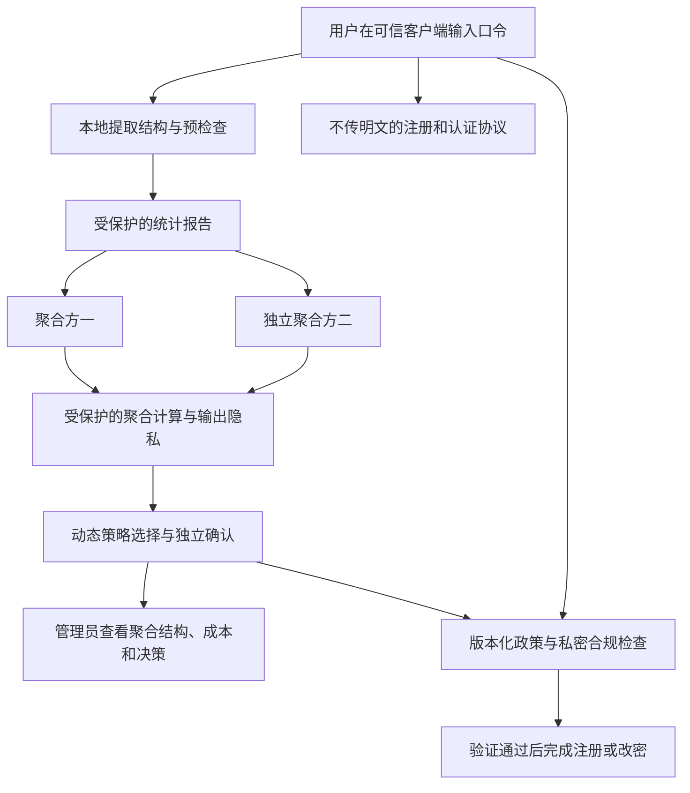

# 隐私保护口令统计：文献与 ZipfGuard 项目接入分析

**日期:** 2026-10-11。

**性质:** 文献调研与探索性架构建议，不是已完成的隐私协议、生产部署方案或论文创新性证明。本文未修改研究算法，也未安装或运行文献中的协议实现。

## 1. 结论与需要区分的目标

已有研究可以私密收集热门口令、聚合用户统计，并在不发送明文口令的情况下执行注册与政策检查。这些能力分别有论文支撑，但不能简单拼接后就声称整个动态策略系统满足隐私要求。

“管理员知道热门口令有哪些”有两种不同含义：

| 隐私目标 | 管理员可看到的内容 | 含义与代价 |
| --- | --- | --- |
| 不披露个人口令记录，允许披露满足条件的热门字符串 | 热门字符串、经过保护的群体频次和结构汇总 | 不显示谁使用它，但热门字符串本身会被披露；需要阈值、输出隐私和关联攻击分析 |
| 不披露任何真实口令字符串 | 受保护的排名频次、聚合结构、热点规模与政策效果 | 不能同时显示热门字符串；完整口令热点的识别和阻断必须在受保护的计算内部完成 |

按照“网站也不能看到明文”的较严格解释，建议默认第二种目标。若用户接受第一种目标，可接入更贴近既有热门口令研究的路线；这项输出范围尚待产品决策，不能默认为允许披露。

注册或登录协议不发送明文，并不代表低熵口令绝不可能被猜出。必须说明客户端可信范围、服务器或聚合方的串通条件、允许披露的输出，以及在线与离线猜测的能力。本文的“无明文”指协议不直接传输或存储真实口令明文，不能解释为无条件阻止所有推断。

## 2. 最相关的文献

### 2.1 直接研究热门口令与动态阻断

**[E1] Naor、Pinkas、Ronen，How to (not) Share a Password: Privacy Preserving Protocols for Finding Heavy Hitters with Adversarial Behavior，ACM CCS 2019。**

论文研究私密识别热门口令并发布动态阻断表，结合恶意安全的双方计算与差分隐私，还考虑恶意设备操纵统计和持续观察变化中的阻断表。它与注册阶段动态完整口令阻断直接相关。但其设计输出包括热门口令列表，不能据此声称所有口令字符串都隐藏。

来源：[作者摘要页](https://www.wisdom.weizmann.ac.il/~naor/PAPERS/how_to_not_share_password_abs.html)。本次核对作者摘要；未完成全文协议审计。

**[E2] Jiang 等，An Efficient Privacy-Preserving Scheme for Weak Password Collection in Internet of Things Against Perpetual Leakage，IEEE TIFS，20:1405–1420，2025，EAGER+。**

摘要介绍以秘密分享和对称加密为基础的条件解密机制：达到足够使用数量时，服务提供者可以解出热门口令；其他口令受到保护。还结合服务器辅助口令加固与密钥更新。它是较新的口令专用统计研究，但有意允许披露热门口令，适合第一种输出目标。

来源：[作者所在高校研究库](https://ink.library.smu.edu.sg/sis_research/10813/)，DOI：10.1109/TIFS.2024.3523202。研究库没有提供全文，本次结论限定于摘要。

### 2.2 收集结构与其他聚合指标

**[E3] Corrigan-Gibbs、Boneh，Prio: Private, Robust, and Scalable Computation of Aggregate Statistics，USENIX NSDI 2017。**

客户端分享输入，多服务器计算聚合统计；论文说明在至少一个服务器诚实的条件下保护单个输入，输出统计本身的泄露仍需考虑。输入有效性证明可限制非法格式。可将其作为结构直方图、拒绝次数和注册完成指标的候选基础。

来源：[USENIX 论文与摘要页](https://www.usenix.org/conference/nsdi17/technical-sessions/presentation/corrigan-gibbs)。本次核对官方摘要。

**[E4] Boneh、Boyle、Corrigan-Gibbs、Gilboa、Ishai，Lightweight Techniques for Private Heavy Hitters，IEEE S&P 2021，Poplar。**

研究双方服务器上的私密热门项识别，也提供私密子集直方图方法。可研究其对开放结构空间或口令热点的适用性。热门项输出会揭示对应字符串；不能将它直接解释为严格隐藏热门值的服务。

来源：[作者论文页](https://people.eecs.berkeley.edu/~henrycg/pubs/oakland21private/)、[论文配套代码](https://github.com/henrycg/heavyhitters)。论文页此前已核对，本次访问不稳定；代码 README 已核对，明确标注研究原型、不适合生产，且后续版本移除了参与方之间的 TLS。可作实验参考，不应直接部署。

**[E5] Mouris、Patton、Davis、Sarkar、Tsoutsos，Mastic: Private Weighted Heavy-Hitters and Attribute-Based Metrics，PoPETs 2025(1):290–319。**

将热门项计算拓展到带权输入和按属性聚合的指标，依赖不串通的服务器。可以探索将结构与重选成本等指标共同统计。测量有效性不等于证明测量来自实际注册口令；若输出热门字符串，同样存在输出披露。

来源：[会议论文页](https://crysp.petsymposium.org/popets/2025/popets-2025-0017.php)、[全文](https://crysp.petsymposium.org/popets/2025/popets-2025-0017.pdf)，DOI：10.56553/popets-2025-0017。本次核对官方摘要，前序检索已读取全文。

### 2.3 只发布频率，保护个人参与信息

**[E6] Blocki、Datta、Bonneau，Differentially Private Password Frequency Lists，NDSS 2016。**

研究发布经过扰动的排序频次，不带对应口令字符串，并与 Yahoo 合作发布约 7000 万用户的频次统计。它证明口令研究可以使用经过保护的真实业务统计，而不必只依赖泄露明文集。

该工作保护统计发布，并不自动解决服务器如何在不接收明文的情况下采集数据。无标签频次可支持集中度与分布评价，但无法单独生成“应阻断哪个字符串”的列表。

来源：[会议全文](https://www.ndss-symposium.org/wp-content/uploads/2017/09/differentially-private-password-frequency-lists.pdf)，DOI：10.14722/ndss.2016.23328。本次核对全文摘要和相关定义。

### 2.4 注册、认证和政策检查不接收明文

**[E7] OPAQUE，RFC 9807，2025 年 7 月。**

增强型口令认证密钥交换协议，能够在注册和认证时向服务器隐藏口令。可作为新账户服务的候选基础。但它不负责热点统计，也不自动验证复杂的动态规则。RFC 属于 IRTF 的 Informational 文档，不是 Internet Standards Track 标准。

来源：[RFC 9807](https://www.rfc-editor.org/rfc/rfc9807.html)，重点为摘要、第 1 节和注册部分。文档明确讨论服务器凭据泄露后仍需防御的离线字典攻击。

**[E8] Kiefer、Manulis，Zero-Knowledge Password Policy Checks and Verifier-Based PAKE，ESORICS 2014。**

研究盲注册、口令政策的零知识检查，以及政策检查与认证验证信息的绑定。具体工作重点包括 ASCII 口令长度、允许字符和字符类别数量。其方法论相关，但不能直接称为已支持本站动态完整口令表、连续段结构阻断或 PCFG 强度检查。

来源：[作者全文](https://manulis.eu/papers/KiMa_ESORICS14.pdf)，重点为摘要与第 1、2 节。

**[E9] Dong、Kiefer，Secure Set-Based Policy Checking and Its Application to Password Registration，CANS 2015。**

研究基于集合的私密政策检查和盲注册，包含证明与原型评估。一般政策表示是单调访问结构；口令实例主要是字符类别和数量要求，政策公开。它支持“网站不看明文也可检查政策”的方向，但不是隐藏动态黑名单和任意规则的现成实现。

来源：[作者机构全文](https://strathprints.strath.ac.uk/54928/1/Dong_Kiefer_CANS_2015_Secure_set_based_policy_checking_and_its_application_to_password.pdf)，DOI：10.1007/978-3-319-26823-1_5。第 5.2 节还说明需要限制服务器反复更换政策探测同一口令。

以上为本次找到的直接相关证据，不是系统性综述或“截至某日没有其他方法”的证明。引用进入正式论文前，作者还需核对全文、书目信息和具体安全模型。

## 3. 当前代码与现实部署之间的差距

| 当前能力 | 已实现输入和行为 | 隐私接入需要改变什么 |
| --- | --- | --- |
| 字符结构提取 | `policy/registration_joint.py` 的 `structure(word)` 从明文产生 ASCII 连续段编码 | 在可信客户端提取；只分享受保护统计；不向服务器逐账户发送结构 |
| 完整口令与结构联合检查 | `JointRule.accepts(word)` 读取明文并查集合或模型 | 客户端预检查加可验证的私密检查；隐藏热点集合需要受保护的成员判定 |
| 动态热门项重建 | `rebuild` 使用明文 Counter，完整口令计数至少 2、结构计数至少 20 | 换成隐私测量或受保护计算；原阈值只是实验参数，没有自动的隐私保证 |
| 注册候选选择与确认 | `experiments/registration_joint_pipeline.py` 使用模拟用户响应、历史频次和独立开发数据 | 保留候选选择框架，重新定义可观察的风险、成本、覆盖与确认输入 |
| 存量整改对象选择 | `policy/intervention_controller.py` 部分分支读取账户口令或相同口令频次 | 改为客户端判断资格，或经明确设计只披露必要任务资格；匿名统计不能直接给出真实账户名单 |
| 攻击评价 | 研究流程训练 PCFG 等模型并评价样本 | 外部参考数据训练可保留；本站精确私有训练和样本评价需要另行设计 |

注册研究已含“独立训练资料按目标结构重加权”的做法，这部分有适配聚合结构统计的潜力。但整个候选评价、模拟响应与 A1 评价不能因此自动转成无明文在线服务。

不建议采用以下替代：

- 无盐或共享盐哈希后直接统计：低熵口令可被字典枚举。
- 用网站自己掌握密钥的 HMAC 标签代替口令，并让网站看到全部标签：网站可以计算候选词的标签进行匹配。
- 只写“用了 OPRF”：还必须分析谁持有密钥、谁看到输出以及是否可以枚举关联；同一方拥有密钥与可见确定性标签时，不能据此证明隐私。
- 向管理员隐藏字段，但后端仍接收明文：满足界面隔离，不能满足本次服务器隐私要求。

## 4. 推荐接入架构

以下为拟议组合，安全组合证明和实现均未完成。

### 4.1 认证通道

使用 OPAQUE 等盲注册认证机制的合适实现，不再把真实候选口令传给业务接口。账户服务持有协议所需凭据；登录与改密也使用相应流程。认证基础不能自行用“前端 SHA-256 后直接当口令上传”替代。

普通网站能随时修改其下发的 JavaScript。如果恶意网站也在威胁模型中，仅使用站点自身页面无法确保输入不被窃取。浏览器扩展可提供独立受控的输入界面和协议客户端，这使插件有明确用途。扩展依然依赖自身可信分发与更新；若将明文回填到网站页面，保护即失效。

此方案需要合作网站接入。扩展无法使任意仍要求接收明文的第三方网站自动变成盲认证网站。

### 4.2 结构统计通道

客户端提取现有结构编码，使用 Prio 类协议对预定义结构桶、长度桶和其他指标聚合。无限制的结构空间需要预先限定编码和长度、合并尾部类别，或评估私密热门结构发现协议。

输出按批次进行，避免逐人实时刷新；对小群体、交叉筛选和导出设置一致的输出范围。差分隐私用于约束统计输出和持续发布的推断风险，不能只在服务器已经拿到明文后加噪声就称为无明文采集。

### 4.3 完整口令热点通道

若允许披露热门字符串，优先研究 E1、E2 或适配 E4、E5；管理员不查看个人关联，但接受热门值的规定范围披露。

若严格不披露字符串，热点发现与集合维护应在秘密分享或安全计算内部完成。管理员仅看到经过保护的热点规模和频次摘要；客户端执行受保护的热点成员检查。不能把 Poplar 输出的明文热门字符串先交给网站，再在界面遮住。

这一通道需要额外设计：隐藏集合如何生成和更新、如何检查成员关系、哪些参与方会知道什么、如何绑定注册口令，以及如何限制字典查询。当前未找到一个经核验、可直接覆盖本项目全部规则的现成组件组合。即使不显示字符串，成员查询结果和拒绝原因也可能帮助枚举热点，需要单独的泄露模型。

### 4.4 合规与统计真实性

仅客户端执行 JavaScript 检查可以演示诚实用户流程，但恶意用户可跳过规则。要声称网站能强制执行，应使用零知识政策证明或安全计算，并证明检查、统计报告和认证凭据对应同一口令。

Prio 类输入有效性证明通常约束向量或测量格式，不自动证明用户报告的结构就是所注册口令的结构；OPAQUE 也不自动提供这条绑定。E8、E9 提供相关研究基础，其具体实例不能直接覆盖本项目联合规则。

需要防止同一账户重复计数、伪造大量账户、反复报告、任意政策探测和改密后的旧统计残留。改密应定义受保护的旧值撤销与新值加入，或重新收集有明确参与范围的批次，不能一直累加而称为当前账户分布。

### 4.5 聚合方与管理员权限

不串通不是把两个进程起在同一管理员控制的机器上。两进程可用于演示协议，但现实部署要解释独立运营方、密钥权限、通信渠道和串通假设。单服务器路线可研究本地差分隐私，通常需要重新评估稀疏结构与热门项识别的效用，不能承诺效果相同。

管理员可看聚合热门结构、受保护频次、注册成本、确认结果和政策版本；严格模式不展示热点字符串、逐人结构、逐人确定性口令标签或精确站内口令查询结果。

## 5. 两项研究如何继续使用

### 5.1 注册动态策略

保留“候选政策 → 风险与用户成本比较 → 独立确认 → 更新或保持”的控制框架。把真实完整口令 Counter 改为受保护的热点测量和聚合结构输入；比较统计误差和延迟导致的策略偏差。

本站结构统计可用于重加权外部参考训练资料。模型攻击风险必须标注参照条件：它不是精确知道本站私有口令后的真实最优攻击率。需要额外评价时，可由客户端评价自己的样本并安全聚合，但真实性、覆盖范围和与认证的绑定仍需设计。

### 5.2 存量分布调整与局部干预

已存储的逐账户加盐凭据不能直接恢复所需结构和频次。收集应从用户下一次登录、改密或主动参与时开始；未参与账户不应被假装纳入统计。

网站发布群体条件，客户端在持有口令时判断自己是否符合。若网站需要给对应账户创建强制任务，需要证明资格并披露最小结果，且将这项个人资格泄露列入模型。也可以先随机抽取账户，再由参与客户端完成检查；无完整参与时必须分析样本偏差和预算记账。

匿名结构直方图不能直接恢复高风险账户名单。当前研究的逐人热点排序和无需用户在线的定向整改，不是这一隐私架构自动提供的能力。

## 6. 可以研究的动态策略理论

建议研究题目为：**隐私约束下，基于不完全观测的完整口令与字符结构联合动态策略控制。**

已有文献提供采集、热门项识别与政策检查基础；本项目可重点研究反馈误差如何影响防御效果、用户成本及政策稳定性。不应未经检索和证明宣称首次提出私密热门口令阻断。

有价值的理论问题包括：

1. 统计误差、热点阈值和更新延迟如何影响风险估计及候选选择。
2. 如何在成本上限和有效覆盖条件下保守地更新，证据不足时保持现政策。
3. 多轮注册、改密与政策发布如何消耗用户级隐私预算；策略变化本身也应作为输出分析。
4. 不披露热门字符串时，联合策略较仅用结构的收益是否足以覆盖计算和隐私成本。
5. 如何在部分账户参与的情况下制定干预计划，并约束预算、选择偏差和个人资格披露。

一个可验证的控制原理示例：假设对所有候选政策都有同一事件下成立的风险误差界 $|\widehat{R}(\pi)-R(\pi)|\leq\eta$。只有满足下式才更新：

$$
\widehat{R}(\pi_{\mathrm{old}})-\widehat{R}(\pi_{\mathrm{new}})>2\eta.
$$

在该假设成立时，真实风险确实下降，因为两端误差最多抵消 $2\eta$ 的估计收益。成本也可采用上置信界而不是点估计约束。

这只是直接由误差界得到的设计示例，不是新定理或已验证结果。真正的研究工作是建立适用于本项目估计器、反事实用户响应、候选搜索与多轮自适应复用数据的误差界；差分隐私噪声、抽样和模型失配不能只合并为一个未经证明的常数。本站现有独立确认框架可以作为接入起点。

## 7. 建议补充的实验

| 实验问题 | 对照和变量 | 应报告的结果 |
| --- | --- | --- |
| 私密观测是否仍能驱动有效政策 | 完整明文观测基准、结构统计模式、私密联合模式、固定政策 | 风险、成本、保持或更新次数、确认失败与模型覆盖 |
| 热点测量是否准确 | 阈值、批次规模、隐私参数、长尾结构 | 热点识别误报漏报、近阈值稳定性、用户误拒绝 |
| 多轮动态效果如何 | 分布漂移、更新延迟、窗口长度、改密与旧值撤销 | 反应时间、热点迁移、政策振荡和累计成本 |
| 输出与查询泄露如何 | 差分查询、字典枚举、小群体筛选、反复更换政策 | 各攻击模型下的泄露与防护；经验攻击不能替代协议证明 |
| 恶意报告是否破坏策略 | 非法格式、伪造结构、重复报告、批量账户 | 检出率、残余污染及统计与认证绑定的覆盖范围 |
| 存量用户参与偏差 | 不同参与率、延迟响应、热点用户选择性不参与 | 群体估计偏差、整改完成率与预算偏差 |
| 现实运行成本 | 注册、登录、改密、报告与聚合分别计时 | 延迟分位数、通信量、峰值内存、批次处理量 |

第一步可用现有泄露数据在离线环境模拟各客户端，对照完整观测与隐私观测，验证控制器；这样可以复用已有实验资产。第二步运行实际协议原型，测量成本并核验输出范围。第三步才是测试账户或经批准的用户研究。

仅在 Counter 上添加模拟噪声，能证明算法在指定误差模型下的表现，不能证明已实现无明文采集。研究成果应明确区分这两层。

## 8. 对双端前端计划的影响与建议顺序

用户端需要可信输入、本地解释、盲认证及受保护报告；浏览器插件因此可成为独立协议客户端，而不是收集口令的工具。网站端需要聚合趋势、隐私参数、参与范围、预算和确认记录。

建议顺序：先确定输出隐私目标与威胁模型；优先做结构聚合和不传明文的测试账户流程；用现有算法验证私密观测下的动态选择；再决定隐藏完整口令热点与绑定证明的投入。只完成结构通道时，应展示为隐私结构动态策略原型，不能宣称完整联合隐私系统已经完成。

**当前状态:** 文献已调研、代码输入已核对、接入建议已形成；盲认证、私密统计、隐藏热点成员检查、与认证绑定的合规证明都尚未在本项目实现。
