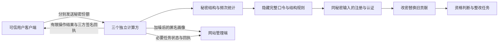

# 隐私协议研究原型

本目录是第三板块的真实密码学功能原型，供后续用户端及网站端接入。它不是既有展示网站的改造，也还不是浏览器服务。

## 已运行的流程



图中客户端和管理端代表拟接入角色。本次实验由合成夹具控制器代替它们，一次上传预设事务序列；没有真实浏览器表单、HTTP会话或独立运营商。

- `mpc_protocol_party.py` 只接收并保存本方秘密份额。认证、结构派生、规则检查和统计使用同一秘密字节对象。
- `transaction_contract.py` 定义版本、幂等、查询次数、画像预算、整改人数预算和三方回执验证。
- 请求绑定采用各方私有256位HMAC密钥；不公开其他方份额的普通哈希。
- 噪声由各方独立贡献，在MPC中相加后再发布；不输出真实频次。
- 本次48项检查与18项内部诊断通过，范围见[全流程报告](../docs/第三板块_工具全流程隐私可行性论证.md)。

## 复现

在 `ZipfGuard` 目录，使用项目Python环境执行。依赖单独放入本地 `privacy_deps`，不修改系统Python：

```powershell
& '.\.venv\Scripts\python.exe' -m pip install --target privacy_deps -r requirements-privacy-protocol.txt
& '.\.venv\Scripts\python.exe' tools/run_privacy_protocol_study.py
& '.\.venv\Scripts\python.exe' tools/report_privacy_protocol_study.py
& '.\.venv\Scripts\python.exe' -m unittest tests.test_privacy_transaction_contract tests.test_privacy_joint_profile -v
```

协议需要本地回环套接字权限。运行实验会覆盖固定结果目录 `reports/privacy_protocol_20261011`，需留存旧结果时先另行复制。公开表格和实现指纹不含密码值；`private` 下包含测试证书、密钥、份额和日志，已排除版本跟踪，不应作为论文公开附件。

## 接入条件

MPyC 0.11采用被动安全模型：三方必须独立，最多一方被动腐化。单机三个进程只证明协议可运行，不能替代这一运营条件。测试控制器拥有合成口令和测试证书，它不是现实部署中的网站后台。

真正的服务入口还要在任何绑定计算和查询之前鉴权与统一限速，包括失败、nonce冲突及拒绝请求；测试中的登录次数限制不覆盖任意生产探测接口。全部调用必须遵守报告的输出与会话契约。

当前没有标准PAKE、完整业务权限、可信扩展分发、线上成本评估、跨节点崩溃恢复或规模测试。测试用的秘密画像参考比较只输出布尔值，仍必须在实际服务中移除。已有PCFG训练器继续用于独立参照与离线研究，不能取得本站秘密口令。
